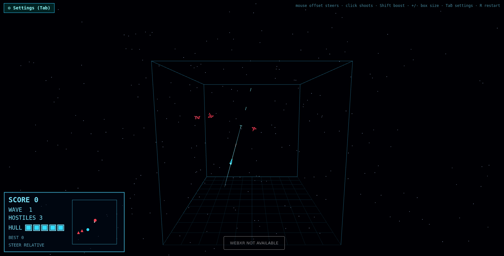
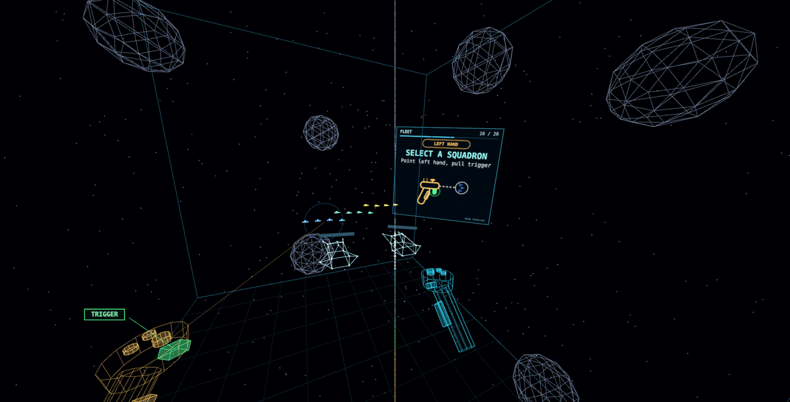
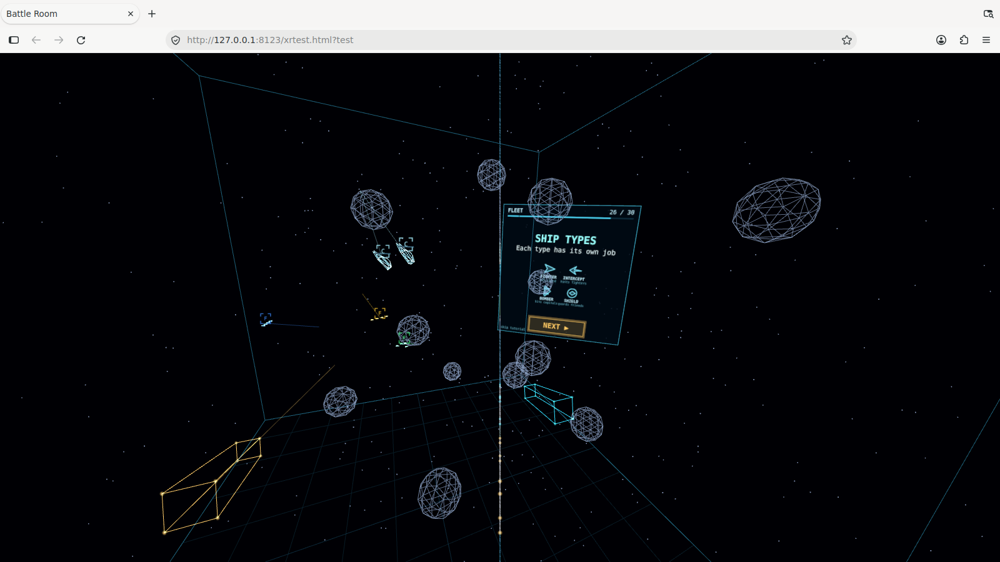
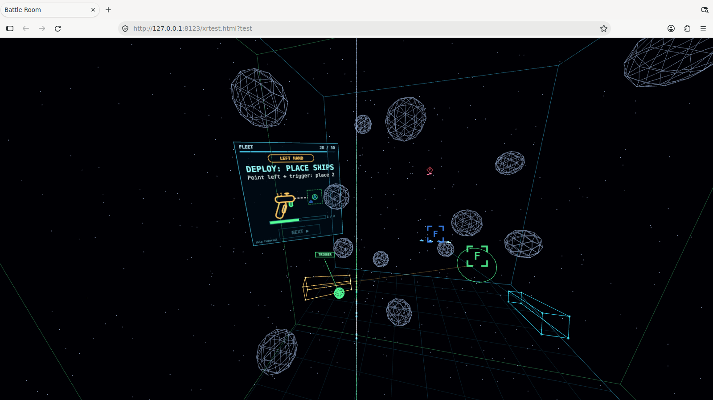
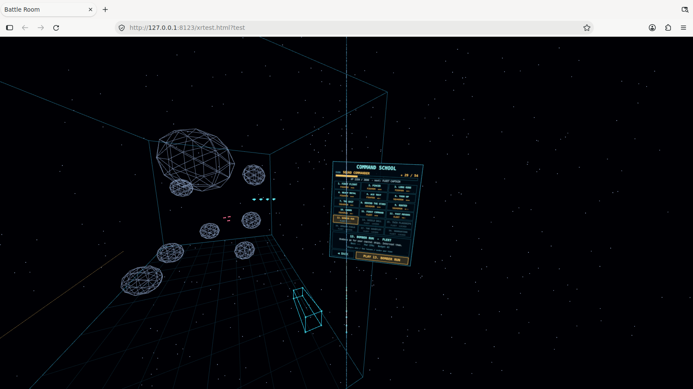
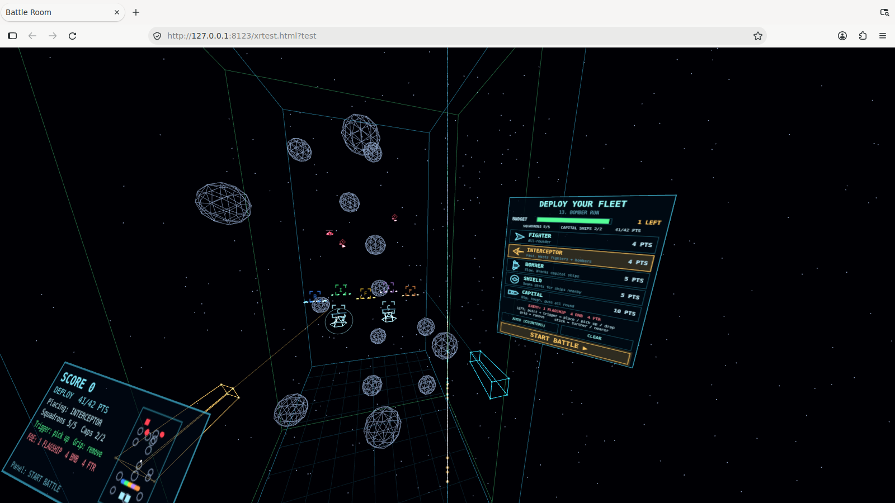
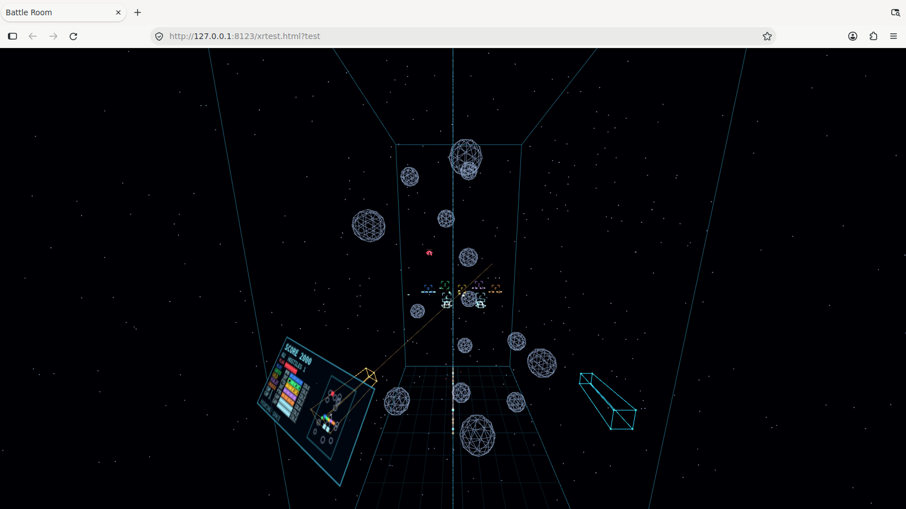

# Battle Room

A seated, **tabletop** wireframe space battle for **Meta Quest 3 / 3S**, inspired by the
command-school simulator in *Ender's Game*. The whole battle plays out as a miniature
inside a wireframe room (about 1 m across, changing shape between rounds) floating in front of you, so you never have to turn
or move.

It is a WebXR web page built with three.js. It runs in the Quest's built-in browser, so you
don't need to install an app or turn on developer mode. **It is VR only:** the page shows a single
**ENTER VR** button. In a browser without WebXR, or with no headset, a short note under the button says so.

## Tutorial

The first time you enter VR, a short tutorial runs automatically (about 3.5 minutes, 30 small steps).
It teaches **one thing per step** on a single instruction card that always sits in the same place,
beside the room's right wall, and always has the same layout:

- the section (ROOM / FLY / SQUADRON / FLEET) and a progress bar with **step N / 30**
- **which hand** to use (RIGHT HAND in cyan, LEFT HAND in gold, the colours of your controllers)
- a short title and one plain line saying what to do and why ("Pull right trigger: shoot")
- a big animated icon: a Quest Touch controller with the button to use pulsing green, and what it does
- a status line: a progress bar for things you hold or repeat, or **NICE!** when you've done it
- a **NEXT** button at the bottom of the card: lit (gold, pulsing) when you can press it, dim while the step is waiting for you

**The button to use is marked on the controller in your hand.** The controllers keep their simple wireframe
look; during the tutorial a pulsing green marker sits where the trigger, grip or stick is, with a small label.

**Pacing.** Each new card fades in with a soft sound, gives you a moment to read it, then waits for you to
do the thing. When you do, it shows a check mark and **NICE!**, pauses, and fades calmly into the next step
(a little slower in the Fleet part); you can also press the lit **NEXT** to move on straight away. Steps that
only explain something wait for **NEXT** on the card. If something goes wrong, the card says how to fix it (for example *"Missed: point
right at the ships"* or *"Not quite: point at the red flagship"*).

The steps:
1. **Room:** your battle room; move it (grip and move your hand); resize it (grip + stick).
2. **Fly:** steer your ship; pick a steering style; shoot; boost; destroy one practice target, then three more.
3. **Squadron:** your 4 fighters; lead them; attack (hold trigger); regroup (let go); finish the enemies.
4. **Fleet:** your fleet; select a squadron (left trigger); select everything (left stick click); steer the fleet;
   giving orders (left grip); HOLD, GUARD, FOLLOW and ATTACK orders; watch them attack; sink a training flagship;
   **ship types** (what each class is for); **deployment**: pick a type on the panel, place two squadrons with the
   left trigger, press START BATTLE. (While you deploy, the card moves to the left of the room, because the
   deployment panel is on the right.)
5. **Training complete**, then on to the lobby. Completion is saved on the device.

Practice ships never shoot and nothing of yours can be destroyed during training, and the score HUD stays
hidden so the card is the only thing to read. A subtle **skip tutorial** on the card jumps straight to the
lobby, and **REDO TUTORIAL** in the lobby runs it again.

The button to use is marked on your controller:

Moving the room (both grips glow, the bar fills as you move it), and the **NICE!** beat after a step:

Fleet steps use the left hand:

Ship types and deployment (the card moves to the left of the room while the deployment panel is on the right):

## Lobby

After the tutorial, every time you enter VR, and a few seconds after a game ends, you are in the **lobby**.
A blue-vs-red skirmish plays out around the stars in the room as a backdrop.

- **Grip** (either hand) and drag to move the room; **grip + that hand's stick up/down** resizes it.
- The **panel on the right** of the room (point with either controller's ray, pull the trigger):
  - Your **rank**, an **XP bar** to the next rank, and your **stars** (of 54).
  - **COMMAND SCHOOL**: the campaign (see below), with the next battle named on the button.
  - **FREE PLAY:** Fighter / Squadron / Fleet, with a one-line description, and **START FREE PLAY** (endless rounds).
  - **Stats** (saved on the device): best round, games and last round for each free-play mode, win streak (a "win" is a
    game in which you cleared at least round 1; the streak counts wins in a row) and best streak, kills, time played
    and best score.
  - **REDO TUTORIAL** and **SETTINGS**.

Settings (left X + Y, or the lobby button) open on a panel to the **left** of the room:

## Command School (campaign)

**COMMAND SCHOOL** in the lobby opens the battle select: **18 hand-designed battles**, from Launchie to Commander.
Battles 1-5 are **Fighter**, 6-10 **Squadron** and 11-18 **Fleet**. Each battle is one round with its own
enemy line-up, a short briefing and a par time. A battle opens once you have won the one before it; locked
battles say LOCKED, open ones show your best stars.

Each battle earns **1 to 3 stars**:
1. **Win** the battle.
2. **Few losses:** Fighter: lose at most 2 hull; Squadron: lose at most 1 ship; Fleet: lose at most a third of
   your fleet's points.
3. **Fast:** win within the par time.

Every new star is worth **100 XP**, and every win 50 XP more. XP sets your **rank**, and ranks unlock ship types,
a bigger Fleet budget and more deployment slots (in the campaign and in free play):

| Rank | XP | Ship types you can deploy | Extra budget | Squadron slots | Capital slots |
|---|---|---|---|---|---|
| Launchie | 0 | Fighter, Capital | +0 | 3 | 2 |
| Cadet | 300 | Fighter, Capital | +2 | 3 | 2 |
| Toon Member | 800 | + **Interceptor** | +4 | 4 | 2 |
| Toon Leader | 1400 | + **Bomber** | +6 | 4 | 2 |
| Squad Commander | 2100 | + **Shield** | +8 | 5 | 2 |
| Fleet Captain | 3000 | all | +12 | 5 | 3 |
| Commander | 4200 | all | +16 | 6 | 3 |

After a battle the result (stars, XP, time, losses, any rank-up and new ship types) shows on your wrist and then
in the battle select. Progress is saved on the device. **Free play** (endless rounds) is still there in the lobby.

## Three modes

## Rounds: every round is a fresh battle

All three modes are played in **rounds**, and the goal is to reach the highest round you can.
Your score keeps adding up across rounds, and each cleared round gives a bonus of 500 x the round number.
The best round you have reached is saved for each mode and shown on the wrist panel.

- **Each new round fully resets the battlefield.** Your side comes back at full strength in
  its start positions: in Fighter your ship has full hull; in Squadron all 4 bots have full hull; in Fleet
  all 3 squadrons have 4 bots each and both capital ships have full hull. The enemy spawns fresh.
  Nothing carries over (no partial repairs or reinforcements), so you lose only if your side is wiped
  out within a single round. When you lose, you're back in the lobby a few seconds later.
- **The room reshapes** between rounds, and in Squadron and Fleet the **stars** fade out and come
  back in **new random positions** that suit the new room shape. They are kept clear of both
  sides' start areas, and no ship is ever left inside a star.
- **The enemy gets harder and smarter every round.** Each round brings more ships, tougher flagships, faster bullets
  and better aim. Their shot leading starts at about half and is perfect from round 5. New tactics unlock as you go, and the
  round-start message on your wrist names any new one:

  | Round | New enemy tactic | Modes |
  |---|---|---|
  | 1 | Pincers and flankers, retreat when damaged | All |
  | 2 | **Focus fire** on your most exposed ship; **bait and ambush** | Squadron, Fleet |
  | 3 | **Hiding behind stars** (snipers, damaged ships, damaged flagships) | Squadron, Fleet |
  | 3 | **Retreat and regroup:** damaged ships fall back to their wingmen; outnumbered ships pull back | All |
  | 4 | **Pincers on your capital ships:** pincer and heavy groups gang up on your weaker capital | Fleet |
  | 5 | **Synchronized strikes:** every attack group times its run to hit at the same moment | All |
  | 5 | **Dodging your shots:** many enemy ships side-step incoming bullets | All |
  | 6 | **Hunter-killers:** a fast pack that chases your most damaged ship | All |
  | 7 | **Flagships launch fighters:** a fresh pair every 20 seconds while the flagship lives | Fleet |

### Fighter

You fly one cyan ship and win round after round against red ships. The battle room is much bigger than
the ships, so there is plenty of room to manoeuvre.

The enemies fight in groups with real plans:
- **Pincer pairs** swing out to opposite sides of you, then attack together.
- **Flankers** circle round to come at you from the side or behind, make a pass, and swing out again.
- **Snipers** (from round 2) hold long range and fire accurate shots.
- **Heavies** (cruisers, from round 3) hold medium range and fire 3-shot spreads.
- Everyone **leads their shots** (aims where you will be), and pulls back for a moment when damaged.

Your hull has 5 points, back to full at the start of every round. Lose them all in one round and it's game over.

### Squadron

A much bigger, zoomed-out battlefield with smaller ships. You command **4 friendly bot
fighters**. You don't fly them: the right controller is a **command**. Its direction (Mirror
steering, 3x gain by default) sets the heading of the squadron, shown by the cyan aim line
and ring. The bots fly their own ships. They keep a side-by-side formation, steer toward
the commanded heading, dodge incoming bullets, and never run into each other.

- **Hold the right trigger = engage.** The bots spread out a little, staying on a leash
  around the group centre, and each one attacks the nearest enemy. A bot only fires when
  the line is clear, so never through a wingman or a star. Release to regroup into
  formation and carry on in the commanded direction.
- **Right grip = boost.** It only works while NOT engaging, and the whole squadron boosts together.
- **Stars:** big wireframe spheres. Nothing can fly through them and they block bullets, so
  both sides use them as cover. Ships steer around them. They are spread through the room in
  proportion to its current shape, in new random positions every round.
- **Enemies** come in coordinated groups:
  - Pincers and flankers **focus fire** on your most exposed bot (the one furthest from its wingmen).
  - Snipers **hide behind stars** and step out to shoot.
  - From round 2, a **bait** ship flies in close and then runs back to a star where two
    **ambushers** are hiding.
  - Enemies **fall back to cover when outnumbered** and pull back when damaged.
  - Rounds get bigger and the enemies get faster, more accurate and smarter (see Rounds above).
- Each bot has 3 hull points. A destroyed bot is gone for the rest of the round; every new
  round starts with all 4 back at full hull. Lose all 4 within one round and it's game over.
  The wrist panel shows each bot's hull.

### Fleet

The biggest, most zoomed-out battlefield: since v16 the room is **much bigger** (half-size 11, was 7.5) with
**15 stars** (was 8), and the two sides start far apart, so positioning matters. The room still changes shape.
Every unit carries a small **tag** that stays a readable size however far away it is: a bracket with the class
letter in your unit's colour (F, I, B, S, C), and a red diamond with the class letter over each enemy group.

You command a fleet of colour-coded squadrons (Blue, Green, Gold, Violet, Orange, White; 4 bots each, flying
and fighting like the Squadron-mode squadron) and up to 3 **capital ships** (big cyan cruisers, 60 hull, slow,
turrets that fire automatically at the nearest enemy in range). You can command a capital ship like a squadron.

**Deployment (before every Fleet round).** The enemy is already in place, frozen, so you can see its layout:
its flagships and its groups, each tagged with its class. You have a **budget** of points (free play: 32 + your
rank bonus + 3 per round; campaign: set per battle + your rank bonus) and a number of squadron and capital-ship
**slots** (from your rank). Your half of the room (the near half) is outlined in green.
- The **panel on the right** lists the ship classes with their role and cost (locked ones show the rank that
  unlocks them), the budget left, the slots used, and a one-line enemy summary. Pick a class with the trigger.
- **Left ray + trigger** on empty space: place a squadron (or capital ship) of that class there. A green ring
  means you can; red means you can't (the wrist says why: budget, slots or locked).
- **Left trigger on a placed unit** picks it up; it follows your ray; **trigger** again drops it.
- **Left grip** on a unit removes it (the points come back). **Left stick up / down** places further / nearer.
- **AUTO (COUNTERS)** fills the budget with counters to what the enemy brought; **CLEAR** empties it.
- **START BATTLE** starts the round. Your last fleet is placed again for the next round, so you can just press START.

**Ship classes.** A squadron (4 ships) is all one class; so is each enemy group. Each class has its own shape:

| Class | Cost | Hull | Speed | Job | Strong against | Weak against |
|---|---|---|---|---|---|---|
| **Fighter** | 4 | 3 | normal | all-rounder (the original ship) | nothing special | nothing special |
| **Interceptor** | 4 | 2.5 | fast (1.4x), rapid fire, dodges 40% of small-arms hits (not capital-ship flak) | hunts fighters and bombers (enemy interceptors go for your bombers first) | fighters, bombers | flagships, shields |
| **Bomber** | 5 | 4 | slow (0.72x) | heavy shots: 4x damage to capital ships, hard hits on shields (enemy bombers go for your capital ships) | flagships, shields | interceptors, fighters |
| **Shield** | 5 | 3.5 | 0.95x | a shield bubble soaks shots aimed at ships near it (12 hits, recharging 1.5 per second; bomber shots drain it 3x, capital shots 2x); light guns | interceptors, holding off a flagship | enemy shields (slow stalemates) |
| **Capital** | 10 | 60 | slow | turrets all round, very tough | interceptors | bombers, big swarms |

The classic fleet (3 fighter squadrons and 2 capital ships, 32 points) is placed for you the first time.

The enemy brings a **flagship** (two from round 3) plus **2 to 4 attack groups** (pincer, flank, bait, and
a sniper or hunter pack) using all the Squadron tactics. The flagships have no escort groups. Later rounds
don't add more groups; the groups get **bigger and better** (more ships, heavy cruisers inside the groups,
extra veteran hull every few rounds). In free play the enemy's groups get classes as the rounds go up:
fighters in round 1, interceptors from round 2, bombers from round 3, shields from round 4 (the newest class
always appears in the round it arrives).
**Destroy every enemy flagship to win the round.** Any remaining enemy fighters then jump out.
**It's game over only when both capital ships AND every one of your fighters are destroyed.**
If both capitals fall, the wrist warns "CAPITALS LOST - fighters only" and you fight on with
the squadrons you have left (and the other way round: capitals alone fight on too). Every new
round starts with the full fleet again. Rounds get harder: more and smarter enemies, tougher flagships
and faster flagship guns.

**Round start.** After deployment the round starts with **no orders and nothing selected**. The whole fleet drifts
forward very slowly in formation (wrist tag `IDLE`) and nothing attacks on its own until you give an
order; a unit only shoots back in self-defence if an enemy comes very close.

**Movement (v16).** Squadrons cruise and dogfight a little slower than before (85% cruise), scaled by their class.
When a unit has a hold, guard or attack point far away (more than a few ship lengths), it **boosts there
automatically** (wrist tag `BST`) and stops boosting as soon as it is fighting. Enemy groups also cruise fast
while far from the fight.

**Squadron autonomy (v16).** When a unit's attack target is destroyed (or the unit it was following is lost), it
**decides for itself** what to do next, and the wrist says so, e.g. **"BLUE → ASSISTING GREEN"** with the reason
underneath. In order of value:
- **Assist** a friendly unit that is losing its fight (more enemy strength around it than it has), or
- **attack a weakened enemy:** a group that is already small or damaged, or a badly damaged flagship,
- otherwise **guard a capital ship** (escort it) or **hold at a star**, in cover on the side away from the enemy.

The choice weighs distance and the unit's class (bombers prefer flagships, interceptors fighter and bomber groups).
A decided order shows on the wrist with a `*` (e.g. `ATK*`) for a few seconds. You can always override it.

**Smart squadron leaders.** Once a squadron has an attack, hold or guard order (or you engage with it),
its leader fights as a squadron, not just as four pilots (individual pilots fly as before):
- **Boom-and-zoom:** it lines up at a start point outside the enemy's range, makes a fast firing run
  through the target, then zooms out at boost speed before turning back for another run.
- **Flanking, not head-on:** start points are off to the target's side or rear, never straight down its guns.
- **Split angles:** squadrons sent at the same target spread their start points around it and, against a
  flagship, wait for each other and go in together (its turrets can only track one at a time).
  Flagship runs break off early if the squadron is taking hits.
- **Stars as cover:** start points hidden behind a star are preferred, and a squadron that is
  **outnumbered or badly hurt breaks off, regroups behind a star** and then attacks again.
- **Protect the capitals:** a squadron drops what it is doing to drive off enemies attacking a friendly capital ship.
- It keeps clear of enemy flagships' guns when not attacking them, and picks the tactic by the situation
  (weak target: repeated passes; strong target: runs with zooms out; flagship: coordinated runs).

The wrist shows each squadron's current phase: `APPR` (moving to the start point), `RUN`, `ZOOM`,
`CVR` (regrouping in cover) or `DEF` (defending a capital).

Unit tags in battle (brackets with class letters; red diamonds over enemy groups):

**Selecting (left hand).** The left controller casts a pointing ray, and the wrist shows what it points at.
- **Left trigger** selects the unit you point at (a squadron or a capital ship).
- **Left stick click** selects everything.
- Selected units get a highlight ring and are marked `>` on the wrist panel.

**Commanding (right hand).** It works just like Squadron, for whatever is selected: Mirror
steering (3x) sets their heading, **hold the right trigger** to engage, and the **right grip** boosts (only when not engaging).
Units you have not selected keep their last order. They also defend themselves if an enemy comes close.

**Quick orders (left grip)** go to the selected units, depending on what you point at:
- Empty space: **HOLD** at that spot.
- A star: **GUARD** the star (hold beside it).
- One of your units: **FOLLOW** it.
- An enemy group or flagship: **ATTACK** it.

Units that receive an order are deselected so they carry it out. Select them again to take
back direct control. Each order is confirmed on the wrist message panel. A faint line shows
where each unit is heading.

There is no friendly fire, and friendly ships, including the capitals, never collide.

**Wrap-around (all modes):** fly out through one face of the box and you come back in
through the opposite face. Enemies wrap too. Your view never moves and the game never turns you.

**The room changes shape (all modes):** width, height and depth vary independently, so the
room may be a long tunnel, a flat slab, a tall tower or a cube. A new shape is picked for
every game, and between rounds the room smoothly reshapes itself, keeping every ship inside.
The volume stays about the same, so the difficulty stays fair, and the size is capped (at
most about 1.5 m wide or deep, 1.35 m tall with the Medium box size). A deeper room grows
away from you, so its near face never comes closer.

**Messages** (round start and new enemy tactics, round cleared, wingman down, unit decisions, game over...) appear on a small
panel on your left wrist, to the right of the score panel, so nothing covers the battle.
Only the short game-over message floats in front of you.

## Controls

### Quest (VR, seated)

| Hand | Input | Fighter | Squadron (Fleet: for the selected units) |
|---|---|---|---|
| Right | **Turn the controller** (Mirror steering, default) | The ship turns the way your controller turns, in any direction, including straight up, straight down, loops and upside down, without flipping. Turns are multiplied by the gain (default **2x**), so a 45° wrist turn turns the ship 90°. Turns past 180° stop at 180°. Wrist roll is ignored. | Same, but it turns the squadron's commanded heading (default gain **3x**) |
| Either | **Ray + trigger** on a panel | Press lobby, tutorial and settings buttons | Same |
| Either | **Grip** (lobby and tutorial) | Drag to move the room; with that hand's **stick up/down**, resize it | Same |
| Right | **Trigger** | Shoot (gentle aim assist) | **Hold = engage**, release = regroup |
| Right | **Hold the grip** | Boost | Boost the squadron (only while not engaging) |
| Right | **A** | Brake | Slow the squadron |
| Right | **Click the thumbstick** | Re-center: the controller's current orientation becomes "straight into the box" (also done automatically at the start of a game) | Same |
| Left | **Trigger / grip / stick forward-back** | Extras: shoot (engage) / boost / boost-brake | Same |
| Left | **Click the thumbstick** | Put the box back in its default spot (Fleet: select all; use Settings > Box position) | Same |
| Left | **X + Y together** | Settings, on a panel to the left of the room (point and pull the trigger to change; the game pauses) | Same |
| Left | **Fleet only** | | Point the ray; **trigger** = select the unit you point at, **stick click** = select all, **grip** = quick order (hold / guard / follow / attack) |
| Left | **Fleet deployment** | | Point the ray; **trigger** = place / pick up / drop, **grip** = remove, **stick up/down** = further / nearer. Right ray on the panel: class, AUTO, CLEAR, START BATTLE |
| Left | **Look at your wrist** | Score, round, best round, hull, a top-down radar, and the message panel | Score, round, squadron status, a radar with the stars, and the message panel |

Other steering modes (in Settings) also work in all modes:
- **Relative (hand stick):** tilt the controller away from a captured neutral. Click the right stick to re-center.
- **Point:** the ship (or squadron heading) follows where you point.
- **Thumbstick:** the right stick steers. B inverts up/down.

### Settings (saved on the device, as are the box position and size)

| Setting | Options | Default |
|---|---|---|
| Game mode | Fighter / Squadron / Fleet | Fighter |
| Steering | Mirror / Relative / Point / Thumbstick | Mirror |
| Mirror gain (Fighter) | 1x / 1.5x / 2x / 2.5x / 3x / 3.5x | 2x |
| Mirror gain (Squadron and Fleet) | 1x / 1.5x / 2x / 2.5x / 3x / 3.5x | 3x |
| Ship turn speed (Relative, Point and Thumbstick) | Normal / Fast / Very fast | Fast |
| Box size | Small 0.7 m / Medium 1.0 m / Large 1.3 m | Medium |
| Box position | RESET puts the box back in its default spot | |
| Leave game | TO LOBBY ends the current game and goes back to the lobby | |

Changing the mode during a game restarts in the new mode.

### Testing without a headset (developers only)

Players only get the ENTER VR button. For testing, `?test` turns on hidden desktop controls and a
debug HUD, and sends errors and status lines to a local test server:

| Input | Action |
|---|---|
| Mouse | Mirror steering: the ship (or squadron heading) points where the mouse points |
| Left click / Space | Shoot (Squadron: hold to engage) |
| Shift / F | Boost / brake |
| N | Cycle mode (Fighter / Squadron / Fleet) |
| 1-5 / 0 or ` / G | Fleet: select Blue, Green, Gold, Capital 1, Capital 2 / select all / quick order at what the mouse points at |
| M | Cycle steering: mirror / relative (cursor offset from the centre) / point / thumbstick (I/K + J/L, V inverts) |
| + / - | Box size |
| C | Reset the box |
| Right-drag or arrow keys | Look around |
| Tab or the gear button | Settings |
| Enter / R | Start / restart |
| L / T | Lobby / tutorial |

Extra test options (with `?test`): `&demo` autopilot, `&mode=fighter|squadron|fleet`, `&wave=5` start at round 5,
`&sim=6` run the simulation 6x faster, `&ai=old` use the old (v12) Fleet squadron leaders, `&bench` let a test script drive games,
`&unlockall` unlock every campaign battle, rank and ship type. With `&demo`, Fleet deployment is done automatically (AUTO).

### Fleet ship class balance (v16 autopilot duels)

Your side: 2 squadrons of one class (or 1 capital ship); enemy: 2 groups of one class worth 4x the points (enemy
pilots are much weaker one-on-one), or a lone flagship (80 hull). Both sides on autopilot, round-3 enemy AI,
2 seeds each, 12x simulation speed (final settings; the flagship column and the fighter/interceptor rows are from the second tuning round, which only differed in bomber-vs-shield numbers). The number is **how much of your force was lost** (lower is better; 100% = lost):

| Yours \ Enemy | Fighters | Interceptors | Bombers | Shields | Flagship |
|---|---|---|---|---|---|
| **Fighter** | 50% | 63% | **6%** | 88% (1 of 2 lost) | 19% (45 s) |
| **Interceptor** | **19%** | 44% | **13%** | 81% (1 of 2 lost) | 100% (lost) |
| **Bomber** | 63% (1 of 2 lost) | 63% (1 of 2 lost) | 31% | **56%** | **13% (29 s)** |
| **Shield** | 44% | **38%** | 25% | 69% | **0%** (78 s, soaked 68 hits) |
| **Capital** | lost | **0%** | lost (77% of the enemy left) | lost | |

So: interceptors are the answer to fighters and bombers and useless against flagships; bombers sink flagships
fastest and are the best answer to shields, but get torn up by fighters and interceptors; shields are the
answer to interceptors and can sit in a flagship's fire without loss, but kill slowly; capital ships shred
interceptors and die to bombers. AUTO deployment picks counters from this.

Free play on autopilot (AUTO deployment every round, all classes unlocked): 2 games, both reached **round 10**.

Round 1 of the class tuning (before the numbers above) had every class at 2-5 hull: the 5-hull bombers and
shields won everything and interceptors lost almost everything, so hull went down (bomber 4, shield 3.5),
interceptors got 2.5 hull and their dodge, and bomber shots got harder on shields.

### Fleet AI: smart leaders vs the old leaders

Measured with the Fleet autopilot (it orders every squadron to attack the nearest enemy group and the capitals
to attack the flagship), the same random seed for each pair of battles, 6x simulation speed:

| Test | Smart leaders (v13) | Old leaders (v12) |
|---|---|---|
| Round 3 battles (8 pairs): won | 8 / 8 | 8 / 8 |
| Round 3: fighters lost per battle (of 12) | **2.4** | 9.6 |
| Round 3: time to win | **54 s** | 66 s |
| Round 5 battles (8 pairs): won | **7 / 8** | 4 / 8 |
| Round 5: fighters lost per battle (of 12) | **5.4** | 9.5 |
| Round 5: capital hull lost per battle (of 120) | **82** | 96 |
| Full games from round 1 (3 pairs): round reached | **7, 7, 7** (avg 7.0) | 6, 7, 7 (avg 6.7) |
| Full games: average score | **138,700** | 121,150 |

Enemy kills per battle are the same for both, because a won battle means every enemy is destroyed. The full-game
numbers are closer: the simple autopilot (always attack the nearest group) runs out of steam around round 7,
when flagships start launching fighters, whichever leaders it has. In a real game you give the orders.

## Getting it onto the Quest

**Live copy:** https://willcoding11.github.io/vr-battle-room/ (GitHub Pages). Open it in the
Quest Browser and press **ENTER VR**.

WebXR only works over **HTTPS** (or `localhost`), so the files must be served from an HTTPS
address. The folder is plain static files (`index.html`, `js/`, `vendor/`), so there is no
build step.

1. **Simplest: a static host.** Put the folder on any HTTPS static host, such as GitHub
   Pages, Netlify Drop or Cloudflare Pages. Open the URL in the Quest Browser and press
   **ENTER VR**. Tip: bookmark it in the Quest browser.
2. **Local, over USB, no hosting.** On a PC with `adb` and the Quest in developer mode, run
   `adb reverse tcp:8000 tcp:8000`. Then run `python -m http.server 8000` in this folder
   and open `http://localhost:8000` on the Quest. `localhost` counts as secure.
3. **Local Wi-Fi.** Serve the folder over HTTPS with a self-signed certificate, for example
   `npx http-server -S` or `caddy`, and accept the warning in the Quest browser.

When you are in the Quest browser, sit down, then press **ENTER VR**. If the battle sits too
high or too low, hold the Meta button to recentre, change the box size in Settings, or click
the left stick to put the box back in its default spot.

## Files

- `index.html` - page with the ENTER VR button (plus the hidden test HUD)
- `js/main.js` - game: scene, input, player, enemy AI, squadron bots, fleet (selection, orders, capital ships, smart squadron leaders, autonomy, deployment, unit tags), stars, rounds and enemy tactic unlocks, campaign battles, lobby, HUD, effects
- `js/ships.js` - the Fleet ship classes (stats, damage table, shield) and their 2D silhouettes
- `js/campaign.js` - Command School: battles, ranks, stars, XP, unlocks (saved on the device)
- `js/ui.js` - VR panels (canvas text and buttons picked with a controller ray) and the animated controller icons
- `js/controller.js` - the wireframe controller gizmos at your hands, with the tutorial's glowing button markers
- `js/tutorial.js` - the step-by-step tutorial
- `js/stats.js` - stats saved on the device (localStorage)
- `js/models.js` - wireframe ship models (points joined by lines)
- `js/audio.js` - synthesized 3D sound effects (WebAudio, no audio files)
- `vendor/` - three.js r187 (`three.module.js`, `three.core.js`), MIT licence
- `screenshots/` - screenshots (test mode and the IWER headset emulator)

## Not done yet / ideas

- Fleet: drag-box selection and waypoint chains
- Superweapons / big set-piece moments (deliberately not in v16)
- A louder warning when an enemy attacks from behind (positional sound only, so far)
- More comfort options (seated height, volume)
- So far it has only been tested in an emulator (IWER) and in desktop Firefox, not yet on a real Quest
