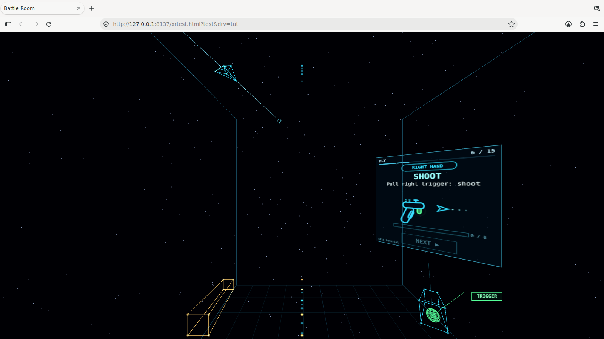
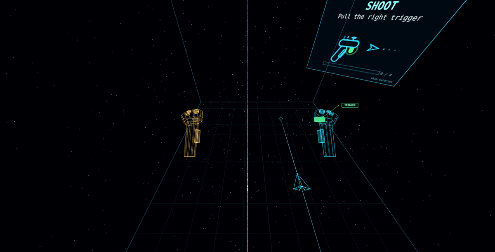
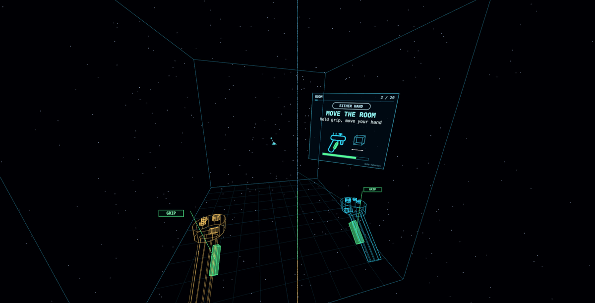
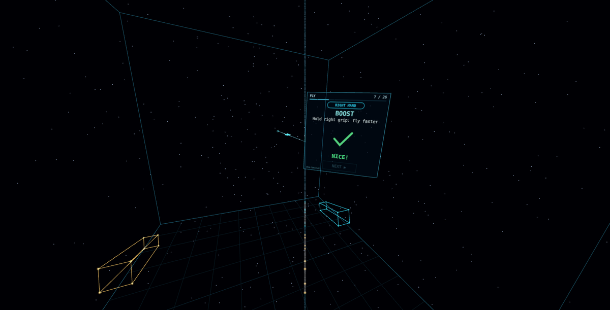
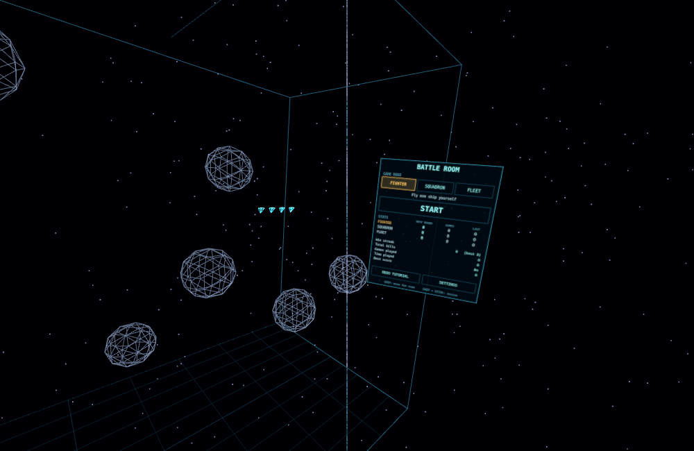
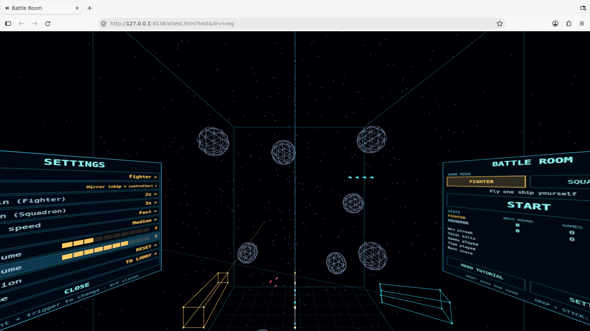
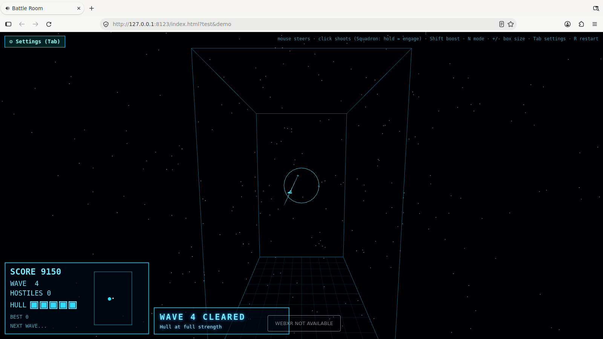

# Battle Room

A seated, **tabletop** wireframe space battle for **Meta Quest 3 / 3S**, inspired by the
battle-room simulator in *Ender's Game*. The whole battle plays out as a miniature
inside a wireframe room (about 1 m across, changing shape between rounds) floating in front of you, so you never have to turn
or move.

It is a WebXR web page built with three.js. It runs in the Quest's built-in browser, so you
don't need to install an app or turn on developer mode. **It is VR only:** the page shows a single
**ENTER VR** button. In a browser without WebXR, or with no headset, a short note under the button says so.

There are two modes: **Fighter** (fly one ship yourself) and **Squadron** (lead 4 bot fighters, or split
them into 2 pairs and lead one pair with each hand).

## Tutorial

The first time you enter VR, a short tutorial runs automatically (about 2 minutes, 20 small steps).
It teaches **one thing per step** on a single instruction card that always sits in the same place,
beside the room's right wall, and always has the same layout:

- the section (ROOM / FLY / SQUADRON) and a progress bar with **step N / 20**
- **which hand** to use (RIGHT HAND in cyan, LEFT HAND in gold, the colours of your controllers)
- a short title and one plain line saying what to do and why ("Pull right trigger: shoot")
- a big animated icon: a Quest Touch controller with the button to use pulsing green, and what it does
- a status line: a progress bar for things you hold or repeat, or **NICE!** when you've done it
- a **NEXT** button at the bottom of the card: lit (gold, pulsing) when you can press it, dim while the step is waiting for you

**The button to use is marked on the controller in your hand.** The controllers keep their simple wireframe
look; during the tutorial a pulsing green marker sits where the trigger, grip or stick is, with a small label.

**Pacing.** Each new card fades in with a soft sound, gives you a moment to read it, then waits for you to
do the thing. When you do, it shows a check mark and **NICE!**, pauses, and fades calmly into the next step;
you can also press the lit **NEXT** to move on straight away. Steps that only explain something wait for
**NEXT** on the card.

The steps:
1. **Room:** your battle room; move it (grip and move your hand); resize it (grip + stick).
2. **Fly:** steer your ship; pick a steering style; shoot; boost; **barrel roll** (flick your right wrist); destroy one practice target, then three more.
3. **Squadron:** your 4 fighters; lead them; attack (hold trigger); regroup (let go); finish the enemies;
   **split** them into 2 pairs (click the left stick); **lead the gold pair** with your left hand; **rejoin**
   (click again); switch **formation** (B).
4. **Training complete**: press **TO LOBBY**. Completion is saved on the device.

Practice ships never shoot and nothing of yours can be destroyed during training, and the score HUD stays
hidden so the card is the only thing to read. A subtle **skip tutorial** on the card jumps straight to the
lobby, and **REDO TUTORIAL** in the lobby runs it again.

The button to use is marked on your controller:

Moving the room (both grips glow, the bar fills as you move it), and the **NICE!** beat after a step:

## Lobby

After the tutorial, every time you enter VR, and a few seconds after a game ends, you are in the **lobby**.
A blue-vs-red skirmish plays out around the stars in the room as a backdrop.

- **Grip** (either hand) and drag to move the room; **grip + that hand's stick up/down** resizes it.
- The **panel on the right** of the room (point with either controller's ray, pull the trigger):
  - **GAME MODE:** Fighter / Squadron, with a one-line description.
  - **START**.
  - **Stats** (saved on the device): best round, games and last round for each mode, win streak (a "win" is a
    game in which you cleared at least round 1; the streak counts wins in a row) and best streak, total kills,
    games played, time played and best score.
  - **REDO TUTORIAL** and **SETTINGS**.

Settings (left X + Y, or the lobby button) open on a panel to the **left** of the room:

The two **volume sliders** (Music, Sound) work like the other rows: point at the bar and pull the trigger
where you want the level.

## Rounds: every round is a fresh battle

Both modes are played in **rounds**, and the goal is to reach the highest round you can.
Your score keeps adding up across rounds, and each cleared round gives a bonus of 500 x the round number.
The best round you have reached is saved for each mode and shown on the wrist panel.

- **Each new round fully resets the battlefield.** Your side comes back at full strength in
  its start position: in Fighter your ship has full hull; in Squadron all 4 bots have full hull.
  The enemy spawns fresh. Nothing carries over, so you lose only if your side is wiped
  out within a single round. When you lose, you're back in the lobby a few seconds later.
- **The room reshapes** between rounds, and in Squadron the **stars** fade out and come
  back in **new random positions** that suit the new room shape. They are kept clear of your
  start area, and no ship is ever left inside a star.
- **The enemy gets harder and smarter every round.** Each round brings more ships, faster bullets
  and better aim. Their shot leading starts at about half and is perfect from round 5. New tactics unlock as you go, and the
  round-start message on your wrist names any new one:

  | Round | New enemy tactic | Modes |
  |---|---|---|
  | 1 | Pincers and flankers, retreat when damaged | Both |
  | 2 | **Focus fire** on your most exposed ship; **bait and ambush** | Squadron |
  | 3 | **Hiding behind stars** (snipers and damaged ships) | Squadron |
  | 3 | **Retreat and regroup:** damaged ships fall back to their wingmen; outnumbered ships pull back | Both |
  | 5 | **Synchronized strikes:** every attack group times its run to hit at the same moment | Both |
  | 5 | **Dodging your shots:** many enemy ships side-step incoming bullets | Both |
  | 6 | **Hunter-killers:** a fast pack that chases your most damaged ship | Both |
  | 3 | **Leaders with escorts:** an orange leader flies with escorts; kill it and the escorts scatter | Both |
  | 3+ | **Aces** (sometimes; see below) | Both |
  | 4 | **Screens:** a ship that parks itself between you and a sniper, leader or heavy to shield it | Both |

  Difficulty grows mainly through **behaviour**, not numbers: a round adds only about one ship
  (Fighter rounds 1-10: 3, 4, 7, 8, 9, 12, 12, 13, 16, 16 ships; Squadron: 4, 8, 11, 13, 14, 17, 17, 18, 21, 21).
  Enemies keep more space from each other, flankers swing wider, and nobody shoots while scattering.

- **Aces.** From round 3 a named ace (VIPER, HALO, NOVA, ...) sometimes joins, in **gold** with its name over it.
  It is faster, tougher and always dodges, and flies boom-and-zoom attack runs, breaking off before it gets close.
  When it is badly hurt it **runs for a wall**: if it escapes, it comes back in the next round with one more
  hull point. Shooting one down is a big moment: a longer freeze-frame, a strong rumble, a gold flash of the room,
  **ACE DOWN!** and a bonus of 1500 x round (more for an ace that escaped before).

  

### Fighter

You fly one cyan ship and win round after round against red ships. The battle room is much bigger than
the ships, so there is plenty of room to manoeuvre.

The enemies fight in groups with real plans:
- **Pincer pairs** swing out to opposite sides of you, then attack together.
- **Flankers** circle round to come at you from the side or behind, make a pass, and swing out again.
- **Snipers** (from round 2) hold long range and fire accurate shots.
- **Heavies** (cruisers, from round 3) hold medium range and fire 3-shot spreads.
- Everyone **leads their shots** (aims where you will be), and pulls back for a moment when damaged.
- From round 3, **leaders** (orange, bigger) with **escorts**, **screens** and sometimes an **ace** (see above).

**Barrel roll:** flick your right wrist quickly sideways (a twist of about 60-70 degrees, as if turning a door
handle fast). The ship snap-rolls and hops sideways, and **enemy bullets pass through you** for the
0.4 s roll. Then it needs 1.2 s to recharge (the wrist panel shows ROLL READY). Normal steering never
triggers it: Mirror steering ignores wrist twist, and a roll needs a fast, mostly pure twist.

Your hull has 5 points, back to full at the start of every round. Lose them all in one round and it's game over.

### Squadron

A much bigger, zoomed-out battlefield with smaller ships. You command **4 friendly bot
fighters**. You don't fly them: the right controller is a **command**. Its direction (Mirror
steering, 3x gain by default) sets the heading of the squadron, shown by the cyan aim line
and ring. The bots fly their own ships. They keep a side-by-side formation, steer toward
the commanded heading, dodge incoming bullets, and never run into each other.

- **Hold the right trigger = engage.** The bots spread out a little, staying on a leash
  around the group centre, and each one attacks the nearest enemy. A bot only fires when
  the line is clear, so never through a wingman or a star. Release to regroup into
  formation and carry on in the commanded direction.
- **Right grip = boost.** It only works while NOT engaging, and the whole squadron boosts together.
- **Smarter bots when engaging:** each bot prefers enemies **ahead of the commanded heading** (a cone,
  weighted by distance) and **damaged** enemies, so they finish targets off. Bots don't fly straight down an
  enemy's guns (they come in at an angle), and a bot down to its last hull point **pulls back** into the
  formation while a healthier wingman fights (it still takes shots at anything right in front of it).
  Dodging and formation flying are unchanged.
- **Formations (right B):** line -> wedge -> ring.
  - **Line** (default): side by side; when engaging, **two bots per target**.
  - **Wedge**: a V; when engaging, **all on one target**, faster, on a shorter leash.
  - **Ring**: a tight ring; bots spread over the nearest threats and stay close to the centre.
- **Split (click the left stick):** the squadron splits into **2 pairs**. The **cyan pair** follows your
  **right** controller as before; the **gold pair** follows your **left** controller (its own gold command point
  and aim line), with the same mirror steering, **left trigger = engage** and **left grip = boost**. Click
  again to **rejoin**. The wrist panel shows SPLIT, each bot's hull box in its pair's colour, and what each pair
  is doing (R: / L: ATTACK or HOLD). If a whole pair is lost, the squadron rejoins automatically.

- **Stars:** big wireframe spheres. Nothing can fly through them and they block bullets, so
  both sides use them as cover. Ships steer around them. They are spread through the room in
  proportion to its current shape, in new random positions every round.
- **Enemies** come in coordinated groups:
  - Pincers and flankers **focus fire** on your most exposed bot (the one furthest from its wingmen).
  - Snipers **hide behind stars** and step out to shoot.
  - From round 2, a **bait** ship flies in close and then runs back to a star where two
    **ambushers** are hiding.
  - Enemies **fall back to cover when outnumbered** and pull back when damaged.
  - Rounds get bigger and the enemies get faster, more accurate and smarter (see Rounds above).
- Each bot has 3 hull points. A destroyed bot is gone for the rest of the round; every new
  round starts with all 4 back at full hull. Lose all 4 within one round and it's game over.
  The wrist panel shows each bot's hull.

**Wrap-around (both modes):** fly out through one face of the box and you come back in
through the opposite face. Enemies wrap too. Your view never moves and the game never turns you.

**The room changes shape (both modes):** width, height and depth vary independently, so the
room may be a long tunnel, a flat slab, a tall tower or a cube. A new shape is picked for
every game, and between rounds the room smoothly reshapes itself, keeping every ship inside.
The volume stays about the same, so the difficulty stays fair, and the size is capped (at
most about 1.5 m wide or deep, 1.35 m tall with the Medium box size). A deeper room grows
away from you, so its near face never comes closer.

**Juice (both modes):** kills give a tiny freeze-frame (about 40-55 ms) and a rumble; explosions burst into
sparks with a short flash ring and a bright core; hit ships flash white and throw sparks; the room's frame
glows briefly on kills and hits. **Hit from behind**, the edges of your view flash red (and the left controller
rumbles) so you know to look out. There is **no camera shake**: the view never moves (VR comfort).

**Sound and music:** all synthesized (WebAudio, no files). Shots, layered explosions (body, sub drop and
crackle; big ones dip the music for a moment), boost whoosh, barrel roll, hits, and short chimes for
split / rejoin / regroup / formation / ace. Music is procedural, in D minor: a calm ambient pad in the lobby,
and in battle a driving synth track (bass, arpeggio, drums, 112 BPM) whose layers build up with the number of
enemies alive and your recent kills. Everything goes through a compressor and a limiter, so it never clips.
Music and Sound volume are separate sliders in Settings.

**Messages** (round start and new enemy tactics, round cleared, wingman down, game over...) appear on a small
panel on your left wrist, to the right of the score panel, so nothing covers the battle.
Only the short game-over message floats in front of you.

## Controls

### Quest (VR, seated)

| Hand | Input | Fighter | Squadron |
|---|---|---|---|
| Right | **Turn the controller** (Mirror steering, default) | The ship turns the way your controller turns, in any direction, including straight up, straight down, loops and upside down, without flipping. Turns are multiplied by the gain (default **2x**), so a 45° wrist turn turns the ship 90°. Turns past 180° stop at 180°. Wrist roll is ignored. | Same, but it turns the squadron's commanded heading (default gain **3x**) |
| Either | **Ray + trigger** on a panel | Press lobby, tutorial and settings buttons | Same |
| Either | **Grip** (lobby and tutorial) | Drag to move the room; with that hand's **stick up/down**, resize it | Same |
| Right | **Trigger** | Shoot (gentle aim assist) | **Hold = engage**, release = regroup |
| Right | **Hold the grip** | Boost | Boost the squadron (only while not engaging) |
| Right | **A** | Brake | Slow the squadron |
| Right | **B** | (Thumbstick steering: invert up/down) | **Next formation**: line / wedge / ring |
| Right | **Flick the wrist sideways** | **Barrel roll** (dodge) | - |
| Right | **Click the thumbstick** | Re-center: the controller's current orientation becomes "straight into the box" (also done automatically at the start of a game) | Same |
| Left | **Trigger / grip / stick forward-back** | Extras: shoot / boost / boost-brake | Joined: same extras for the squadron. **Split: they command the gold pair** (engage / boost / boost-brake) |
| Left | **Turn the controller** | - | **Split:** steers the gold pair (same mirror steering) |
| Left | **Click the thumbstick** | Put the box back in its default spot | **Split / rejoin** the squadron (the box reset is in Settings) |
| Left | **X + Y together** | Settings, on a panel to the left of the room (point and pull the trigger to change; the game pauses) | Same |
| Left | **Look at your wrist** | Score, round, best round, hull, a top-down radar, and the message panel | Score, round, squadron status, a radar with the stars, and the message panel |

Other steering modes (in Settings) also work in both modes:
- **Relative (hand stick):** tilt the controller away from a captured neutral. Click the right stick to re-center.
- **Point:** the ship (or squadron heading) follows where you point.
- **Thumbstick:** the right stick steers. B inverts up/down (Fighter).
- While split, the gold pair uses Mirror steering when that is the style, otherwise it heads where the left controller points.

### Settings (saved on the device, as are the box position and size)

| Setting | Options | Default |
|---|---|---|
| Game mode | Fighter / Squadron | Fighter |
| Steering | Mirror / Relative / Point / Thumbstick | Mirror |
| Mirror gain (Fighter) | 1x / 1.5x / 2x / 2.5x / 3x / 3.5x | 2x |
| Mirror gain (Squadron) | 1x / 1.5x / 2x / 2.5x / 3x / 3.5x | 3x |
| Ship turn speed (Relative, Point and Thumbstick) | Normal / Fast / Very fast | Fast |
| Box size | Small 0.7 m / Medium 1.0 m / Large 1.3 m | Medium |
| Music volume | slider 0-10 | 6 |
| Sound volume | slider 0-10 | 8 |
| Box position | RESET puts the box back in its default spot | |
| Leave game | TO LOBBY ends the current game and goes back to the lobby | |

Changing the mode during a game restarts in the new mode.

### Testing without a headset (developers only)

Players only get the ENTER VR button. For testing, `?test` turns on hidden desktop controls and a
debug HUD, and sends errors and status lines to a local test server:

| Input | Action |
|---|---|
| Mouse | Mirror steering: the ship (or squadron heading) points where the mouse points |
| Left click / Space | Shoot (Squadron: hold to engage) |
| Shift / F | Boost / brake |
| N | Switch mode (Fighter / Squadron) |
| Q / E | Barrel roll left / right (Fighter) |
| G | Split / rejoin (Squadron; the gold pair copies the mouse) |
| B | Next formation (Squadron) |
| M | Cycle steering: mirror / relative (cursor offset from the centre) / point / thumbstick (I/K + J/L, V inverts) |
| + / - | Box size |
| C | Reset the box |
| Right-drag or arrow keys | Look around |
| Tab or the gear button | Settings |
| Enter / R | Start / restart |
| L / T | Lobby / tutorial |

Extra test options (with `?test`): `&demo` autopilot, `&mode=fighter|squadron`, `&wave=5` start at round 5,
`&sim=6` run the simulation 6x faster, `&bench` let a test script drive games.

## Getting it onto the Quest

**Live copy:** https://willcoding11.github.io/vr-battle-room/ (GitHub Pages). Open it in the
Quest Browser and press **ENTER VR**.

WebXR only works over **HTTPS** (or `localhost`), so the files must be served from an HTTPS
address. The folder is plain static files (`index.html`, `js/`, `vendor/`), so there is no
build step.

1. **Simplest: a static host.** Put the folder on any HTTPS static host, such as GitHub
   Pages, Netlify Drop or Cloudflare Pages. Open the URL in the Quest Browser and press
   **ENTER VR**. Tip: bookmark it in the Quest browser.
2. **Local, over USB, no hosting.** On a PC with `adb` and the Quest in developer mode, run
   `adb reverse tcp:8000 tcp:8000`. Then run `python -m http.server 8000` in this folder
   and open `http://localhost:8000` on the Quest. `localhost` counts as secure.
3. **Local Wi-Fi.** Serve the folder over HTTPS with a self-signed certificate, for example
   `npx http-server -S` or `caddy`, and accept the warning in the Quest browser.

When you are in the Quest browser, sit down, then press **ENTER VR**. If the battle sits too
high or too low, hold the Meta button to recentre, change the box size in Settings, or click
the left stick to put the box back in its default spot.

## Files

- `index.html` - page with the ENTER VR button (plus the hidden test HUD)
- `js/main.js` - game: scene, input, player, enemy AI, squadron bots, stars, rounds and enemy tactic unlocks, lobby, HUD, effects
- `js/ui.js` - VR panels (canvas text and buttons picked with a controller ray) and the animated controller icons
- `js/controller.js` - the wireframe controller gizmos at your hands, with the tutorial's glowing button markers
- `js/tutorial.js` - the step-by-step tutorial
- `js/stats.js` - stats saved on the device (localStorage)
- `js/models.js` - wireframe ship models (points joined by lines)
- `js/audio.js` - synthesized 3D sound effects and the mix (WebAudio, no audio files)
- `js/music.js` - procedural music: lobby pad and the battle track
- `vendor/` - three.js r187 (`three.module.js`, `three.core.js`), MIT licence
- `screenshots/` - screenshots (test mode and the IWER headset emulator)

## Changes in v18

- **Juice:** freeze-frame + rumble on kills, spark bursts with a flash ring, hit flashes, frame glow,
  red view-edge flash when hit from behind, rumble when hit. No camera shake.
- **Squadron split** (left stick click) into two pairs, one per hand; **formations** (right B).
- **Smarter bots** when engaging (heading cone, focus fire, damaged targets first, no head-on runs, hurt bots pull back).
- **Smarter enemies:** leaders with escorts, screens, wider flanks, more spacing, scatter when the leader dies;
  difficulty grows mostly by behaviour, numbers only modestly.
- **Aces** that escape and come back, with a big bonus when shot down.
- **Barrel roll** dodge in Fighter (wrist flick).
- **Sound:** new effects and procedural **music**, Music / Sound volume sliders.
- Tutorial: new steps for the roll, split, leading the gold pair, rejoin and formations (20 steps).

**Input changes:** the **left stick click** in Squadron now splits / rejoins (in Fighter it still resets the
box; the box can always be reset from Settings). **Right B** in Squadron cycles formations (it still inverts
up/down in Fighter with Thumbstick steering). While split, the left trigger / grip / stick command the gold
pair instead of being extras for the whole squadron. X + Y (settings) is unchanged.

**Mix check** (rendered offline with an OfflineAudioContext at the default volumes, then measured):

| Segment | Peak | RMS | Energy above 5 kHz | Clipped samples |
|---|---|---|---|---|
| Lobby pad | -10.7 dBFS | -23.3 dBFS | -48 dB | 0 |
| Battle, calm | -6.9 dBFS | -23.1 dBFS | -30 dB | 0 |
| Battle, full intensity | -5.4 dBFS | -20.6 dBFS | -29 dB | 0 |
| Full intensity + a busy fight (shots, 7 explosions, hits, chimes) | -2.8 dBFS | -18.7 dBFS | -26 dB | 0 |

The first render was bass-heavy (most energy below 250 Hz, which the Quest's small speakers can't play), so the
bass and kick were turned down and the arpeggio and pads up by a few dB. Very little energy sits above 5 kHz, so
it isn't harsh.

## Changes in v17

Fleet mode and the Command School campaign are gone (with deployment, ship classes, ranks, XP, stars and
unlocks, and the Fleet part of the tutorial). Fighter and Squadron play exactly as before; Squadron's bot
pilots are unchanged.

## Not done yet / ideas

- More comfort options (seated height)
- The barrel-roll flick threshold is tuned in the emulator only; it may need adjusting on a real Quest
- So far it has only been tested in an emulator (IWER) and in desktop Firefox, not yet on a real Quest
