# Command Room

**Command Room** is a seated, **tabletop** wireframe space battle for **Meta Quest 3 / 3S**, inspired by the
battle-room simulator in *Ender's Game*. You command from your seat: the whole battle plays out as a
miniature inside a wireframe room (0.7 m across by default, resizable, changing shape between rounds)
floating in front of you, so you never have to turn or move. (The repository and web address keep the
old working name, vr-battle-room.)

It is a WebXR web page built with three.js. It runs in the Quest's built-in browser, so you
don't need to install an app or turn on developer mode. **It is VR only:** the page shows a single
**ENTER VR** button. In a browser without WebXR, or with no headset, a short note under the button says so.

There are three modes: **Fighter** (fly one ship yourself), **Squadron** (lead 4 bot fighters, or split
them into 2 pairs and lead one pair with each hand) and **Endless** (fly out into open space, raid enemy
outposts and grow from one fighter into a squadron).

## Tutorial

The first time you enter VR, a short tutorial runs automatically (about 2 minutes, 18 small steps).
It teaches **one thing per step** on a single, plain card beside the room's right wall:

- a short **title**
- **one line** saying what to do ("Pull right trigger")
- a **picture**: a Quest Touch controller in that hand's colour (right = cyan, left = gold) with the button to
  use lit green, and what it does
- a **NEXT** button: lit when you can press it, dim while the step waits for you; and a subtle **skip tutorial**

Nothing is highlighted on the controllers in your hands; the picture on the card is enough. Each card fades in,
gives you a moment to read it, then waits for you to do the thing. When you do, a check mark shows for a
moment and the card fades into the next step (or press the lit **NEXT** straight away). Steps that only
explain something wait for **NEXT**.

The steps:
1. **Room:** your command room; move it (grip and move your hand); resize it (grip + stick).
2. **Fly:** steer your ship; shoot; boost; destroy one practice target, then three more.
3. **Squadron:** your 4 fighters; lead them; attack (hold trigger); regroup (let go); finish the enemies;
   **split** them into 2 pairs (**X**); **lead the gold pair** with your left hand; **rejoin** (**X** again);
   switch **formation** (**A**).
4. **Training complete**: press **TO LOBBY**. Completion is saved on the device.

Practice ships never shoot and nothing of yours can be destroyed during training. **REDO TUTORIAL** in the
lobby runs it again.

## Lobby

After the tutorial, every time you enter VR, and a few seconds after a game ends, you are in the **lobby**.
A battle plays inside the room as a backdrop, and it follows the mode you pick:
- **Fighter:** one blue fighter on autopilot against red ships using the real Fighter-mode behaviours. No
  rounds: when the red group is shot down a fresh one comes in a moment later. The blue ship can't be
  destroyed, and nothing is announced.
- **Squadron:** a blue squadron skirmishing with red raiders round the stars.
- **Endless:** a real Endless preview. The room's walls are hidden, but everything stays inside the same
  room-sized volume (an invisible window, as in Endless itself). A small blue group of 3 fighters drifts through
  the seeded stars, passes an asteroid field, finds a small red outpost and fights it. The blue ships can be
  lost; when the outpost is cleared or the group is gone, the preview fades to a fresh group on the next route.

**The room never changes size or shape in the lobby:** it is always the cube, at the size you set. Only your own
grip-resize changes it. Changing the mode **cross-fades** between the backdrops (about 0.65 s): the battle
fades out and the other fades in. Going to or from Endless, the room's frame fades too.

- **Grip** (either hand) and drag to move the room; **grip + that hand's stick up/down** resizes it. A bigger
  room moves a little more per hand movement and a smaller one less (gain sqrt(size / medium), 0.7 - 1.6).

### The holo ring

The menu is a **curved holo band above the room**, facing you (point with either controller's ray, pull the
trigger): **FIGHTER / SQUADRON / ENDLESS**, **START**, **SETTINGS**, **STATS** and **TUTORIAL** on one row, everything
within about 35 degrees of straight ahead. A short line above START shows your best score and the selected
mode's best round (best distance for Endless). In a game the band shows the round and hostiles, the score in the middle and announcements
on the right.

**It never covers the battle:** the band's bottom edge is always above the room's top, so every sight line to
it passes over the room (nothing in the room is behind it), and it is drawn with depth testing first, so any
ship, shot or star between you and the band shows in front of it. It sits about 18 degrees above straight ahead
for the default room (v26: 23 degrees). In the lobby the room is always the cube, so the band stays still; in
a game it rises with a tall room.

**STATS** opens the stats panel to the **right** of the room (Settings opens on the left): it slides out of the
STATS button with a quick fade (0.3 s), like Settings. Press STATS again, or CLOSE on the panel, to close it.
It has one section per mode, each with that mode's own numbers (the selected mode is highlighted):
- **FIGHTER** and **SQUADRON:** best round, games, last round, best score, kills, time played, win streak and
  best streak (a "win" is a game in which you cleared at least round 1; the streak counts wins in a row).
- **ENDLESS:** best distance, best score, outposts destroyed, games and time played.
- The header line has the totals: **screen time** (all time in the headset: lobby, tutorial and games; saved
  every 15 s and when you leave VR), total kills and games.

Per-mode best score, kills, time played and win streak are tracked from v27 on (older saves had only best
round, games and last round per mode). Every number has thousands separators.

Settings (left **X + Y**, or the ring's **SETTINGS** button; press either again to close) open on a panel to
the **left** of the room. While Settings are open the ring's SETTINGS button is lit, as STATS is while the stats
panel is open. From the lobby the panel slides out of the SETTINGS button to its spot in about
0.3 s, fading in, so you can see where it went; closing is a quick fade. With Settings open:
- **In the lobby** nothing stops: the backdrop battle keeps playing, and you can still grip-move and
  grip + stick resize the room.
- **In a game** the battle is **paused** (so nothing can hit you while you read), and you can grip-move and
  grip + stick resize the room too. Close Settings to carry on.

The two **volume sliders** (Music, Sound) work like the other rows: point at the bar and pull the trigger
where you want the level.

| Fighter backdrop | Squadron backdrop | Endless backdrop |
|---|---|---|
| 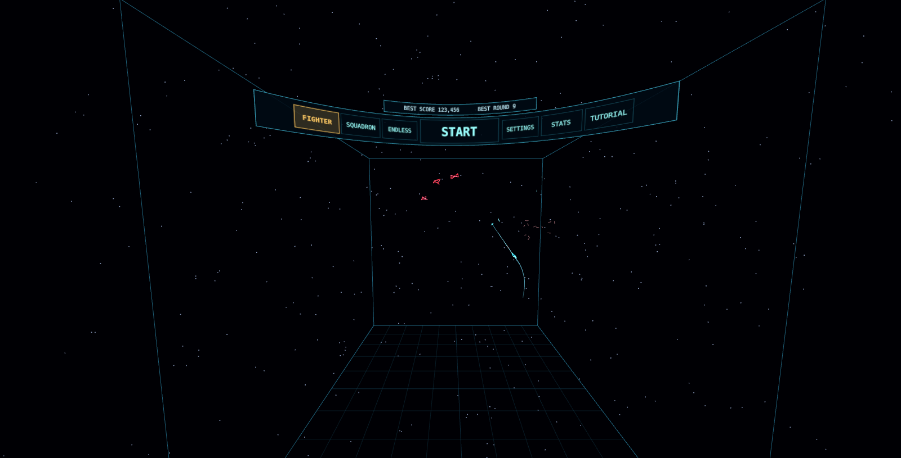 | 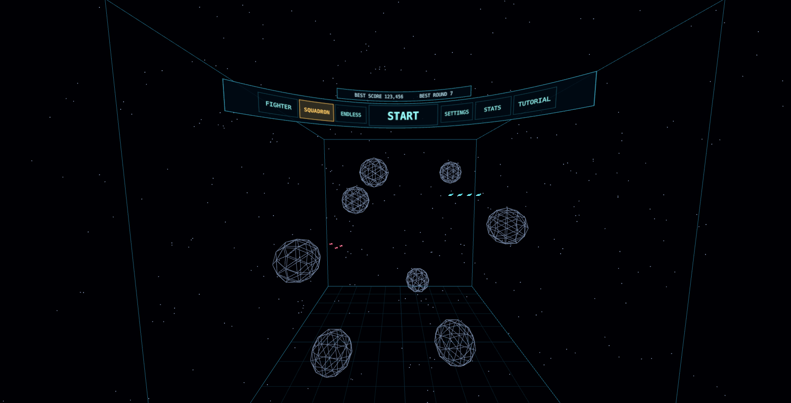 | 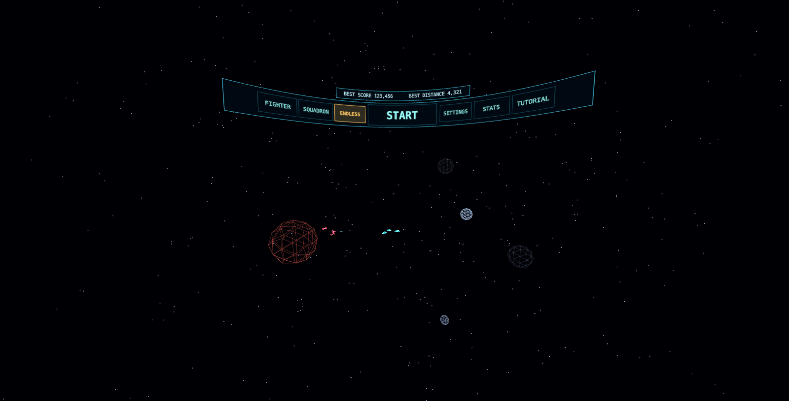 |

| Settings open (SETTINGS lit) | Stats open | Game + announcement |
|---|---|---|
| 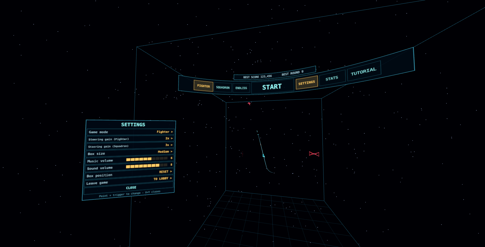 | 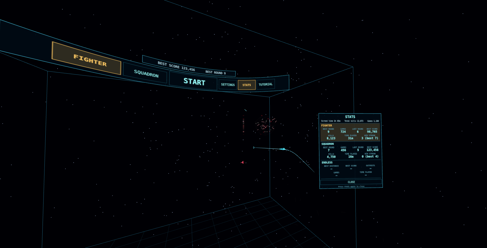 | 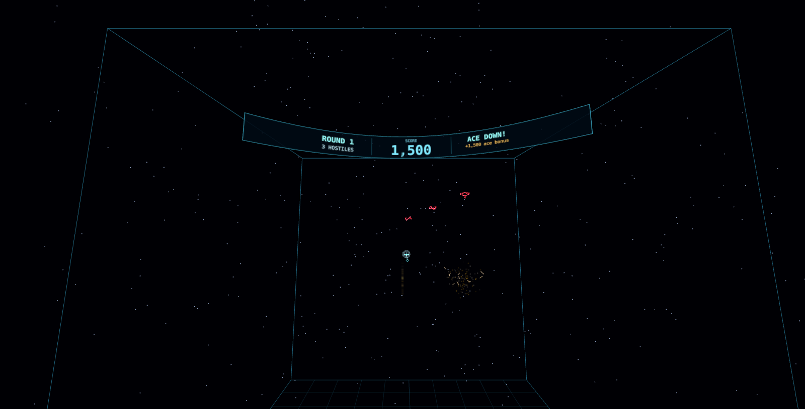 |

## Endless

No room walls: your ship (or your squadron's centre) stays in the middle of a view window and space moves
past it. The window is wider than the room (radius 6.5 game units, 1.6x v28's), so you see more around you.
Fly as far as you like; the space is generated from a fixed seed, so it is the same every run. The game
never pauses in Endless (only Settings pauses it).

- **Stars** everywhere, all the same size (the size stars are next to the ships in Squadron mode). Far stars
  fade out gradually over a long band (from 30% of the window's radius to its edge), so nothing pops in.
  You start beside an ordinary star. Stars never overlap: no two are closer than 3 units centre to centre,
  and none is within 5 units of an outpost (chosen from the seeded candidates alone, so the sky is the same
  whichever way you fly).
- **Enemy outposts** are **red stars** with their ships huddled round them. They wake when you come close,
  roam near their star (they never chase you far), and go back to sleep if you leave. The further from home,
  the higher the **tier** (one step every 36 units): more and tougher ships, and more points.
- **Friendly outposts** are **green stars**, commoner near home. They are **safe zones**: enemies turn away
  from them and enemy shots fizzle out near them.
- Outposts are closer together than in v28 (regions 26 units apart instead of 40).
- **Arrows** at the window's edge point the way: **red** to the next enemy outpost and **green** to the
  nearest friendly outpost when a ship is hurt. Each arrow is a long shaft with two short prongs, and it
  turns slowly about its own axis. The ring also shows the next outpost's distance and tier.
- **Asteroid fields** (v36: **a lot more** - almost every region without an outpost has one, and about 7 in 10
  of the corners between regions hold another, kept 10 away from any outpost: about 125 fields within 5 regions
  of home, roughly 3 - 4 times v35; v33: about 1 site in 5 near home, one just behind the start) drift
  slowly, tumble, and damage whatever hits them. Their rocks stay clear and bright until close to the window's
  edge, so you see a field coming from a distance.
- **Bounty outposts** (about 1 in 7) are **gold** stars: tougher defenders, double points and credits, and
  rarer upgrade cards.
- **Patrols** roam between outposts (every 40 - 60 s or so) and come after you - but **not once you have
  landed** (v35): on any star you land on, every enemy breaks off and keeps at least 45 (shown units) away, no
  attack runs, no ramming, its shots fizzle, and a patrol turns round and leaves for good; a **treasure ship** (gold)
  sometimes turns up and circles away on a widening orbit - catch it in the 6 - 10 seconds before it escapes
  for a big payout.
- **Credits** drift out of destroyed ships as small spinning gold wireframe diamonds (v34; v33 had gold
  dots): fly through them (or buy a magnet).
- **Combos:** kills within 2.5 s of each other chain (x3 and up score a bonus). **Distance milestones**
  every 1,000 get a small celebration. The music gets busier with combos, bounties and the treasure ship.
- **Outposts get tougher** with their tier. v35 eased the start again: tiers 1 - 4 fight like rounds 1 - 4
  (v34: 2 - 5), tier 5 like round 6, tier 6 like round 7, and from tier 7 on it is the v34 curve (tier 9 like
  round 11; v33: 13), and every defender has a little more hull further out. A bigger fleet meets a bigger
  defence (an extra pair for every 3 ships past 2, up to 5 extra pairs), and every 2.5 minutes of the run the
  enemy gets one level tougher everywhere (with 15% more hull and, every 5 minutes, another pair per outpost;
  from 10 minutes in their hits cost 2 hull, from 20 minutes 3), so a run always ends sooner or later.
- **Destroying an outpost** (every ship round it) gives 1,000 x its tier in points and credits. A short effect
  (1 s): one faint ring, a few sparks, a quieter boom, a very short hit-stop; the red star flickers gently,
  shrinks and comes back grey. Then your ships **land on the star by themselves**: the view glides over to
  the star (about 1 s) while every ship flies a real approach - it carries on along its own heading, curves
  in, lines up with the squadron and comes down onto its own spot on the star at a shallow angle, slowing as
  it touches down, then levels out. Nothing slides sideways. A split squadron rejoins first.
- **Landed:** the ship (or the whole squadron) sits on top of the star while the game keeps running. Landed
  ships can't be hurt, steering does nothing and X does not split. A small panel appears **beside the star**
  (point + trigger) **as soon as your ships head in to land** (v34; before, once they had settled), on its
  right - or on its left or above it when that side has a clearer view. v34: it is **always drawn over
  everything** - stars, rocks and ships never cover it - and its background is nearly opaque. v36: your
  **credits are the biggest thing on it** (a gold number with a wireframe credit diamond), and when you buy
  something the number counts down to the new total with a short gold flash:
  - **Cleared outpost:** **5 upgrade cards** (v35; was 3) from a pool of 14, in four rarities (Common, Rare, Epic,
    Legendary: v34 shows the rarity as a thin muted colour edge and a small tag, the names in the panel's own
    colours). Buy any or all of them with credits; better ones cost a lot more, and rarer ones roll more often
    at higher tiers and bounty outposts:

    | Rarity | Upgrades (price; each extra level +50%) |
    |---|---|
    | Common | +hull (800), +fire rate 15% (900), engine +12% speed (700), bullet speed +25% (600), credit bonus +20% (700), +1 wingman (1,200, up to 8; v34, was Rare 2,400) |
    | Rare | magnet (2,200), +damage 40% (2,600), repair drone (3,000) |
    | Epic | spread shot - a fan of 3 (6,500), piercing shots (6,000), shields - block a hit, recharge (7,000) |
    | Legendary | homing missiles (14,000), rebuild - the next ship destroyed comes back (16,000, up to 3) |

    Your upgrades show as a compact row on the wrist (e.g. `UPG HUL1 FIR2 SPR MSL1`).
  - **Friendly outpost** (fly onto the green star to land): **repair all** (300), **a new fighter** (v34: 800,
    +15% each time, no fleet limit; v33: 1,500, +30% each time), **+1 hull for every ship** (1,200, +50% each
    time), paid with credits. (v34 - v35 also sold the warp drive here; since v36 every run has it.)
  - **LAUNCH** on the panel is the only way to take off. If you launch from a cleared outpost without
    choosing, its grey star pulses and you can fly back onto it later.
- You start as **one fighter** (Fighter controls). Kills earn credits. With a wingman you lead a squadron
  (Squadron controls). There is no fleet limit in Endless: formations grow to fit (a line becomes rows of up
  to 6, a wedge chevrons of up to 7 one behind the other, a ring widens), and 15 ships in a tier-3 fight still
  cost about 0.6 ms of game logic per frame.
- **Split** (X): the view centre follows both pairs, weighted 60 / 40 toward the blue pair, and eases over
  when you split or rejoin (no jump).
- **Warp** (v34; **from the start** since v36): press **B** (desktop: V) and your ships fly **5x faster** in a
  straight line. You can't steer at warp (and nobody shoots); the ships swerve smoothly round stars and rocks in
  the way and hold their formation. B again drops out early. The button is always shown: **`B WARP`** on a
  small tag at the right controller's B button (`B DROP` while at warp) and on the wrist panel.
  - **The warp flow** (v37; v38 fewer, shorter, closer, smoother): 20 thin light-blue lines stream past your
    fleet, backward against the warp heading, like air flowing round an invisible smooth body just outside the
    formation. Each comes in straight a little ahead of the fleet, eases outward in one long gentle S-curve round
    the ships, runs on alongside them and ends a little past them; lines farther out bend less. Bright dashes
    scroll back along them so the speed reads. Nothing is drawn on the ships. No entry or exit animation (it
    fades in and out in 0.2 s); a rising sound on the jump and a falling one on the drop. (v36 had a wireframe
    bubble with streaks inside; v35 filled the whole box with streaks and ring bursts.)
  - **Only the outpost dead ahead counts** (v35): warp drops out about **45 (shown units) before** an outpost
    (enemy, friendly or the homeworld) that lies in a narrow cone along your warp heading (1.6 units wide at
    your ships, opening at 10 degrees). Outposts beside or behind you are ignored (and you fly past them without
    waking them), and the star you are on or just took off from never blocks the warp. It can't be engaged
    with an outpost dead ahead closer than about 60. (v34: dropped 130 from any outpost in any direction and
    could not be engaged within 150 of one.)
- **The goal - the enemy homeworld** (v34): once you are past the tier-9 outposts (2,880 out), the **ENEMY
  HOMEWORLD** appears about 1,200 further on, in the direction you have been heading out. It is a huge red star
  (more than 5x a star's size, with two turning rings) in a wide clearing with no stars, outposts or fields.
  A **magenta arrow** and the ring point the way and show the distance. Come close and **one massive swarm**
  launches (v36; v34 - v35: three waves of about 20): about **68 ships for a 6-ship fleet, 76 for 10** -
  12 cruisers, two leaders with escorts, hunters, snipers and a cloud of fighters - on a wide arc **between
  you and the planet, inside your view** (4 - 5 units ahead, across about 110 degrees; v35's waves entered on
  the planet's far side, out of sight). The swarm's fighters drop their vertex dots (one draw call each); with
  the swarm up, the game logic costs about 1.3 - 1.7 ms per frame in the emulator, about 200 draw calls.
  Destroy the whole swarm and the homeworld **breaks apart**: time slows to a quarter for about 1.5 s, a huge
  spark burst and boom, its wireframe flies apart edge by edge (white-hot, cooling to red), three shock shells
  sweep out and the view glides over to watch. Then **VICTORY** on the ring, held for 12.5 s, with the run's
  numbers round it - time, distance, score, outposts, kills - and no sentences (+50,000; wins are counted in
  the stats). Run from it and the swarm pulls back (it comes again in full). Endless keeps its name.
- A destroyed ship is gone for good. **Down to one ship** (v35), it becomes your fighter again: Fighter
  controls (A brakes, the ship is yours to fly), with its share of hull; a new wingman makes it a squadron
  again. Lose the last ship and the run ends: you see your distance and score, then the lobby.
- **Less text** (v34): Endless notices are a few words (`LEADER DOWN`, `OUTPOST - TIER 2` / `7 hostiles`,
  `+2,000`) - no explanation lines; the panels' text is short too.
- **Wrist HUD with a big fleet** (v34): up to 6 ships, one box each as before; 7 - 16 ships wrap into two rows
  (each box at least 34 px of the 512 px HUD); more than 16, one bar for the whole fleet's hull (with the ship
  count) plus boxes for the 8 weakest ships. (v33 squeezed 20 ships into 8 px slivers.)
- **Score is earned** (v33): kills, outposts (by tier, double for bounties), patrols, the treasure ship and
  combos. Distance scores nothing; it is a stat (best distance is saved, as is best score).

Only nearby things are simulated (outposts wake within a short range, stars and rocks come from small pools),
so a busy tier-3 outpost fight costs about 0.5 ms of game logic per frame.

| Start (wider view) | Outpost (tier 1) | Asteroid field |
|---|---|---|
| 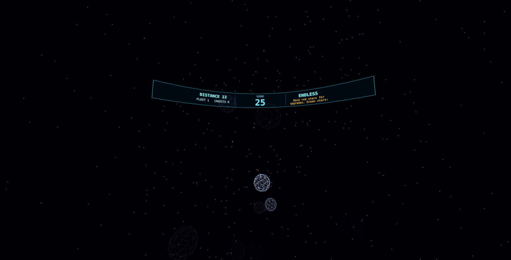 | 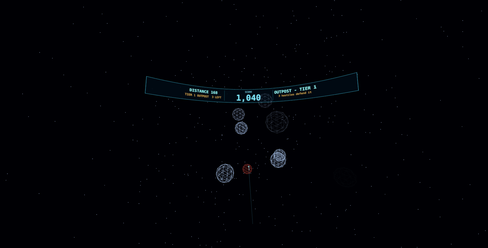 | 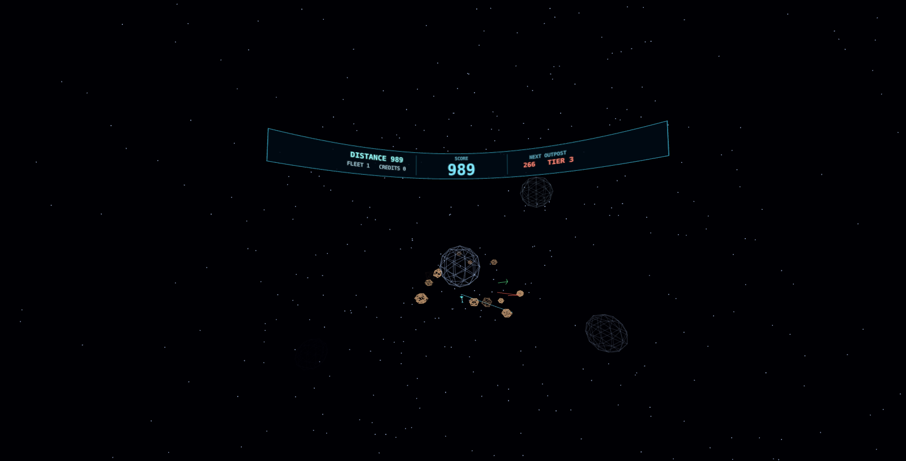 |

| Outpost destroyed (v31, toned down) | Landed: upgrade panel | Landed on a friendly outpost |
|---|---|---|
| 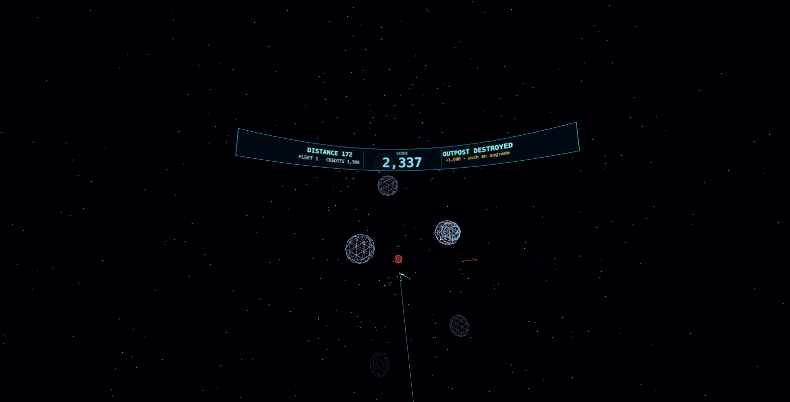 | 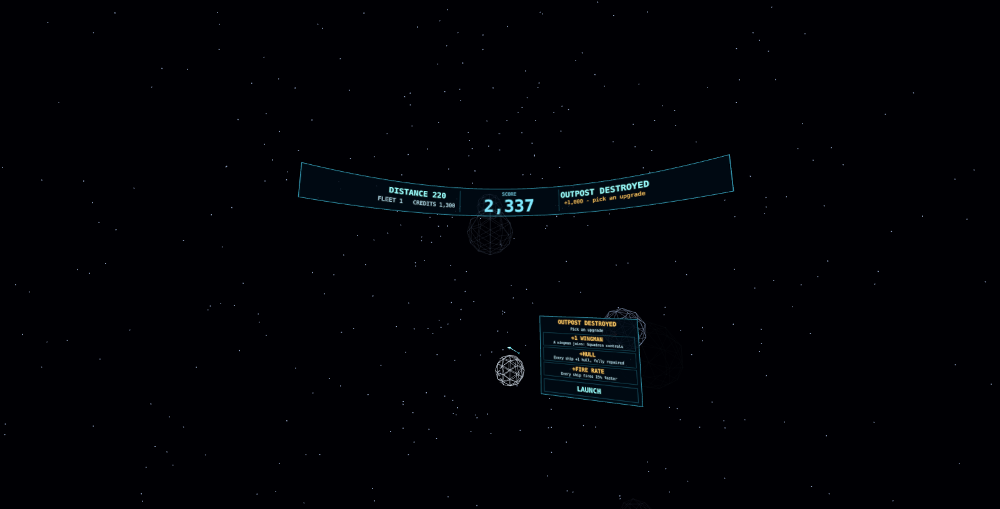 | 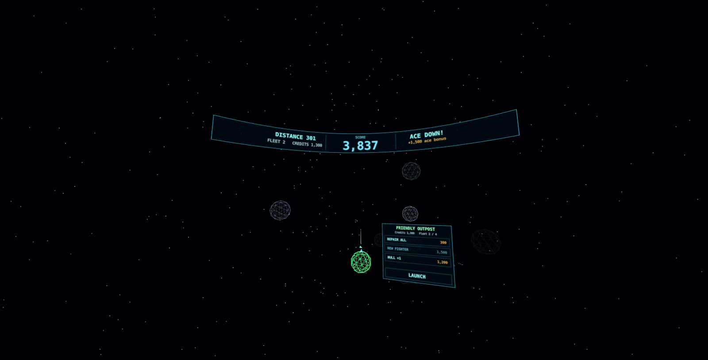 |

| Arrows (red: outpost, green: friendly) |
|---|
| 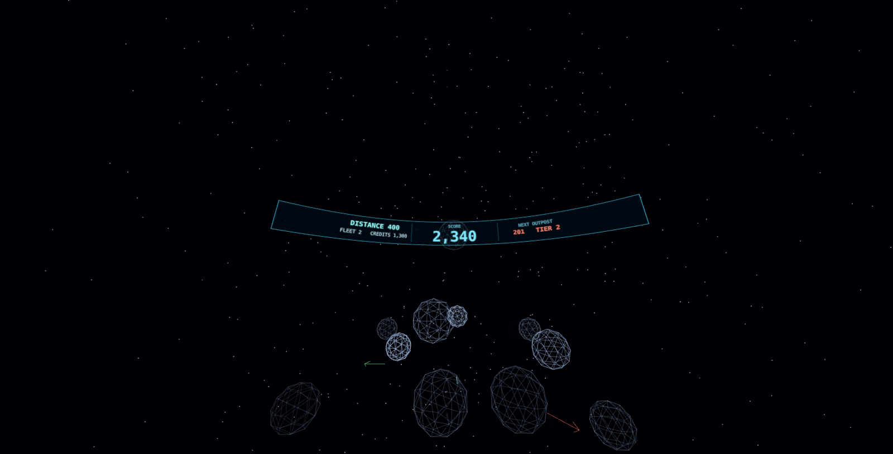 |

| v32: a fighter flying its landing approach | 14 ships landed on a friendly outpost | Split view (60 / 40) |
|---|---|---|
| 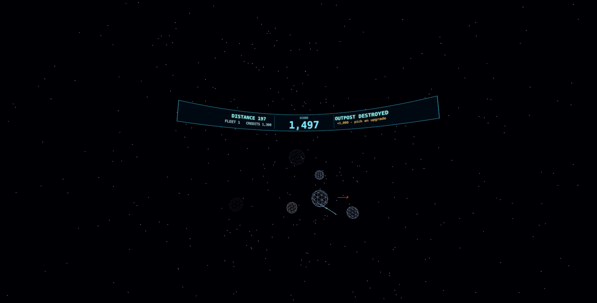 | 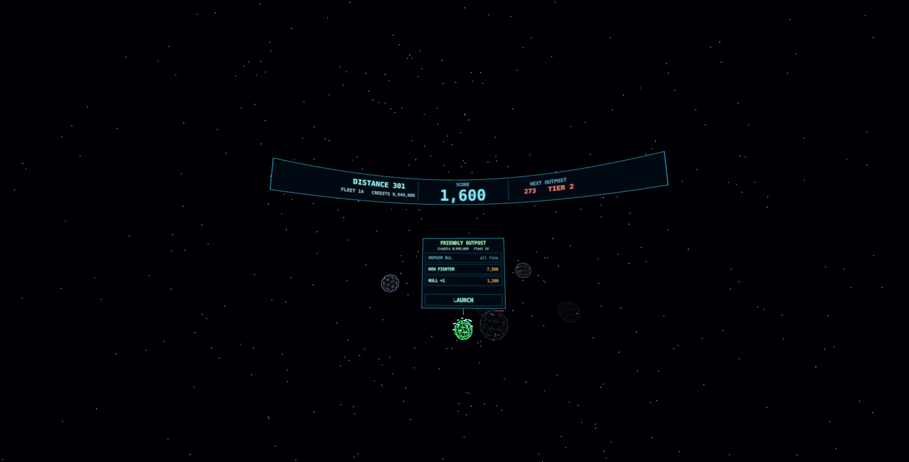 | 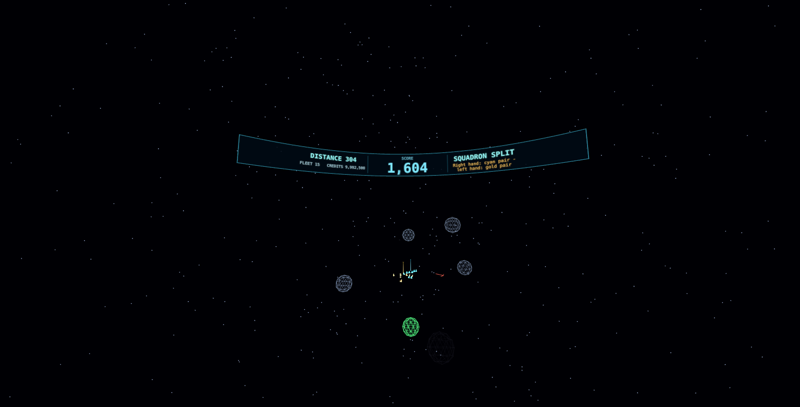 |

| A star in front of the popup (depth-correct) | The popup moved to the clear side |
|---|---|
| 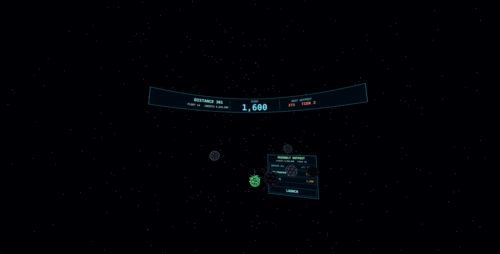 | 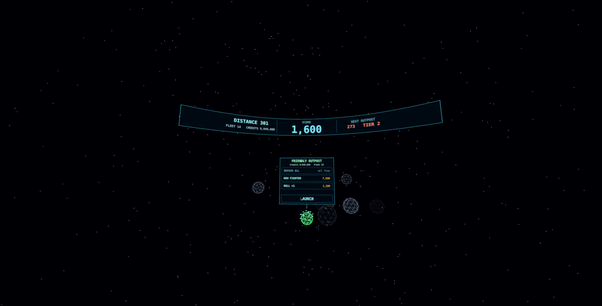 |

## Rounds: every round is a fresh battle

Fighter and Squadron are played in **rounds**, and the goal is to reach the highest round you can.
Your score keeps adding up across rounds, and each cleared round gives a bonus of 500 x the round number.
The best round you have reached is saved for each mode (see the lobby stats).

- **Each new round fully resets the battlefield.** Your side comes back at full strength in
  its start position: in Fighter your ship has full hull; in Squadron all 4 bots have full hull.
  The enemy spawns fresh. Nothing carries over, so you lose only if your side is wiped
  out within a single round. When you lose, you're back in the lobby a few seconds later.
- **The room reshapes** between rounds, and in Squadron the **stars** fade out and come
  back in **new random positions** that suit the new room shape. They are kept clear of your
  start area, and no ship is ever left inside a star.
- **The enemy gets harder and smarter every round.** Each round brings more ships, faster bullets
  and better aim. Their shot leading starts at about half and is perfect from round 5. New tactics unlock as you go, and the
  round-start announcement names any new one:

  | Round | New enemy tactic | Modes |
  |---|---|---|
  | 1 | Pincers and flankers, retreat when damaged | Both |
  | 2 | **Focus fire** on your most exposed ship; **bait and ambush** | Squadron |
  | 3 | **Hiding behind stars** (snipers and damaged ships) | Squadron |
  | 3 | **Retreat and regroup:** damaged ships fall back to their wingmen; outnumbered ships pull back | Both |
  | 5 | **Synchronized strikes:** every attack group times its run to hit at the same moment | Both |
  | 5 | **Dodging your shots:** many enemy ships side-step incoming bullets | Both |
  | 6 | **Hunter-killers:** a fast pack that chases your most damaged ship | Both |
  | 3 | **Leaders with escorts:** an orange leader flies with escorts; kill it and the escorts scatter | Both |
  | 3+ | **Aces** (sometimes; see below) | Both |
  | 4 | **Screens:** a ship that parks itself between you and a sniper, leader or heavy to shield it | Both |

  Difficulty grows mainly through **behaviour**, not numbers: a round adds only about one ship
  (Fighter rounds 1-10: 3, 4, 7, 8, 9, 12, 12, 13, 16, 16 ships; Squadron: 4, 8, 11, 13, 14, 17, 17, 18, 21, 21).
  Enemies keep more space from each other, flankers swing wider, and nobody shoots while scattering.

- **Aces.** From round 3 an **ACE** sometimes joins, in **gold** with "ACE" over it.
  It is faster, tougher and always dodges, and flies boom-and-zoom attack runs, breaking off before it gets close.
  When it is badly hurt it **runs for a wall**: if it escapes, it comes back in the next round with one more
  hull point. Shooting one down is a big moment: a longer freeze-frame, a strong rumble, a gold flash of the room,
  **ACE DOWN!** and a bonus of 1500 x round (more for an ace that escaped before).

  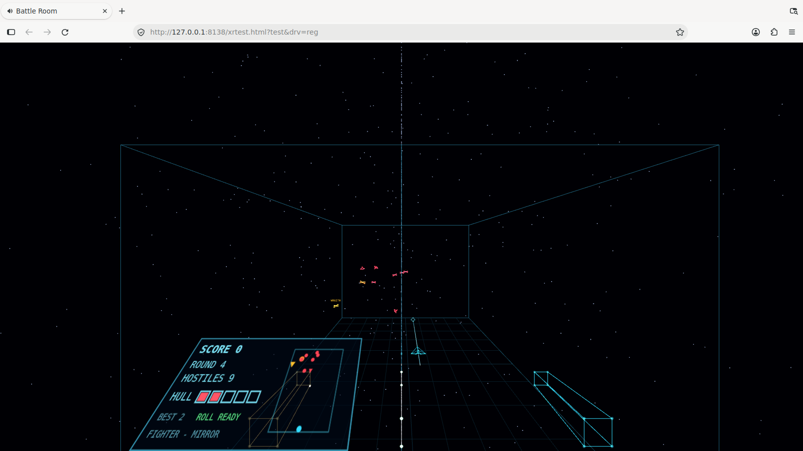

### Fighter

You fly one cyan ship and win round after round against red ships. The command room is much bigger than
the ships, so there is plenty of room to manoeuvre.

The enemies fight in groups with real plans:
- **Pincer pairs** swing out to opposite sides of you, then attack together.
- **Flankers** circle round to come at you from the side or behind, make a pass, and swing out again.
- **Snipers** (from round 2) hold long range and fire accurate shots.
- **Heavies** (cruisers, from round 3) hold medium range and fire 3-shot spreads.
- Everyone **leads their shots** (aims where you will be), and pulls back for a moment when damaged.
- From round 3, **leaders** (orange, bigger) with **escorts**, **screens** and sometimes an **ace** (see above).

Your hull has 5 points, back to full at the start of every round. Lose them all in one round and it's game over.

### Squadron

A much bigger, zoomed-out battlefield with smaller ships. You command **4 friendly bot
fighters**. You don't fly them: the right controller is a **command**. Where it points (3x gain by
default) sets the heading of the squadron, shown by the cyan aim line
and ring. The bots fly their own ships. They keep a side-by-side formation, steer toward
the commanded heading, dodge incoming bullets, and never run into each other.

- **Hold the right trigger = engage.** The bots spread out a little, staying on a leash
  around the group centre, and each one attacks the nearest enemy. A bot only fires when
  the line is clear, so never through a wingman or a star. Release to regroup into
  formation and carry on in the commanded direction.
- **Right grip = boost.** It only works while NOT engaging, and the whole squadron boosts together.
- **Smarter bots when engaging:** each bot prefers enemies **ahead of the commanded heading** (a cone,
  weighted by distance) and **damaged** enemies, so they finish targets off. Bots don't fly straight down an
  enemy's guns (they come in at an angle), and a bot down to its last hull point **pulls back** into the
  formation while a healthier wingman fights (it still takes shots at anything right in front of it).
  Dodging and formation flying are unchanged.
- **Formations (A):** line -> wedge -> ring.
  - **Line** (default): side by side; when engaging, **two bots per target**.
  - **Wedge**: a V; when engaging, **all on one target**, faster, on a shorter leash.
  - **Ring**: a tight ring; bots spread over the nearest threats and stay close to the centre.
- **Split (tap X):** the squadron splits into **2 pairs**. The **cyan pair** follows your
  **right** controller as before; the **gold pair** follows your **left** controller (its own gold command point
  and aim line), with the same steering, **left trigger = engage** and **left grip = boost**. Tap X
  again to **rejoin**. (The split happens when you let go of X, and only if Y wasn't pressed, so X + Y for
  Settings never splits.) The wrist panel shows SPLIT, each bot's hull box in its pair's colour, and what each pair
  is doing (R: / L: ATTACK or HOLD). If a whole pair is lost, the squadron rejoins automatically.

- **Stars:** big wireframe spheres. Nothing can fly through them and they block bullets, so
  both sides use them as cover. Ships steer around them. They are spread through the room in
  proportion to its current shape, in new random positions every round.
- **Enemies** come in coordinated groups:
  - Pincers and flankers **focus fire** on your most exposed bot (the one furthest from its wingmen).
  - Snipers **hide behind stars** and step out to shoot.
  - From round 2, a **bait** ship flies in close and then runs back to a star where two
    **ambushers** are hiding.
  - Enemies **fall back to cover when outnumbered** and pull back when damaged.
  - Rounds get bigger and the enemies get faster, more accurate and smarter (see Rounds above).
- Each bot has 3 hull points. A destroyed bot is gone for the rest of the round; every new
  round starts with all 4 back at full hull. Lose all 4 within one round and it's game over.
  The wrist panel shows each bot's hull.

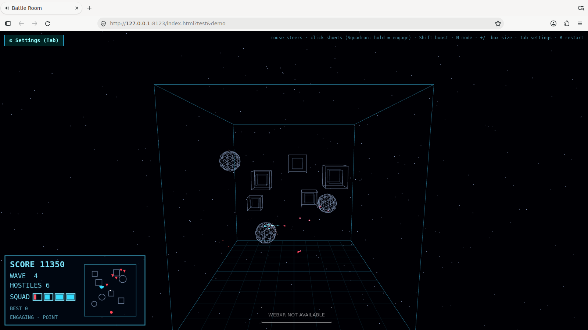

**Wrap-around (both modes):** fly out through one face of the box and you come back in
through the opposite face. Enemies wrap too. Your view never moves and the game never turns you.

**The room changes shape (both modes):** width, height and depth vary independently, so the
room may be a long tunnel, a flat slab, a tall tower or a cube. A new shape is picked for
every game, and between rounds the room smoothly reshapes itself, keeping every ship inside.
The volume stays about the same, so the difficulty stays fair, and the size is capped (at
most about 1.5 m wide or deep, 1.35 m tall with the Medium box size). A deeper room grows
away from you, so its near face never comes closer.

**Juice (both modes):** kills give a tiny freeze-frame (about 40-55 ms) and a rumble; explosions burst into
sparks with a short flash ring and a bright core; hit ships flash white and throw sparks; the room's frame
glows briefly on kills and hits. **Hit from behind**, the edges of your view flash red (and the left controller
rumbles) so you know to look out. There is **no camera shake**: the view never moves (VR comfort).

**Sound and music:** all synthesized (WebAudio, no files). Shots, layered explosions (body, sub drop and
crackle; big ones dip the music for a moment), boost whoosh, hits, and short chimes for
split / rejoin / regroup / formation / ace. Music is procedural, in D minor: a calm ambient pad in the lobby,
and in battle a driving synth track (bass, arpeggio, drums, 112 BPM) whose layers build up with the number of
enemies alive and your recent kills. Everything goes through a compressor and a limiter, so it never clips.
Music and Sound volume are separate sliders in Settings.

**Score and announcements (both modes)** are on the holo ring above the room: **all announcements** (round
start and new enemy tactics, round cleared, ace, leader down, wingman down, split / formation, game over...) on
its right, your **score** big in the middle, the round and the number of hostiles on its left. Nothing ever
pops up in front of the battle. Your **wrist** only shows your hull (Fighter) or your 4 bots' hull and the
formation / split state (Squadron).

## Controls

### Quest (VR, seated)

| Hand | Input | Fighter | Squadron |
|---|---|---|---|
| Right | **Point / turn the controller** | **Absolute forward:** point the controller along the room's front (level, straight away from you into the room) and the ship flies straight into the box, whatever you did before. This holds wherever the room is (even moved to the side), wherever your head is, and after a re-centre. Turn away from that and the ship turns the same way, times the gain (default **2x**: 45° = 90°). Left / right and up / down are both continuous: keep turning past straight back and the ship keeps turning round smoothly (no stop at 180°, no snap), and up over the top works the same way. v35: near straight up / down the ship is moved by the controller's own frame-to-frame turn (times the gain), not by a yaw / pitch split, so pointing near the vertical, or flicking the wrist back from "fleet facing me", never spins or flips the fleet; any leftover offset eases out once you point back toward the room. Wrist roll is ignored. No re-centring, no drift. | Same, for the squadron's heading (default gain **3x**) |
| Either | **Ray + trigger** on a panel | Press lobby, tutorial and settings buttons | Same |
| Either | **Grip** (lobby and tutorial) | Drag to move the room; with that hand's **stick up/down**, resize it | Same |
| Right | **Trigger** | Shoot (gentle aim assist) | **Hold = engage**, release = regroup |
| Right | **Hold the grip** | Boost | Boost the squadron (only while not engaging) |
| Right | **A** | Brake | **Next formation**: line / wedge / ring |
| Left | **Trigger / grip / stick forward-back** | Extras: shoot / boost / boost-brake | Joined: same extras for the squadron. **Split: they command the gold pair** (engage / boost / boost-brake) |
| Left | **Tap X** | - | **Split / rejoin** the squadron |
| Left | **Point / turn the controller** | - | **Split:** steers the gold pair (same absolute forward) |
| Left | **Click the thumbstick** | Put the box back in its default spot | Same |
| Left | **X + Y together** | Settings open / close, on a panel to the left of the room (point and pull the trigger to change; a game pauses meanwhile) | Same |
| Left | **Look at your wrist** | Hull | Your 4 bots' hull, formation, split state |
| Right | **B** | Endless: **warp** on / off (from the start; a `B WARP` tag shows on the controller) | Same |

Right B does nothing outside Endless; the right stick click does nothing. Steering is always this one style (there are no other steering modes).

### Settings (saved on the device, as are the box position and size)

| Setting | Options | Default |
|---|---|---|
| Game mode | Fighter / Squadron | Fighter |
| Steering gain (Fighter) | 1x / 1.5x / 2x / 2.5x / 3x / 3.5x | 2x |
| Steering gain (Squadron) | 1x / 1.5x / 2x / 2.5x / 3x / 3.5x | 3x |
| Box size | Small 0.7 m / Medium 1.0 m / Large 1.3 m | Small (v32; Medium before) |
| Music volume | slider 0-10 | 6 |
| Sound volume | slider 0-10 | 8 |
| Box position | RESET puts the box back in its default spot (centred 0.85 m ahead, centre 1.0 m up) at your Box size | |
| Leave game | TO LOBBY ends the current game and goes back to the lobby | |

Changing the mode during a game restarts in the new mode.

### Testing without a headset (developers only)

Players only get the ENTER VR button. For testing, `?test` turns on hidden desktop controls and a
debug HUD, and sends errors and status lines to a local test server:

| Input | Action |
|---|---|
| Mouse | Steering: the ship (or squadron heading) points where the mouse points |
| Left click / Space | Shoot (Squadron: hold to engage) |
| Shift / F | Boost / brake |
| N | Switch mode (Fighter / Squadron) |
| G | Split / rejoin (Squadron; the gold pair copies the mouse) |
| B | Next formation (Squadron) |
| V | Warp on / off (Endless) |
| + / - | Box size |
| C | Reset the box |
| Right-drag or arrow keys | Look around |
| Tab or the gear button | Settings |
| Enter / R | Start / restart |
| L / T | Lobby / tutorial |

Extra test options (with `?test`): `&demo` autopilot, `&mode=fighter|squadron`, `&wave=5` start at round 5,
`&sim=6` run the simulation 6x faster, `&bench` let a test script drive games.

## Getting it onto the Quest

**Live copy:** https://willcoding11.github.io/vr-battle-room/ (GitHub Pages). Open it in the
Quest Browser and press **ENTER VR**.

WebXR only works over **HTTPS** (or `localhost`), so the files must be served from an HTTPS
address. The folder is plain static files (`index.html`, `js/`, `vendor/`), so there is no
build step.

1. **Simplest: a static host.** Put the folder on any HTTPS static host, such as GitHub
   Pages, Netlify Drop or Cloudflare Pages. Open the URL in the Quest Browser and press
   **ENTER VR**. Tip: bookmark it in the Quest browser.
2. **Local, over USB, no hosting.** On a PC with `adb` and the Quest in developer mode, run
   `adb reverse tcp:8000 tcp:8000`. Then run `python -m http.server 8000` in this folder
   and open `http://localhost:8000` on the Quest. `localhost` counts as secure.
3. **Local Wi-Fi.** Serve the folder over HTTPS with a self-signed certificate, for example
   `npx http-server -S` or `caddy`, and accept the warning in the Quest browser.

When you are in the Quest browser, sit down, then press **ENTER VR**. If the battle sits too
high or too low, hold the Meta button to recentre, change the box size in Settings, or click
the left stick to put the box back in its default spot.

## Files

- `index.html` - page with the ENTER VR button (plus the hidden test HUD)
- `js/main.js` - game: scene, input, player, enemy AI, squadron bots, stars, rounds and enemy tactic unlocks, lobby, HUD, effects
- `js/ui.js` - VR panels (canvas text and buttons picked with a controller ray) and the animated controller icons
- `js/controller.js` - the wireframe controller gizmos at your hands
- `js/tutorial.js` - the step-by-step tutorial
- `js/steer.js` - the mirror-steering tracker (controller pose -> ship orientation, v35)
- `js/endless.js` - Endless mode: the seeded open world (stars, outposts, asteroid fields, docks), the
  dock / upgrade panel and run scoring
- `js/ring.js` - the holo ring (lobby menu, in-game score and announcements) and the stats panel
- `js/stats.js` - stats saved on the device (localStorage)
- `js/models.js` - wireframe ship models (points joined by lines)
- `js/audio.js` - synthesized 3D sound effects and the mix (WebAudio, no audio files)
- `js/music.js` - procedural music: lobby pad and the battle track
- `vendor/` - three.js r187 (`three.module.js`, `three.core.js`), MIT licence
- `screenshots/` - screenshots (test mode and the IWER headset emulator)

**Pointing at panels.** Each controller has a faint ray. When it is over a panel (lobby, settings, tutorial
card), the ray brightens into a slightly thicker beam and a small ring cursor shows where it meets the panel;
both fade in and out in about 0.15 s.

The beam ends exactly at the cursor (its length is the hit distance) and is drawn after the panels, so no part
of it shows behind or through a panel; the cursor ring sits 2 mm in front of the surface.

**Panels stay still.** Settings, the stats panel and the tutorial card are placed beside the room and turned
toward where you sat when you entered VR, about the vertical axis only, on a smooth curve:
yaw = 42 degrees x tanh(angle to the seat / 41 degrees). At the usual spots beside the room that is about
31 degrees (v22 - v30: half the angle, capped at 22). Small angles face you almost fully, and the turn
approaches 42 degrees gently, with no hard stop. They never follow your head; they are only re-placed when you
move, resize or reshape the room (or re-centre with the Meta button).

| Before (v30: capped at 22 degrees) | After (v31) |
|---|---|
| 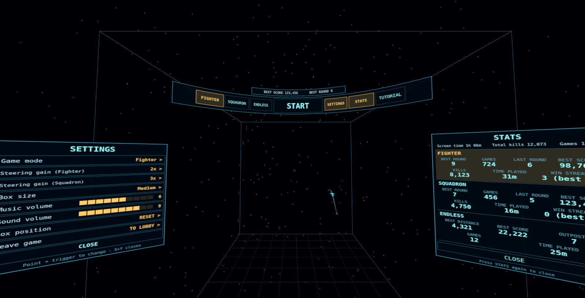 | 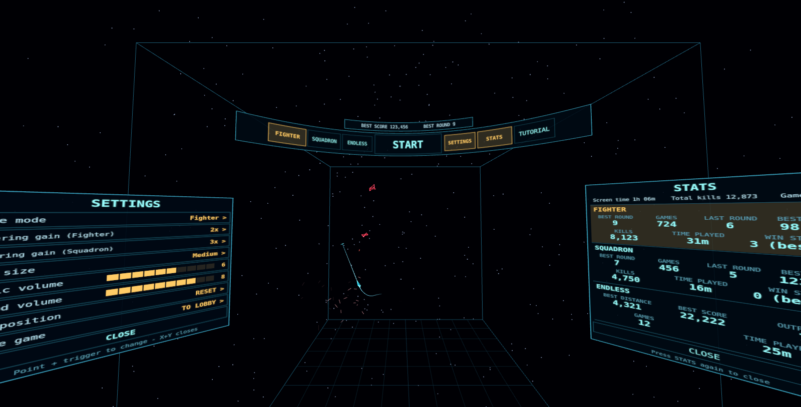 |

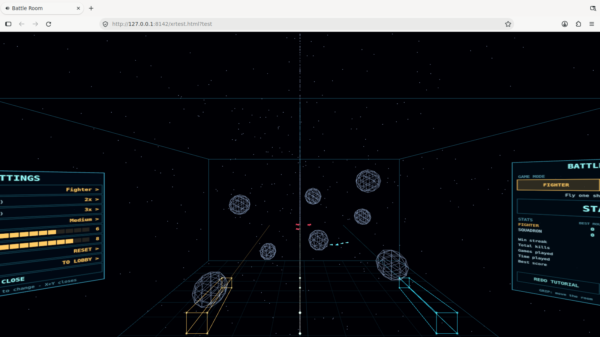

## Changes in v38

- **Warp flow, tighter** (user feedback on v37: "less, shorter, closer, and more smooth from straight to bending
  away from the ships"): 20 lines instead of 44; they reach about 2-3 units ahead of the fleet and 1 past it
  (v37: up to 6 each way); the invisible body sits just outside the formation (about 0.2-0.3 outside the
  farthest ship, its axis through the middle of the formation and its nose just ahead of the leading ship); and
  the bend is one long smootherstep S-curve from straight to alongside, so there is no corner (sharpest turn
  between line segments under 6 degrees).

| From the side (squadron) | Player's view, heading across | Player's view, heading away | Fighter alone |
|---|---|---|---|
| 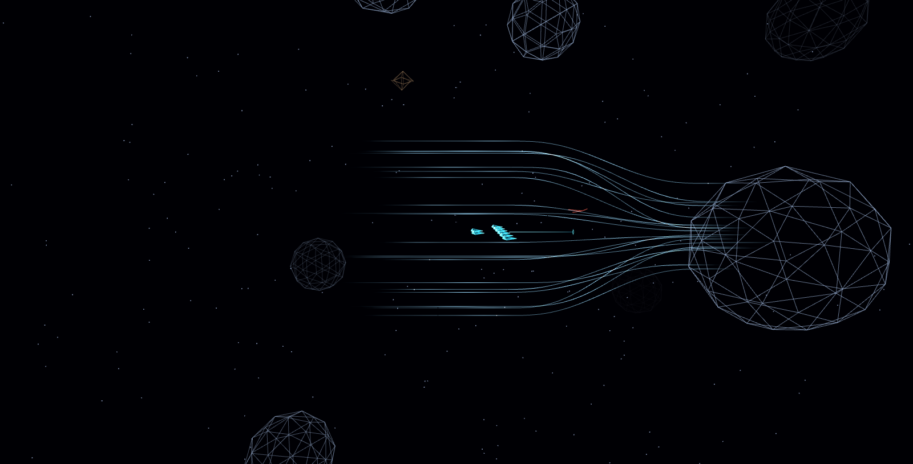 | 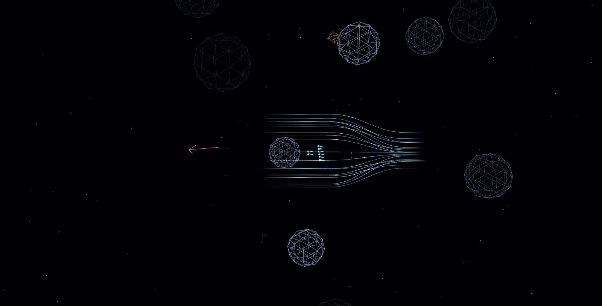 | 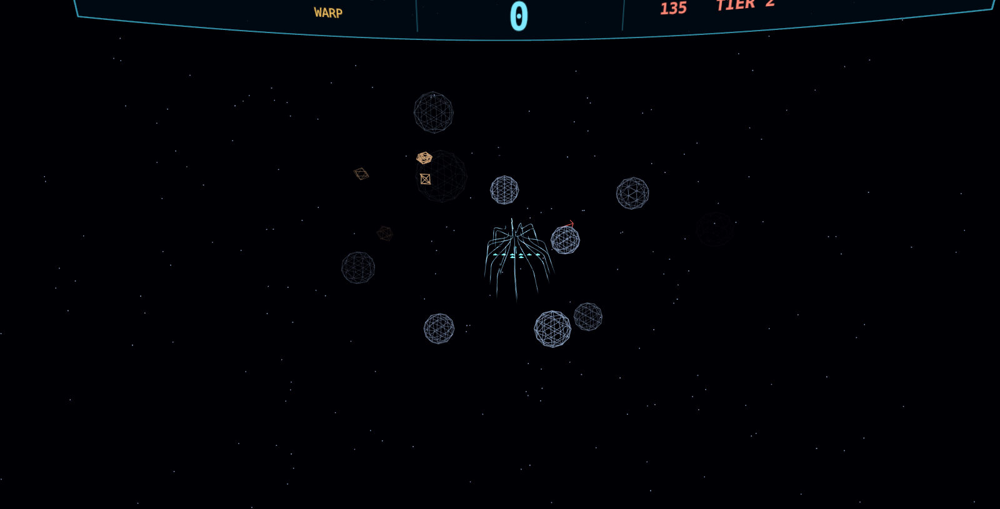 | 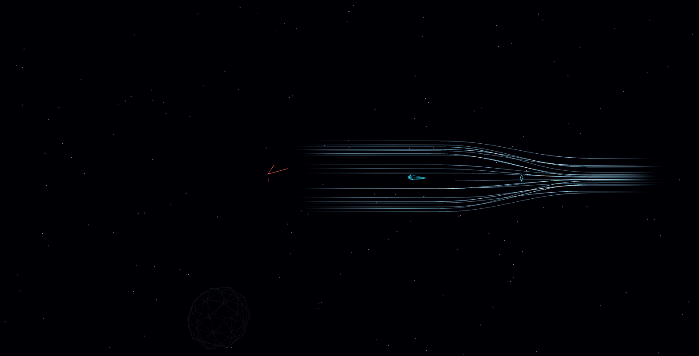 |

## Changes in v37

- **Warp flow** instead of the warp bubble (from the user's sketch): no visible surface; 44 long thin lines in
  the world follow streamlines round an invisible body sized to the fleet (a smooth half-body: it opens from a
  nose ahead of the fleet and stays open behind, so the lines carry on parallel past the fleet like the sketch).
  Lines farther out bend less (each runs at sqrt(r0^2 + B(z)^2) from the axis, B = the body's radius). Dashes
  scroll backward along them. They reach about 2-5 units ahead of and behind the fleet and fade before the
  window's edge. Same 0.2 s fade, no entry / exit animation.

| From the side (squadron) | Player's view, heading across | Player's view, heading away | Fighter alone |
|---|---|---|---|
| 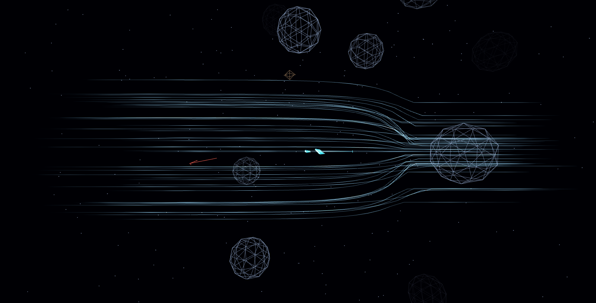 | 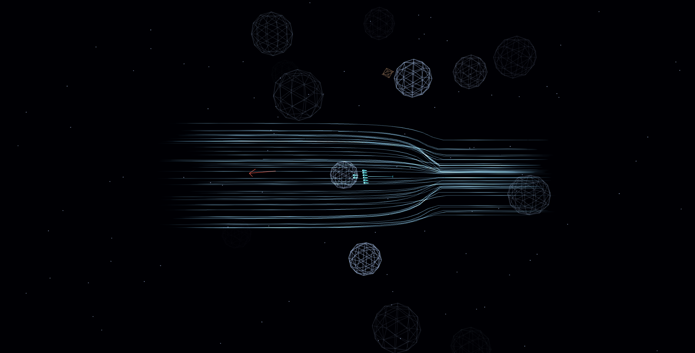 | 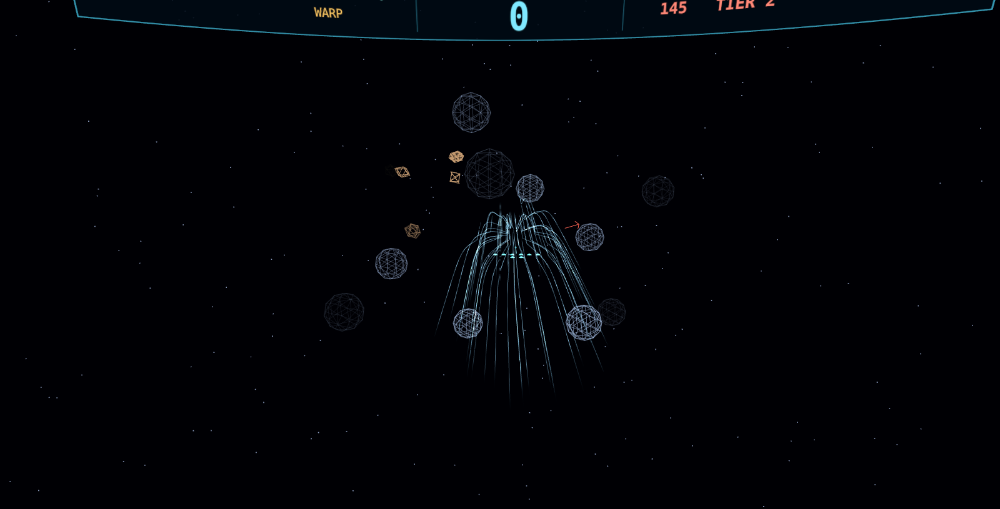 | 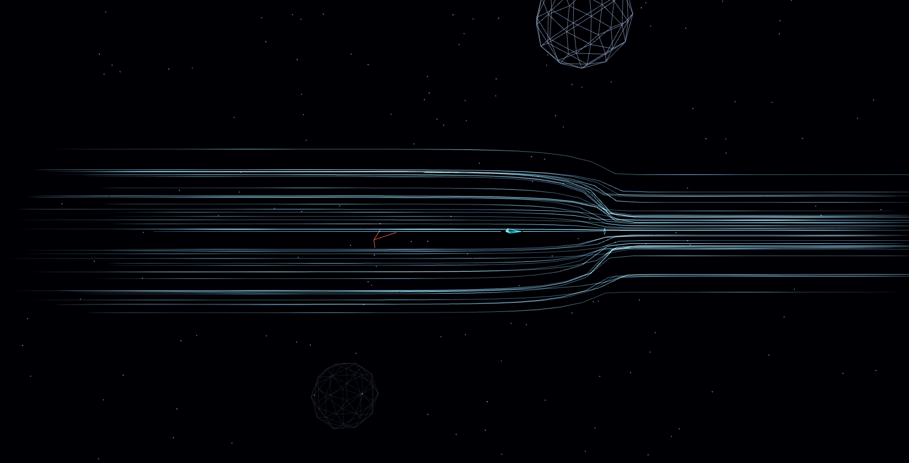 |

## Changes in v36

- **Homeworld:** one massive swarm (about 70 ships with 12 cruisers) that arrives in view, between you and the
  planet - instead of three waves from behind it. Beating it **breaks the planet apart** (slow motion, debris,
  shock shells, the view glides over), then a held **VICTORY** with the run's numbers.
- **Warp:** a bubble round your own ships with light streaks inside, the rest of the view clean; no entry / exit
  animations. **Warp from the start** (no longer sold), with a `B WARP` tag on the controller and the wrist.
- **A lot more asteroid fields** across the map.
- **Outpost panel:** your credits big, counting down with a flash when you buy.
- **Recordings: no more scenery jumps.** Endless handed its pooled star / rock meshes out in list order every
  frame, so when the nearby list changed, visible meshes swapped from one star to another (invisible live, all
  in place every frame - but the recordings interpolate each mesh between frames, so stars and outposts slid
  across the sky for 1 - 4 rendered frames, outposts swapping colours). v6.zip had 6,191 such jumps. Now every
  star and rock keeps its mesh while it is drawn, and the recorder starts a new object id whenever a visible
  object jumps (any pooled mesh, in any version), so the renderer cuts instead of sliding.

Homeworld probe (the autopilot with a 10-ship fleet and a few upgrades, starting next to the homeworld, 3 tries): **3 wins** against the 76-ship swarm, about 3 minutes each, 1 - 6 ships left; game logic at most 3.6 - 5.9 ms per frame at 6x simulation speed.

| Warp bubble (fighter) | The homeworld swarm, in view | The planet breaking apart |
|---|---|---|
| 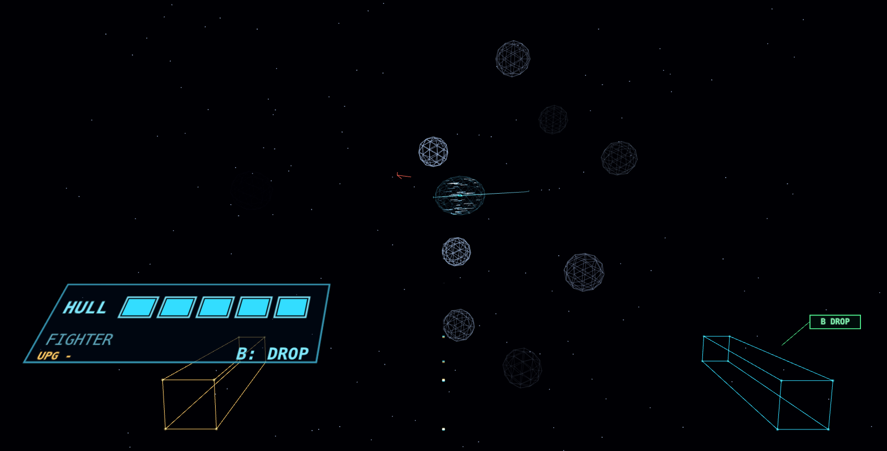 | 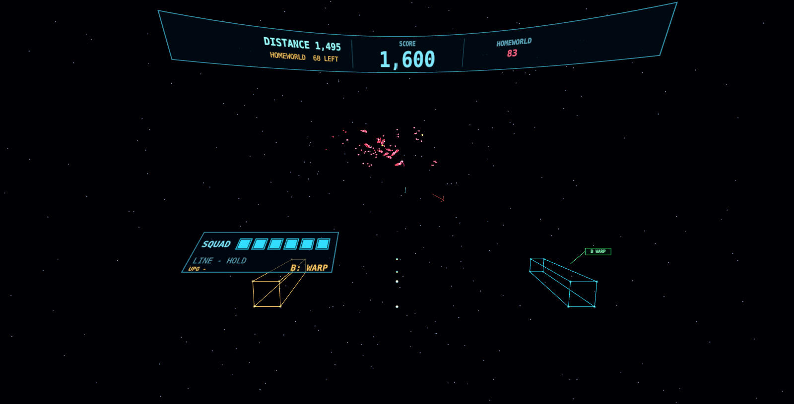 | 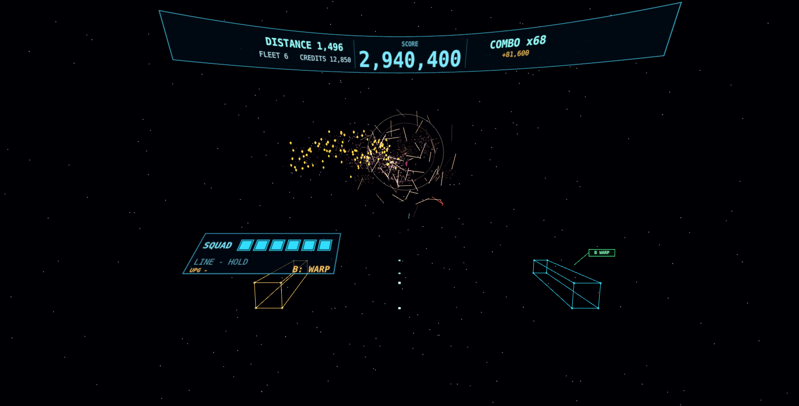 |

| VICTORY with the run's numbers | Outpost panel: big credits | Counting down after a purchase |
|---|---|---|
| 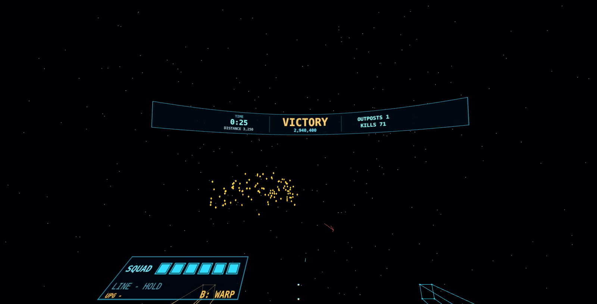 | 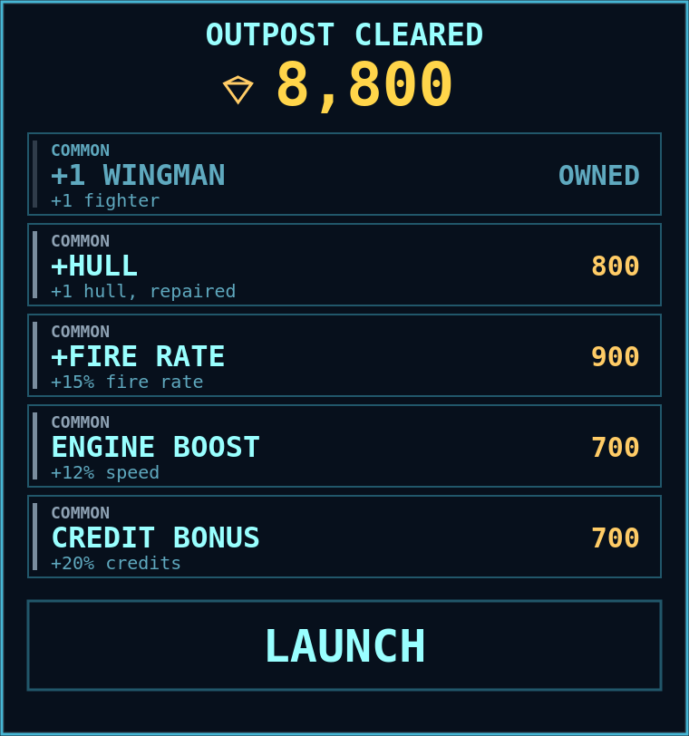 | 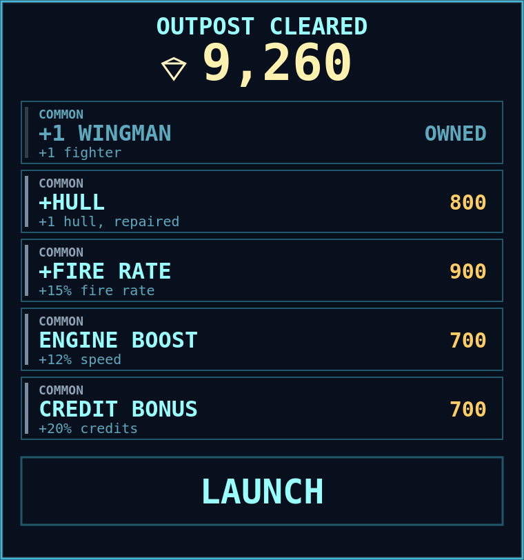 |

## Changes in v35

- **Steering fix** (all modes): turning the wrist so the fleet faces you and then flicking it back, or pointing
  near straight up / down, could make the fleet spin and the aim line jump (the yaw / pitch split blows up near
  the vertical, times the gain). The controller is now tracked frame to frame (a quaternion carried along by the
  smallest turn, no Euler angles), and near the vertical the ship turns by the controller's own movement times
  the gain. Away from it the feel is exactly as before (same map, 0.00 degrees difference in the tests).
- **Landed = safe** in Endless: patrols (and any other enemy) break off as soon as you land - no attack runs, no
  ramming; patrols leave for good.
- **Warp:** a hyperspace jump effect (streaks, entry and exit bursts, sound); drops out about 45 before the
  outpost **dead ahead** only (v34: 130 from any outpost); outposts beside or behind you and the one you just
  left never block or stop it.
- **Easier first tiers** in Endless (tiers 1 - 4 = levels 1 - 4, v34: 2 - 5), the same from tier 7 on.
- **5 upgrade cards** per cleared outpost (was 3).
- **Down to one ship = Fighter controls** again in Endless (a new wingman switches back to Squadron).

Autopilot runs (the test autopilot, 8x simulation speed, minutes of game time per run; 15 minutes of wall time
each - v35 runs last so much longer that only 4 fitted):

| Endless | Runs | Average | Median | Shortest - longest | Notes |
|---|---|---|---|---|---|
| v34 (before) | 25 | 4.3 min | 1.6 min | 0.8 - 26.9 min | |
| **v35 (after)** | 4 | **22.8 min** | 16.9 min | 1.0 - 57.3 min | 3 - 68 outposts per run (avg 31); every run cleared at least 3 outposts; no win (the autopilot never heads for the homeworld) |

The jump is bigger than the tier change alone: 5 cards per outpost means more upgrades, and the last ship
now carries on as a fighter. The threat clock (every 2.5 minutes) still ends every run.

| The jump (streaks + burst) | At warp | Dropped out before the outpost ahead (45) |
|---|---|---|
| 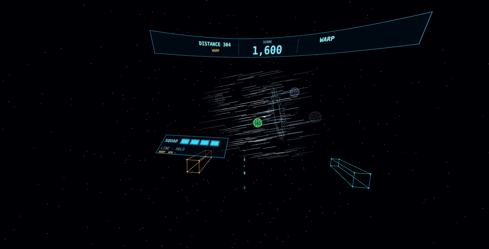 | 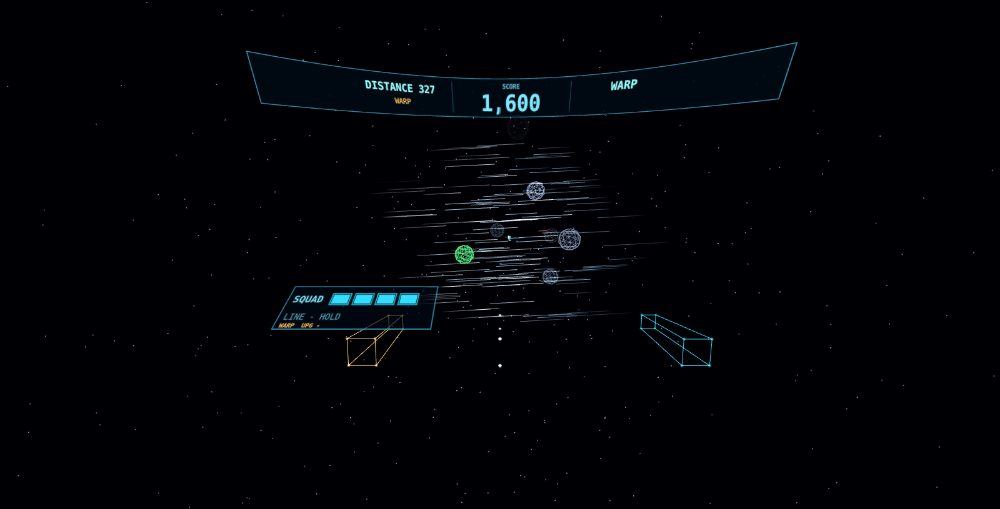 | 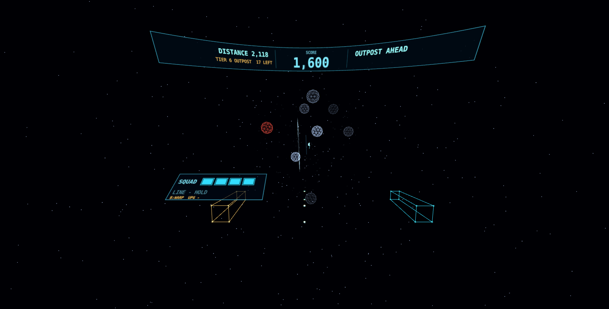 |

| 5 upgrade cards | The last ship: Fighter controls |
|---|---|
| 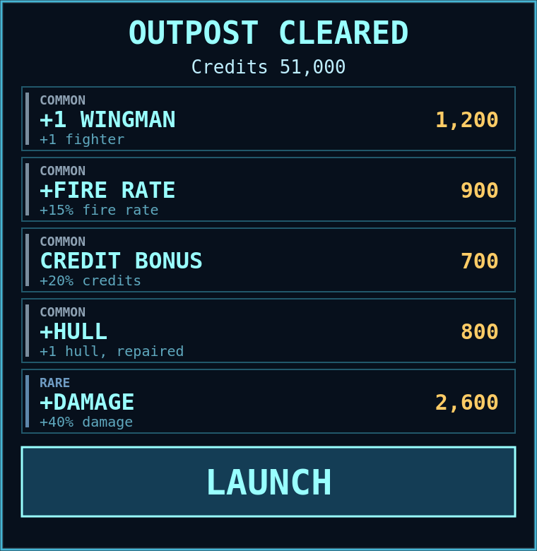 | 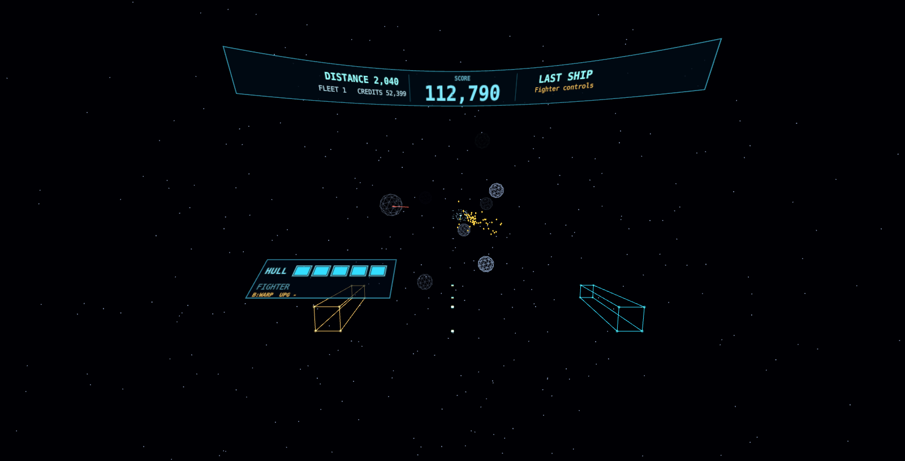 |

## Changes in v34

- **Endless has a goal:** past the tier-9 outposts the **enemy homeworld** appears far out - a huge red star in a
  wide clearing, defended by three waves of a big fleet. Destroy it to win.
- **Warp drive** (friendly outposts, after your first outpost win): B flies your ships 5x faster in a straight
  line, swerving round stars; it drops out about 130 from any outpost and can't be used near one.
- **Gentler difficulty curve** in Endless and **cheaper ships** (a new fighter 800 +15%, was 1,500 +30%; the
  wingman card is a Common 1,200, was a Rare 2,400). Fighter and Squadron are unchanged.
- **Credits are wireframe diamonds**, like everything else.
- **Calmer upgrade panel colours** (muted rarity edge + small tag, names in the panel's own colours).
- **The outpost panel is always drawn over the stars** (the user's recordings showed stars covering it - the
  v32 depth test let stars in front hide it) and shows **as soon as your ships head in to land**.
- **Much less text** in Endless notices and panels.
- **Wrist HUD** stays readable with a big fleet (two rows, then a fleet bar + the weakest ships).

Autopilot runs (the test autopilot, 8x simulation speed, minutes of game time per run):

| Endless | Runs | Average | Median | Shortest - longest | Notes |
|---|---|---|---|---|---|
| v33 (before) | 24 | 3.4 min | 1.8 min | 1.0 - 34.5 min | every run ended |
| **v34 (after)** | 25 | **4.3 min** | 1.6 min | 0.8 - 26.9 min | every run ended; one run reached the homeworld and **won** (42 outposts, 26.9 min) |

Homeworld probe (the autopilot with a 10-ship fleet and a few upgrades, starting next to the homeworld, 4 tries):
4 wins, about 11.5 min each, 6 - 9 ships left; with 8 ships and the larger v34-draft waves it lost every time,
so the final waves were trimmed to about 19 / 22 / 25 ships.

| Outpost panel over a star (v34) | Credits (wireframe, zoomed in) | Friendly outpost with the warp drive |
|---|---|---|
| 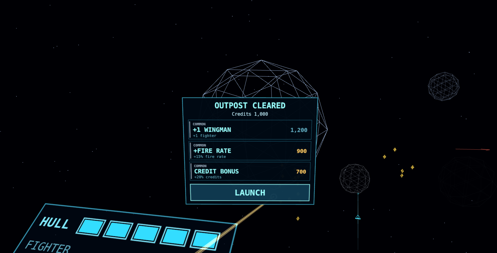 | 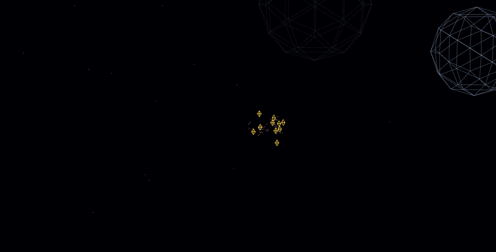 | 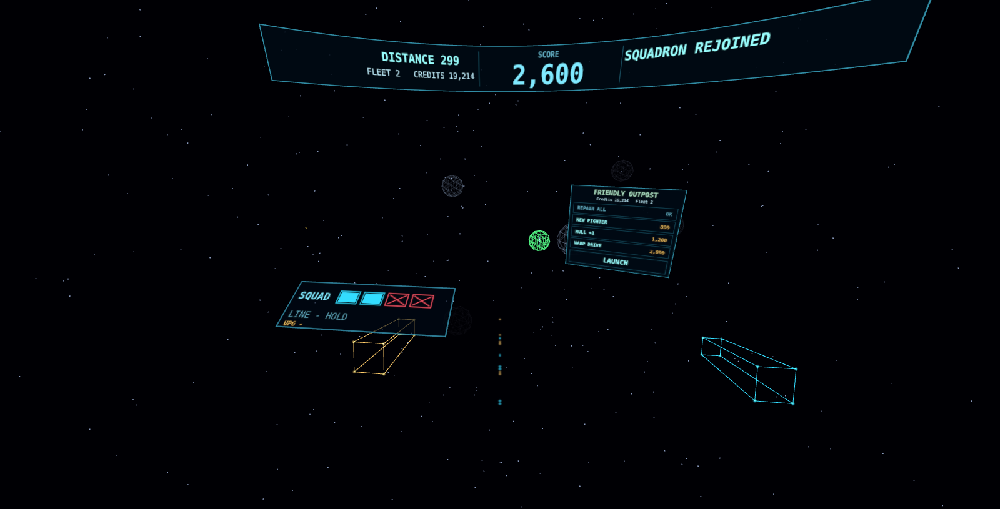 |

| At warp | The enemy homeworld (wave 1) | VICTORY |
|---|---|---|
| 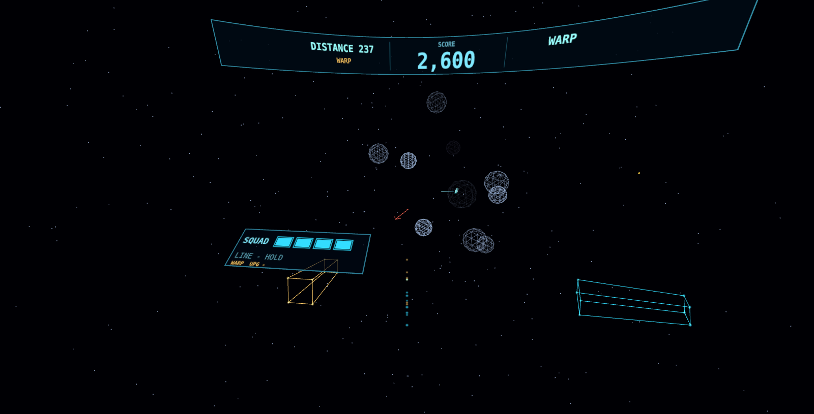 | 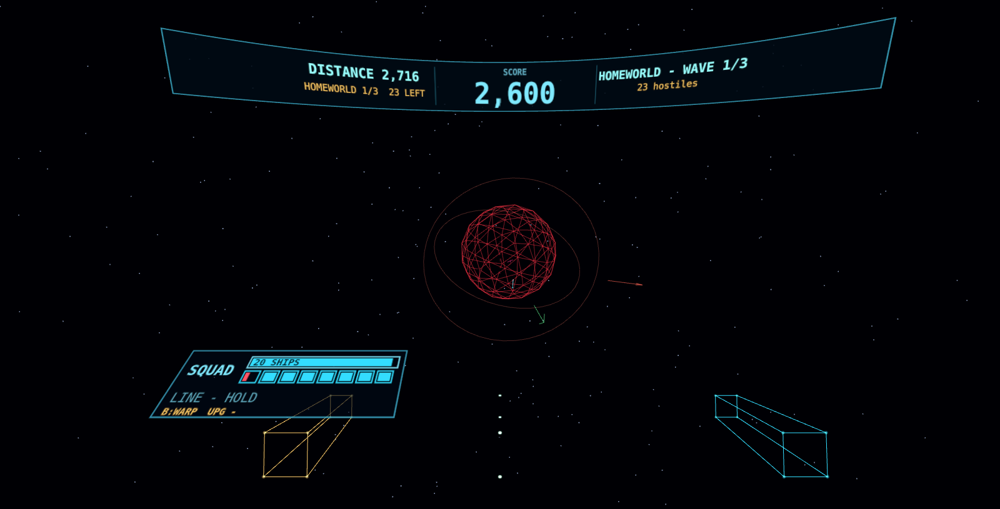 | 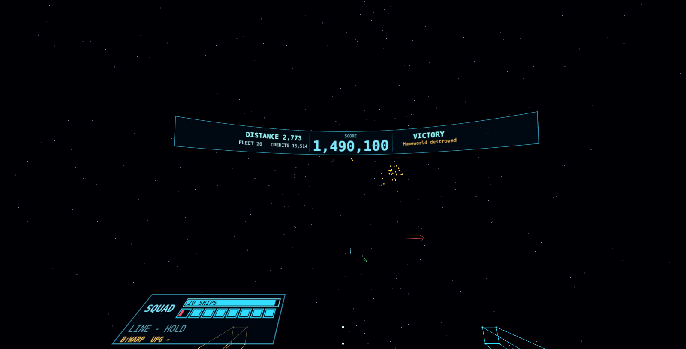 |

| Wrist, 10 ships (two rows) | Wrist, 20 ships (fleet bar + weakest 8) |
|---|---|
| 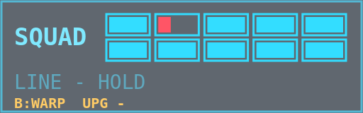 | 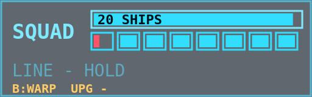 |

## Changes in v33

- The game is now called **COMMAND ROOM** (page title, ENTER VR screen, tutorial). The repository and web
  address keep the old name for now.
- **Endless** is harder and more varied: score is earned only (no points for distance), tougher outposts
  (more ships, smarter from tier 2, more hull further out, more for a bigger fleet, and a little tougher
  every 2 minutes), roaming patrols,
  asteroid fields that actually show up (and are visible from a distance), gold bounty outposts, a fleeing
  treasure ship, credit pickups, combos, distance milestones, music that reacts to all of it, and an upgrade
  system: 3 cards per cleared outpost from a pool of 14 in four rarities, bought with credits.
- Fighter and Squadron are exactly as before.

Autopilot runs (the test autopilot, 8x simulation speed, minutes of game time per run):

| Mode | Runs | Average | Median | Shortest - longest | Notes |
|---|---|---|---|---|---|
| Fighter (unchanged) | 25 | 1.8 min | | 0.9 - 3.2 min | |
| Squadron (unchanged) | 13 | 3.7 min | | | 1 more run unfinished when the budget ran out |
| Endless v32 (before) | 1 | - | | still alive after 60 min | 131 outposts, every upgrade maxed: it never ended |
| **Endless v33 (after)** | 24 | **3.4 min** | 1.8 min | 1.0 - 34.5 min | every run ended; the best reached 37 outposts and round 27 |

| Upgrade cards (colour-coded by rarity) | Asteroid field from a distance | Bounty outpost (gold) |
|---|---|---|
|  |  |  |

| Credit pickups + combo | Patrol (with homing missiles) | Treasure ship |
|---|---|---|
|  |  |  |

## Changes in v32

- **Default layout** from the user's headset photo: new players start with the **Small** box at the default
  spot, with the ring, Settings and Stats placed around it as in the photo. Saved box settings are kept;
  Box position RESET returns to the default spot. Rendered from a similar leaned-back seat, and again with
  the photo's outlines (box, ring, panels) traced on top in pink:

  

- **START** with Settings and / or Stats open closes them (their normal fade) and starts the game.
- **Split:** the blue pair (right hand) is now the ships on the **right** of the heading and the gold pair the
  left (v31 and before had it the wrong way round, so the pairs crossed over). An odd ship goes to blue.
- **Endless:** stars never overlap; landing is a real flight (approach, line-up, touch-down) while the view
  glides; a split squadron rejoins to land; X does nothing while landed; no fleet limit (formations scale);
  the split view centre is weighted 60 / 40 toward blue; the outpost popup is depth-correct and picks the side
  with a clear view.

## Changes in v31

- **Steering:** forward is now the room's own front axis (level), so pointing the controller along it always
  flies straight away, even with the room moved to the side, after head movement or a re-centre. (Before, the
  neutral was the direction from the seat to the room, which drifted when the room was off-centre.) Yaw and
  pitch are scaled separately with unwrapped angles, so turning is continuous all the way round: no 180-degree
  clamp, no snap, no jitter.
- **Side panels** turn more toward you on a smooth asymptotic curve (about 31 degrees at the usual spots, max 42).
- **Endless:**
  - Tiers (difficulty and reward) step every 36 units instead of 45 (about 25% steeper).
  - The outpost destroy effect is toned down: one faint ring, fewer sparks, a gentle flicker, a quieter boom,
    a very short hit-stop.
  - After you clear an outpost, your ships glide onto the star by themselves (about 1 s) and land. A small panel
    beside the star offers the upgrade. Friendly outposts work the same way: fly onto the green star and the
    panel offers repair and buy. **LAUNCH** on the panel is the only way to take off; steering does nothing while
    landed, landed ships can't be hurt, and the game never pauses.

## Changes in v30

- Endless: there is no home star (you start beside an ordinary star), and every star is the same size.
- Outposts are stars: red for enemy outposts and green for friendly ones (no rings). Green stars are safe
  zones.
- Destroying an outpost: shockwave, debris, the star flickers, collapses and turns grey, with a big boom and
  a hit-stop. There is no pause any more: land on the star and pick the upgrade on the ring. Friendly outposts
  work the same way (repair and buy on the ring). Take off by steering away.
- The view window is wider (1.6x), far stars fade gradually, and outposts are closer together.
- The direction arrows are now long-shaft arrows with two short prongs, slowly turning about their axis.

## Changes in v29

- The ring's **SETTINGS** button is lit while Settings are open (like STATS).
- **Fighter backdrop:** no rounds, the room never changes, enemies just respawn, the blue ship can't be
  destroyed, no announcements.
- **The lobby room never changes size or shape**, in any backdrop or when switching; only your grip-resize does.
- **Endless backdrop:** a real preview (no walls, same volume): a small blue group explores, passes an asteroid
  field, fights a small red outpost; it can be lost and comes back as a fresh group. Cross-fades like the others.

## Changes in v28

- **Endless mode** (third mode on the ring): open space round a centred ship, seeded stars, outposts with
  tiers that rise with distance, asteroid fields, docks to repair and buy ships, upgrade choices, permanent
  losses, best distance and best score saved.
- The stats panel's Endless section now shows real numbers.

| Lobby (three modes) | Stats |
|---|---|
|  |  |

## Changes in v27

- **Holo ring is the only layout:** the Layout setting, the command table, the twin pillars and the old side
  board are gone.
- The ring sits lower (about 18 degrees above straight ahead instead of 23 for the default room), its bottom
  edge always above the room, and is depth-tested so ships in front of it show over it. In the lobby it stays
  still when the room reshapes.
- **STATS** button on the ring: a stats panel to the right of the room (slide + fade, like Settings on the
  left), with Fighter, Squadron and Endless sections; per-mode best score, kills, time and win streak tracked.
- **The lobby backdrop follows the selected mode:** Fighter shows a bot-on-bots Fighter battle (autopilot ship
  vs real Fighter waves, Fighter room); Squadron the squad skirmish; switching cross-fades in about 0.65 s.

## Changes in v26

- **Layout setting** with three panel layouts, switchable live and saved: **Command table** (default), **Holo
  ring** and **Twin pillars**. The separate lobby panel beside the room is
  replaced by the layout's menu.
- Command table: cards stand up when pointed at or in use and are always kept under the eye-to-room-front-bottom
  line, so they never cover the battle; the table follows the room and never touches it.
- Holo ring: important items kept near the middle of the arc, stats on their own thin line, fewer separators.
- Twin pillars: wider pillars, short labels, wrapped announcements; Settings replaces the menu pillar while open.
- Pointing works the same on the curved ring (beam, cursor and clicks).

## Changes in v25

- **Grip-drag scales with the room size:** the room moves by your hand's movement times a gentle gain,
  sqrt(size / medium size) kept to 0.7 - 1.6 (small 0.84, medium 1.0, large 1.14, biggest 1.41). It is
  applied frame by frame, so a grab never jumps when it starts or when you resize during it.

## Changes in v24

- **Thousands separators:** scores read like `18,450` everywhere: the side-board score in play and at game
  over, the ace and round bonus announcements (also in the desktop `?test` message box), and the lobby's Best
  score, Total kills, Games played and per-mode games. One shared formatter (`fmtNum` in `js/stats.js`).
- **Fix:** an ace killed outside the enemy update (e.g. overkill in one frame) could briefly be treated as
  still alive and announce "ACE IS RUNNING" over its "ACE DOWN!" bonus; dead enemies are now skipped.
- Before / after pairs of every place a score appears: `screenshots/compare/<place>-before.png` and
  `-after.png` (lobby-stats, sideboard-score, ace-bonus, round-bonus, game-over, desktop-message).

## Changes in v23

- **Screen time:** a new stat that adds up every second spent in the headset (lobby, tutorial and battles).
  It is saved every 15 s and when the VR session ends, and the lobby row ticks up live.
- **Lobby stats:** "Time played" is now **Time in battle**, and a **Screen time** row is added. The six rows
  are slightly tighter (40 px apart, 24 px text), so they still clear the REDO TUTORIAL / SETTINGS buttons.

## Changes in v22

- **Gentler panel angle:** the lobby panel, Settings, the tutorial card and the side board turn only half-way
  toward your seat, capped at 22 degrees (was fully facing you, which looked sharply angled). Still fixed, vertical
  axis only.
- **Pointer beam in front of panels:** the panels are drawn on top of the room, and they used to be drawn over the
  beam too, so the beam looked as if it went behind or through them. The beam and line are now drawn after the
  panels and the cursor last. The beam stops exactly at the hit point, and the cursor sits just in front of the
  surface.

## Changes in v21

- **UI pointer:** over a panel the ray becomes a brighter, slightly thicker beam with a small ring cursor at the
  hit point, fading in / out (~0.15 s). Off the UI it stays a faint line.
- **Settings toggle:** the lobby SETTINGS button closes Settings again when they are open (X + Y already did).
- **Lobby keeps running with Settings open**, and the room can be grip-moved / resized; in a game too
  (the battle is paused while Settings are open, so you can't die).
- **Opening animation** from the lobby: the Settings panel slides from the lobby panel to the left and fades
  in (0.3 s); in a game it fades in; closing is a quick fade.
- **Fixed panel orientation:** panels face the spot where you sit (captured once on entering VR) instead of
  turning with your head every frame.
- **Left menu (☰) button:** not available. The Quest Browser's WebXR gamepad for the Touch controllers has
  7 buttons (0 trigger, 1 grip, 2 unused, 3 thumbstick, 4 X, 5 Y, 6 thumbrest; this is the layout recorded from
  real Quest headsets that the IWER emulator reproduces). There is no menu button in it: the system keeps that
  button for its own menu, so it never reaches the page. Settings stay on **X + Y**. The game
  still listens for a menu button at index 7 in case a browser ever exposes one, and with `?test` it logs each
  controller's button count and profiles when it connects.

## Changes in v19

- **Tutorial:** plainer card (title, one line, picture, NEXT, skip): no progress bar, step counter, section or
  hand label. Nothing glows on the 3D controllers any more. 18 steps (no steering-style picker, no roll).
- **Inputs:** **X** (tap) = split / rejoin in Squadron (on release, only if Y wasn't pressed, so X + Y still
  opens Settings). **A** = next formation in Squadron (still brake in Fighter; in Squadron, brake is the left
  stick back). The **left stick click** resets the box again in both modes. **B** has no job.
- **Steering is one style only** (absolute mirror steering). Relative, Point and Thumbstick, the steering
  setting, the turn-speed setting and the tutorial's style picker are gone; the gain settings stay.
- **Absolute forward:** the neutral is fixed in the world: level, pointing from you to the room. Pointing that
  way always flies the ship or squadron straight into the box. No re-centring (the right stick click does
  nothing), no drift. The gold pair uses the same neutral with the left hand.
- **Barrel roll removed** (input, sound, tutorial step, wrist status).
- **Aces are just "ACE"** (no names).
- **Side board:** all announcements and the score (always visible, big) on an invisible board right of the
  room. Nothing pops up in front of the battle, and the wrist message panel is gone. The wrist shows only
  hull / bots and the squadron's formation / split state.

## Changes in v18

- **Juice:** freeze-frame + rumble on kills, spark bursts with a flash ring, hit flashes, frame glow,
  red view-edge flash when hit from behind, rumble when hit. No camera shake.
- **Squadron split** into two pairs, one per hand; **formations**. (v19: X splits, A changes formation.)
- **Smarter bots** when engaging (heading cone, focus fire, damaged targets first, no head-on runs, hurt bots pull back).
- **Smarter enemies:** leaders with escorts, screens, wider flanks, more spacing, scatter when the leader dies;
  difficulty grows mostly by behaviour, numbers only modestly.
- **Aces** that escape and come back, with a big bonus when shot down.
- **Barrel roll** dodge in Fighter (wrist flick). (Removed in v19.)
- **Sound:** new effects and procedural **music**, Music / Sound volume sliders.
- Tutorial: new steps for the split, leading the gold pair, rejoin and formations.

**Input changes (v18; see v19 for the current buttons):** while split, the left trigger / grip / stick
command the gold pair instead of being extras for the whole squadron. X + Y (settings) is unchanged.

**Mix check** (rendered offline with an OfflineAudioContext at the default volumes, then measured):

| Segment | Peak | RMS | Energy above 5 kHz | Clipped samples |
|---|---|---|---|---|
| Lobby pad | -10.7 dBFS | -23.3 dBFS | -48 dB | 0 |
| Battle, calm | -6.9 dBFS | -23.1 dBFS | -30 dB | 0 |
| Battle, full intensity | -5.4 dBFS | -20.6 dBFS | -29 dB | 0 |
| Full intensity + a busy fight (shots, 7 explosions, hits, chimes) | -2.8 dBFS | -18.7 dBFS | -26 dB | 0 |

The first render was bass-heavy (most energy below 250 Hz, which the Quest's small speakers can't play), so the
bass and kick were turned down and the arpeggio and pads up by a few dB. Very little energy sits above 5 kHz, so
it isn't harsh.

## Changes in v17

Fleet mode and the Command School campaign are gone (with deployment, ship classes, ranks, XP, stars and
unlocks, and the Fleet part of the tutorial). Fighter and Squadron play exactly as before; Squadron's bot
pilots are unchanged.

## Not done yet / ideas

- More comfort options (seated height)
- So far it has only been tested in an emulator (IWER) and in desktop Firefox, not yet on a real Quest
