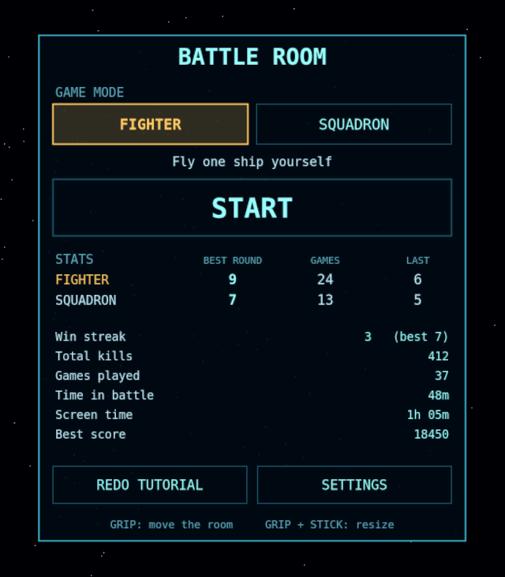
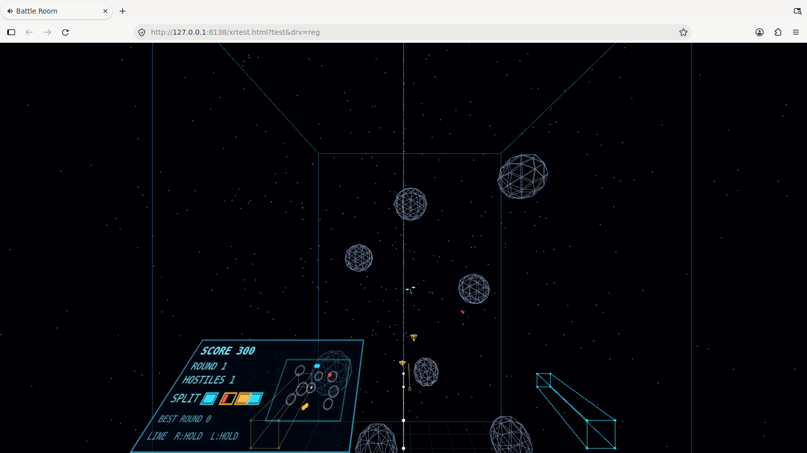
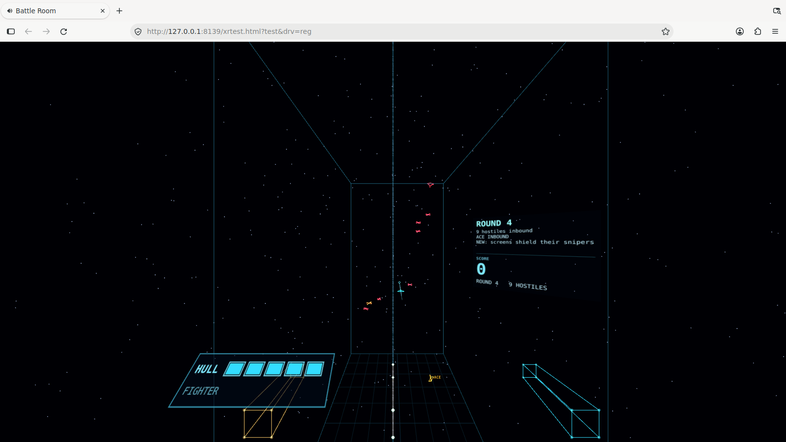
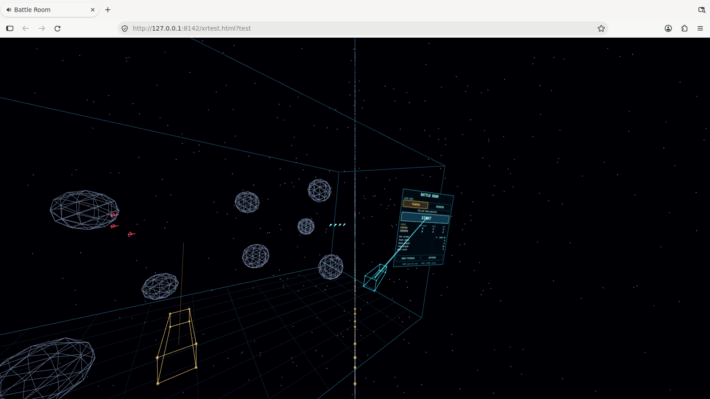

# Battle Room

A seated, **tabletop** wireframe space battle for **Meta Quest 3 / 3S**, inspired by the
battle-room simulator in *Ender's Game*. The whole battle plays out as a miniature
inside a wireframe room (about 1 m across, changing shape between rounds) floating in front of you, so you never have to turn
or move.

It is a WebXR web page built with three.js. It runs in the Quest's built-in browser, so you
don't need to install an app or turn on developer mode. **It is VR only:** the page shows a single
**ENTER VR** button. In a browser without WebXR, or with no headset, a short note under the button says so.

There are two modes: **Fighter** (fly one ship yourself) and **Squadron** (lead 4 bot fighters, or split
them into 2 pairs and lead one pair with each hand).

## Tutorial

The first time you enter VR, a short tutorial runs automatically (about 2 minutes, 18 small steps).
It teaches **one thing per step** on a single, plain card beside the room's right wall:

- a short **title**
- **one line** saying what to do ("Pull right trigger")
- a **picture**: a Quest Touch controller in that hand's colour (right = cyan, left = gold) with the button to
  use lit green, and what it does
- a **NEXT** button: lit when you can press it, dim while the step waits for you; and a subtle **skip tutorial**

Nothing is highlighted on the controllers in your hands; the picture on the card is enough. Each card fades in,
gives you a moment to read it, then waits for you to do the thing. When you do, a check mark shows for a
moment and the card fades into the next step (or press the lit **NEXT** straight away). Steps that only
explain something wait for **NEXT**.

The steps:
1. **Room:** your battle room; move it (grip and move your hand); resize it (grip + stick).
2. **Fly:** steer your ship; shoot; boost; destroy one practice target, then three more.
3. **Squadron:** your 4 fighters; lead them; attack (hold trigger); regroup (let go); finish the enemies;
   **split** them into 2 pairs (**X**); **lead the gold pair** with your left hand; **rejoin** (**X** again);
   switch **formation** (**A**).
4. **Training complete**: press **TO LOBBY**. Completion is saved on the device.

Practice ships never shoot and nothing of yours can be destroyed during training. **REDO TUTORIAL** in the
lobby runs it again.

## Lobby

After the tutorial, every time you enter VR, and a few seconds after a game ends, you are in the **lobby**.
A blue-vs-red skirmish plays out around the stars in the room as a backdrop.

- **Grip** (either hand) and drag to move the room; **grip + that hand's stick up/down** resizes it.
- The **panel on the right** of the room (point with either controller's ray, pull the trigger):
  - **GAME MODE:** Fighter / Squadron, with a one-line description.
  - **START**.
  - **Stats** (saved on the device): best round, games and last round for each mode, win streak (a "win" is a
    game in which you cleared at least round 1; the streak counts wins in a row) and best streak, total kills,
    games played, **time in battle** (time spent in games), **screen time** (all time in the headset: lobby,
    tutorial and games; shown like `1h 05m`, saved every 15 s and when you leave VR) and best score.
  - **REDO TUTORIAL** and **SETTINGS**.

Settings (left **X + Y**, or the lobby **SETTINGS** button; press either again to close) open on a panel to
the **left** of the room. From the lobby the panel slides over from the lobby panel to its spot in about 0.3 s,
fading in, so you can see where it went; closing is a quick fade. With Settings open:
- **In the lobby** nothing stops: the skirmish keeps playing, and you can still grip-move and grip + stick resize
  the room.
- **In a game** the battle is **paused** (so nothing can hit you while you read), and you can grip-move and
  grip + stick resize the room too. Close Settings to carry on.

The two **volume sliders** (Music, Sound) work like the other rows: point at the bar and pull the trigger
where you want the level.

## Rounds: every round is a fresh battle

Both modes are played in **rounds**, and the goal is to reach the highest round you can.
Your score keeps adding up across rounds, and each cleared round gives a bonus of 500 x the round number.
The best round you have reached is saved for each mode (see the lobby stats).

- **Each new round fully resets the battlefield.** Your side comes back at full strength in
  its start position: in Fighter your ship has full hull; in Squadron all 4 bots have full hull.
  The enemy spawns fresh. Nothing carries over, so you lose only if your side is wiped
  out within a single round. When you lose, you're back in the lobby a few seconds later.
- **The room reshapes** between rounds, and in Squadron the **stars** fade out and come
  back in **new random positions** that suit the new room shape. They are kept clear of your
  start area, and no ship is ever left inside a star.
- **The enemy gets harder and smarter every round.** Each round brings more ships, faster bullets
  and better aim. Their shot leading starts at about half and is perfect from round 5. New tactics unlock as you go, and the
  round-start announcement names any new one:

  | Round | New enemy tactic | Modes |
  |---|---|---|
  | 1 | Pincers and flankers, retreat when damaged | Both |
  | 2 | **Focus fire** on your most exposed ship; **bait and ambush** | Squadron |
  | 3 | **Hiding behind stars** (snipers and damaged ships) | Squadron |
  | 3 | **Retreat and regroup:** damaged ships fall back to their wingmen; outnumbered ships pull back | Both |
  | 5 | **Synchronized strikes:** every attack group times its run to hit at the same moment | Both |
  | 5 | **Dodging your shots:** many enemy ships side-step incoming bullets | Both |
  | 6 | **Hunter-killers:** a fast pack that chases your most damaged ship | Both |
  | 3 | **Leaders with escorts:** an orange leader flies with escorts; kill it and the escorts scatter | Both |
  | 3+ | **Aces** (sometimes; see below) | Both |
  | 4 | **Screens:** a ship that parks itself between you and a sniper, leader or heavy to shield it | Both |

  Difficulty grows mainly through **behaviour**, not numbers: a round adds only about one ship
  (Fighter rounds 1-10: 3, 4, 7, 8, 9, 12, 12, 13, 16, 16 ships; Squadron: 4, 8, 11, 13, 14, 17, 17, 18, 21, 21).
  Enemies keep more space from each other, flankers swing wider, and nobody shoots while scattering.

- **Aces.** From round 3 an **ACE** sometimes joins, in **gold** with "ACE" over it.
  It is faster, tougher and always dodges, and flies boom-and-zoom attack runs, breaking off before it gets close.
  When it is badly hurt it **runs for a wall**: if it escapes, it comes back in the next round with one more
  hull point. Shooting one down is a big moment: a longer freeze-frame, a strong rumble, a gold flash of the room,
  **ACE DOWN!** and a bonus of 1500 x round (more for an ace that escaped before).

  

### Fighter

You fly one cyan ship and win round after round against red ships. The battle room is much bigger than
the ships, so there is plenty of room to manoeuvre.

The enemies fight in groups with real plans:
- **Pincer pairs** swing out to opposite sides of you, then attack together.
- **Flankers** circle round to come at you from the side or behind, make a pass, and swing out again.
- **Snipers** (from round 2) hold long range and fire accurate shots.
- **Heavies** (cruisers, from round 3) hold medium range and fire 3-shot spreads.
- Everyone **leads their shots** (aims where you will be), and pulls back for a moment when damaged.
- From round 3, **leaders** (orange, bigger) with **escorts**, **screens** and sometimes an **ace** (see above).

Your hull has 5 points, back to full at the start of every round. Lose them all in one round and it's game over.

### Squadron

A much bigger, zoomed-out battlefield with smaller ships. You command **4 friendly bot
fighters**. You don't fly them: the right controller is a **command**. Where it points (3x gain by
default) sets the heading of the squadron, shown by the cyan aim line
and ring. The bots fly their own ships. They keep a side-by-side formation, steer toward
the commanded heading, dodge incoming bullets, and never run into each other.

- **Hold the right trigger = engage.** The bots spread out a little, staying on a leash
  around the group centre, and each one attacks the nearest enemy. A bot only fires when
  the line is clear, so never through a wingman or a star. Release to regroup into
  formation and carry on in the commanded direction.
- **Right grip = boost.** It only works while NOT engaging, and the whole squadron boosts together.
- **Smarter bots when engaging:** each bot prefers enemies **ahead of the commanded heading** (a cone,
  weighted by distance) and **damaged** enemies, so they finish targets off. Bots don't fly straight down an
  enemy's guns (they come in at an angle), and a bot down to its last hull point **pulls back** into the
  formation while a healthier wingman fights (it still takes shots at anything right in front of it).
  Dodging and formation flying are unchanged.
- **Formations (A):** line -> wedge -> ring.
  - **Line** (default): side by side; when engaging, **two bots per target**.
  - **Wedge**: a V; when engaging, **all on one target**, faster, on a shorter leash.
  - **Ring**: a tight ring; bots spread over the nearest threats and stay close to the centre.
- **Split (tap X):** the squadron splits into **2 pairs**. The **cyan pair** follows your
  **right** controller as before; the **gold pair** follows your **left** controller (its own gold command point
  and aim line), with the same steering, **left trigger = engage** and **left grip = boost**. Tap X
  again to **rejoin**. (The split happens when you let go of X, and only if Y wasn't pressed, so X + Y for
  Settings never splits.) The wrist panel shows SPLIT, each bot's hull box in its pair's colour, and what each pair
  is doing (R: / L: ATTACK or HOLD). If a whole pair is lost, the squadron rejoins automatically.

- **Stars:** big wireframe spheres. Nothing can fly through them and they block bullets, so
  both sides use them as cover. Ships steer around them. They are spread through the room in
  proportion to its current shape, in new random positions every round.
- **Enemies** come in coordinated groups:
  - Pincers and flankers **focus fire** on your most exposed bot (the one furthest from its wingmen).
  - Snipers **hide behind stars** and step out to shoot.
  - From round 2, a **bait** ship flies in close and then runs back to a star where two
    **ambushers** are hiding.
  - Enemies **fall back to cover when outnumbered** and pull back when damaged.
  - Rounds get bigger and the enemies get faster, more accurate and smarter (see Rounds above).
- Each bot has 3 hull points. A destroyed bot is gone for the rest of the round; every new
  round starts with all 4 back at full hull. Lose all 4 within one round and it's game over.
  The wrist panel shows each bot's hull.

**Wrap-around (both modes):** fly out through one face of the box and you come back in
through the opposite face. Enemies wrap too. Your view never moves and the game never turns you.

**The room changes shape (both modes):** width, height and depth vary independently, so the
room may be a long tunnel, a flat slab, a tall tower or a cube. A new shape is picked for
every game, and between rounds the room smoothly reshapes itself, keeping every ship inside.
The volume stays about the same, so the difficulty stays fair, and the size is capped (at
most about 1.5 m wide or deep, 1.35 m tall with the Medium box size). A deeper room grows
away from you, so its near face never comes closer.

**Juice (both modes):** kills give a tiny freeze-frame (about 40-55 ms) and a rumble; explosions burst into
sparks with a short flash ring and a bright core; hit ships flash white and throw sparks; the room's frame
glows briefly on kills and hits. **Hit from behind**, the edges of your view flash red (and the left controller
rumbles) so you know to look out. There is **no camera shake**: the view never moves (VR comfort).

**Sound and music:** all synthesized (WebAudio, no files). Shots, layered explosions (body, sub drop and
crackle; big ones dip the music for a moment), boost whoosh, hits, and short chimes for
split / rejoin / regroup / formation / ace. Music is procedural, in D minor: a calm ambient pad in the lobby,
and in battle a driving synth track (bass, arpeggio, drums, 112 BPM) whose layers build up with the number of
enemies alive and your recent kills. Everything goes through a compressor and a limiter, so it never clips.
Music and Sound volume are separate sliders in Settings.

**The side board (both modes):** an invisible board floats just outside the room's **right** wall, about
30 degrees right of straight ahead. **All announcements** appear at its top (round start and new enemy
tactics, round cleared, ace, leader down, wingman down, split / formation, game over...), and your **score**
is always shown big below them, with the round and the number of hostiles. Nothing ever pops up in front of
the battle. Your **wrist** only shows your hull (Fighter) or your 4 bots' hull and the formation / split state
(Squadron).

## Controls

### Quest (VR, seated)

| Hand | Input | Fighter | Squadron |
|---|---|---|---|
| Right | **Point / turn the controller** | **Absolute forward:** hold the controller level, pointing at the room (away from you), and the ship flies straight into the box, whatever you did before. Turn away from that and the ship turns the same way, times the gain (default **2x**: 45° = 90°), in any direction including loops, without flipping. Turns past 180° stop at 180°. Wrist roll is ignored. No re-centring, no drift. | Same, for the squadron's heading (default gain **3x**) |
| Either | **Ray + trigger** on a panel | Press lobby, tutorial and settings buttons | Same |
| Either | **Grip** (lobby and tutorial) | Drag to move the room; with that hand's **stick up/down**, resize it | Same |
| Right | **Trigger** | Shoot (gentle aim assist) | **Hold = engage**, release = regroup |
| Right | **Hold the grip** | Boost | Boost the squadron (only while not engaging) |
| Right | **A** | Brake | **Next formation**: line / wedge / ring |
| Left | **Trigger / grip / stick forward-back** | Extras: shoot / boost / boost-brake | Joined: same extras for the squadron. **Split: they command the gold pair** (engage / boost / boost-brake) |
| Left | **Tap X** | - | **Split / rejoin** the squadron |
| Left | **Point / turn the controller** | - | **Split:** steers the gold pair (same absolute forward) |
| Left | **Click the thumbstick** | Put the box back in its default spot | Same |
| Left | **X + Y together** | Settings open / close, on a panel to the left of the room (point and pull the trigger to change; a game pauses meanwhile) | Same |
| Left | **Look at your wrist** | Hull | Your 4 bots' hull, formation, split state |

Right B and the right stick click do nothing. Steering is always this one style (there are no other steering modes).

### Settings (saved on the device, as are the box position and size)

| Setting | Options | Default |
|---|---|---|
| Game mode | Fighter / Squadron | Fighter |
| Steering gain (Fighter) | 1x / 1.5x / 2x / 2.5x / 3x / 3.5x | 2x |
| Steering gain (Squadron) | 1x / 1.5x / 2x / 2.5x / 3x / 3.5x | 3x |
| Box size | Small 0.7 m / Medium 1.0 m / Large 1.3 m | Medium |
| Music volume | slider 0-10 | 6 |
| Sound volume | slider 0-10 | 8 |
| Box position | RESET puts the box back in its default spot | |
| Leave game | TO LOBBY ends the current game and goes back to the lobby | |

Changing the mode during a game restarts in the new mode.

### Testing without a headset (developers only)

Players only get the ENTER VR button. For testing, `?test` turns on hidden desktop controls and a
debug HUD, and sends errors and status lines to a local test server:

| Input | Action |
|---|---|
| Mouse | Steering: the ship (or squadron heading) points where the mouse points |
| Left click / Space | Shoot (Squadron: hold to engage) |
| Shift / F | Boost / brake |
| N | Switch mode (Fighter / Squadron) |
| G | Split / rejoin (Squadron; the gold pair copies the mouse) |
| B | Next formation (Squadron) |
| + / - | Box size |
| C | Reset the box |
| Right-drag or arrow keys | Look around |
| Tab or the gear button | Settings |
| Enter / R | Start / restart |
| L / T | Lobby / tutorial |

Extra test options (with `?test`): `&demo` autopilot, `&mode=fighter|squadron`, `&wave=5` start at round 5,
`&sim=6` run the simulation 6x faster, `&bench` let a test script drive games.

## Getting it onto the Quest

**Live copy:** https://willcoding11.github.io/vr-battle-room/ (GitHub Pages). Open it in the
Quest Browser and press **ENTER VR**.

WebXR only works over **HTTPS** (or `localhost`), so the files must be served from an HTTPS
address. The folder is plain static files (`index.html`, `js/`, `vendor/`), so there is no
build step.

1. **Simplest: a static host.** Put the folder on any HTTPS static host, such as GitHub
   Pages, Netlify Drop or Cloudflare Pages. Open the URL in the Quest Browser and press
   **ENTER VR**. Tip: bookmark it in the Quest browser.
2. **Local, over USB, no hosting.** On a PC with `adb` and the Quest in developer mode, run
   `adb reverse tcp:8000 tcp:8000`. Then run `python -m http.server 8000` in this folder
   and open `http://localhost:8000` on the Quest. `localhost` counts as secure.
3. **Local Wi-Fi.** Serve the folder over HTTPS with a self-signed certificate, for example
   `npx http-server -S` or `caddy`, and accept the warning in the Quest browser.

When you are in the Quest browser, sit down, then press **ENTER VR**. If the battle sits too
high or too low, hold the Meta button to recentre, change the box size in Settings, or click
the left stick to put the box back in its default spot.

## Files

- `index.html` - page with the ENTER VR button (plus the hidden test HUD)
- `js/main.js` - game: scene, input, player, enemy AI, squadron bots, stars, rounds and enemy tactic unlocks, lobby, HUD, effects
- `js/ui.js` - VR panels (canvas text and buttons picked with a controller ray) and the animated controller icons
- `js/controller.js` - the wireframe controller gizmos at your hands
- `js/tutorial.js` - the step-by-step tutorial
- `js/stats.js` - stats saved on the device (localStorage)
- `js/models.js` - wireframe ship models (points joined by lines)
- `js/audio.js` - synthesized 3D sound effects and the mix (WebAudio, no audio files)
- `js/music.js` - procedural music: lobby pad and the battle track
- `vendor/` - three.js r187 (`three.module.js`, `three.core.js`), MIT licence
- `screenshots/` - screenshots (test mode and the IWER headset emulator)

**Pointing at panels.** Each controller has a faint ray. When it is over a panel (lobby, settings, tutorial
card), the ray brightens into a slightly thicker beam and a small ring cursor shows where it meets the panel;
both fade in and out in about 0.15 s.

The beam ends exactly at the cursor (its length is the hit distance) and is drawn after the panels, so no part
of it shows behind or through a panel; the cursor ring sits 2 mm in front of the surface.

**Panels stay still.** The lobby panel, Settings, the tutorial card and the side board are placed beside the room
and turned only part of the way toward where you sat when you entered VR: half-way between square to the
room's front face and facing you, capped at 22 degrees, about the vertical axis only. They never follow your
head; they are only re-placed when you move, resize or reshape the room (or re-centre with the Meta button).

## Changes in v24

- **Thousands separators:** scores read like `18,450` everywhere: the side-board score in play and at game
  over, the ace and round bonus announcements (also in the desktop `?test` message box), and the lobby's Best
  score, Total kills, Games played and per-mode games. One shared formatter (`fmtNum` in `js/stats.js`).
- **Fix:** an ace killed outside the enemy update (e.g. overkill in one frame) could briefly be treated as
  still alive and announce "ACE IS RUNNING" over its "ACE DOWN!" bonus; dead enemies are now skipped.
- Before / after pairs of every place a score appears: `screenshots/compare/<place>-before.png` and
  `-after.png` (lobby-stats, sideboard-score, ace-bonus, round-bonus, game-over, desktop-message).

## Changes in v23

- **Screen time:** a new stat that adds up every second spent in the headset (lobby, tutorial and battles).
  It is saved every 15 s and when the VR session ends, and the lobby row ticks up live.
- **Lobby stats:** "Time played" is now **Time in battle**, and a **Screen time** row is added. The six rows
  are slightly tighter (40 px apart, 24 px text), so they still clear the REDO TUTORIAL / SETTINGS buttons.

## Changes in v22

- **Gentler panel angle:** the lobby panel, Settings, the tutorial card and the side board turn only half-way
  toward your seat, capped at 22 degrees (was fully facing you, which looked sharply angled). Still fixed, vertical
  axis only.
- **Pointer beam in front of panels:** the panels are drawn on top of the room, and they used to be drawn over the
  beam too, so the beam looked as if it went behind or through them. The beam and line are now drawn after the
  panels and the cursor last. The beam stops exactly at the hit point, and the cursor sits just in front of the
  surface.

## Changes in v21

- **UI pointer:** over a panel the ray becomes a brighter, slightly thicker beam with a small ring cursor at the
  hit point, fading in / out (~0.15 s). Off the UI it stays a faint line.
- **Settings toggle:** the lobby SETTINGS button closes Settings again when they are open (X + Y already did).
- **Lobby keeps running with Settings open**, and the room can be grip-moved / resized; in a game too
  (the battle is paused while Settings are open, so you can't die).
- **Opening animation** from the lobby: the Settings panel slides from the lobby panel to the left and fades
  in (0.3 s); in a game it fades in; closing is a quick fade.
- **Fixed panel orientation:** panels face the spot where you sit (captured once on entering VR) instead of
  turning with your head every frame.
- **Left menu (☰) button:** not available. The Quest Browser's WebXR gamepad for the Touch controllers has
  7 buttons (0 trigger, 1 grip, 2 unused, 3 thumbstick, 4 X, 5 Y, 6 thumbrest; this is the layout recorded from
  real Quest headsets that the IWER emulator reproduces). There is no menu button in it: the system keeps that
  button for its own menu, so it never reaches the page. Settings stay on **X + Y**. The game
  still listens for a menu button at index 7 in case a browser ever exposes one, and with `?test` it logs each
  controller's button count and profiles when it connects.

## Changes in v19

- **Tutorial:** plainer card (title, one line, picture, NEXT, skip): no progress bar, step counter, section or
  hand label. Nothing glows on the 3D controllers any more. 18 steps (no steering-style picker, no roll).
- **Inputs:** **X** (tap) = split / rejoin in Squadron (on release, only if Y wasn't pressed, so X + Y still
  opens Settings). **A** = next formation in Squadron (still brake in Fighter; in Squadron, brake is the left
  stick back). The **left stick click** resets the box again in both modes. **B** has no job.
- **Steering is one style only** (absolute mirror steering). Relative, Point and Thumbstick, the steering
  setting, the turn-speed setting and the tutorial's style picker are gone; the gain settings stay.
- **Absolute forward:** the neutral is fixed in the world: level, pointing from you to the room. Pointing that
  way always flies the ship or squadron straight into the box. No re-centring (the right stick click does
  nothing), no drift. The gold pair uses the same neutral with the left hand.
- **Barrel roll removed** (input, sound, tutorial step, wrist status).
- **Aces are just "ACE"** (no names).
- **Side board:** all announcements and the score (always visible, big) on an invisible board right of the
  room. Nothing pops up in front of the battle, and the wrist message panel is gone. The wrist shows only
  hull / bots and the squadron's formation / split state.

## Changes in v18

- **Juice:** freeze-frame + rumble on kills, spark bursts with a flash ring, hit flashes, frame glow,
  red view-edge flash when hit from behind, rumble when hit. No camera shake.
- **Squadron split** into two pairs, one per hand; **formations**. (v19: X splits, A changes formation.)
- **Smarter bots** when engaging (heading cone, focus fire, damaged targets first, no head-on runs, hurt bots pull back).
- **Smarter enemies:** leaders with escorts, screens, wider flanks, more spacing, scatter when the leader dies;
  difficulty grows mostly by behaviour, numbers only modestly.
- **Aces** that escape and come back, with a big bonus when shot down.
- **Barrel roll** dodge in Fighter (wrist flick). (Removed in v19.)
- **Sound:** new effects and procedural **music**, Music / Sound volume sliders.
- Tutorial: new steps for the split, leading the gold pair, rejoin and formations.

**Input changes (v18; see v19 for the current buttons):** while split, the left trigger / grip / stick
command the gold pair instead of being extras for the whole squadron. X + Y (settings) is unchanged.

**Mix check** (rendered offline with an OfflineAudioContext at the default volumes, then measured):

| Segment | Peak | RMS | Energy above 5 kHz | Clipped samples |
|---|---|---|---|---|
| Lobby pad | -10.7 dBFS | -23.3 dBFS | -48 dB | 0 |
| Battle, calm | -6.9 dBFS | -23.1 dBFS | -30 dB | 0 |
| Battle, full intensity | -5.4 dBFS | -20.6 dBFS | -29 dB | 0 |
| Full intensity + a busy fight (shots, 7 explosions, hits, chimes) | -2.8 dBFS | -18.7 dBFS | -26 dB | 0 |

The first render was bass-heavy (most energy below 250 Hz, which the Quest's small speakers can't play), so the
bass and kick were turned down and the arpeggio and pads up by a few dB. Very little energy sits above 5 kHz, so
it isn't harsh.

## Changes in v17

Fleet mode and the Command School campaign are gone (with deployment, ship classes, ranks, XP, stars and
unlocks, and the Fleet part of the tutorial). Fighter and Squadron play exactly as before; Squadron's bot
pilots are unchanged.

## Not done yet / ideas

- More comfort options (seated height)
- So far it has only been tested in an emulator (IWER) and in desktop Firefox, not yet on a real Quest
