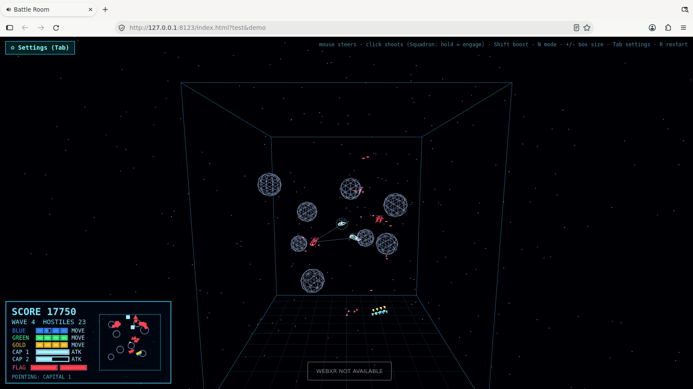

# Battle Room

A seated, **tabletop** wireframe space battle for **Meta Quest 3 / 3S**, inspired by the
command-school simulator in *Ender's Game*. The whole battle plays out as a miniature
inside a wireframe room (about 1 m across, changing shape between rounds) floating in front of you, so you never have to turn
or move.

It is a WebXR web page built with three.js. It runs in the Quest's built-in browser, so you
don't need to install an app or turn on developer mode. It also runs in a normal desktop
browser with mouse and keyboard.

## Three modes

Pick the mode on the title screen (Quest: **B** cycles Fighter / Squadron / Fleet, the right trigger starts; desktop:
the three START buttons, or **N**) or in Settings.

## Rounds: every round is a fresh battle

All three modes are played in **rounds**, and the goal is to reach the highest round you can.
Your score keeps adding up across rounds, and each cleared round gives a bonus of 500 x the round number.
The best round you have reached is saved for each mode and shown on the wrist panel.

- **Each new round fully resets the battlefield.** Your side comes back at full strength in
  its start positions: in Fighter your ship has full hull; in Squadron all 4 bots have full hull; in Fleet
  all 3 squadrons have 4 bots each and both capital ships have full hull. The enemy spawns fresh.
  Nothing carries over (no partial repairs or reinforcements), so you lose only if your side is wiped
  out within a single round.
- **The room reshapes** between rounds, and in Squadron and Fleet the **stars** fade out and come
  back in **new random positions** that suit the new room shape. They are kept clear of both
  sides' start areas, and no ship is ever left inside a star.
- **The enemy gets harder and smarter every round.** Each round brings more ships, tougher flagships, faster bullets
  and better aim. Their shot leading starts at about half and is perfect from round 5. New tactics unlock as you go, and the
  round-start message on your wrist names any new one:

  | Round | New enemy tactic | Modes |
  |---|---|---|
  | 1 | Pincers and flankers, retreat when damaged | All |
  | 2 | **Focus fire** on your most exposed ship; **bait and ambush** | Squadron, Fleet |
  | 3 | **Hiding behind stars** (snipers, damaged ships, damaged flagships) | Squadron, Fleet |
  | 3 | **Retreat and regroup:** damaged ships fall back to their wingmen; outnumbered ships pull back | All |
  | 4 | **Pincers on your capital ships:** pincer and heavy groups gang up on your weaker capital | Fleet |
  | 5 | **Synchronized strikes:** every attack group times its run to hit at the same moment | All |
  | 5 | **Dodging your shots:** many enemy ships side-step incoming bullets | All |
  | 6 | **Hunter-killers:** a fast pack that chases your most damaged ship | All |
  | 7 | **Flagships launch fighters:** a fresh pair every 20 seconds while the flagship lives | Fleet |

### Fighter

You fly one cyan ship and win round after round against red ships. The battle room is much bigger than
the ships, so there is plenty of room to manoeuvre.

The enemies fight in groups with real plans:
- **Pincer pairs** swing out to opposite sides of you, then attack together.
- **Flankers** circle round to come at you from the side or behind, make a pass, and swing out again.
- **Snipers** (from round 2) hold long range and fire accurate shots.
- **Heavies** (cruisers, from round 3) hold medium range and fire 3-shot spreads.
- Everyone **leads their shots** (aims where you will be), and pulls back for a moment when damaged.

Your hull has 5 points, back to full at the start of every round. Lose them all in one round and it's game over.

### Squadron

A much bigger, zoomed-out battlefield with smaller ships. You command **4 friendly bot
fighters**. You don't fly them: the right controller is a **command**. Its direction (Mirror
steering, 3x gain by default) sets the heading of the squadron, shown by the cyan aim line
and ring. The bots fly their own ships. They keep a side-by-side formation, steer toward
the commanded heading, dodge incoming bullets, and never run into each other.

- **Hold the right trigger = engage.** The bots spread out a little, staying on a leash
  around the group centre, and each one attacks the nearest enemy. A bot only fires when
  the line is clear, so never through a wingman or a star. Release to regroup into
  formation and carry on in the commanded direction.
- **Right grip = boost.** It only works while NOT engaging, and the whole squadron boosts together.
- **Stars:** big wireframe spheres. Nothing can fly through them and they block bullets, so
  both sides use them as cover. Ships steer around them. They are spread through the room in
  proportion to its current shape, in new random positions every round.
- **Enemies** come in coordinated groups:
  - Pincers and flankers **focus fire** on your most exposed bot (the one furthest from its wingmen).
  - Snipers **hide behind stars** and step out to shoot.
  - From round 2, a **bait** ship flies in close and then runs back to a star where two
    **ambushers** are hiding.
  - Enemies **fall back to cover when outnumbered** and pull back when damaged.
  - Rounds get bigger and the enemies get faster, more accurate and smarter (see Rounds above).
- Each bot has 3 hull points. A destroyed bot is gone for the rest of the round; every new
  round starts with all 4 back at full hull. Lose all 4 within one round and it's game over.
  The wrist panel shows each bot's hull.

### Fleet

The biggest, most zoomed-out battlefield (the room still changes shape and has sphere stars).
You command a whole fleet:
- **3 squadrons** of 4 bot fighters: **Blue**, **Green** and **Gold**. Each one flies and
  fights exactly like the Squadron-mode squadron.
- **2 friendly capital ships** (big cyan cruisers). Their turrets fire automatically at the
  nearest enemy in range. They are slow but tough (60 hull), and you can command them like a squadron.

The enemy brings a **flagship** (two from round 3), each guarded by an **escort** group, plus
squadrons using all the Squadron tactics (pincers, flankers, snipers, bait and ambush).
**Destroy every enemy flagship to win the round.** Any remaining enemy fighters then jump out.
**It's game over only when both capital ships AND every one of your fighters are destroyed.**
If both capitals fall, the wrist warns "CAPITALS LOST - fighters only" and you fight on with
the squadrons you have left (and the other way round: capitals alone fight on too). Every new
round starts with the full fleet again. Rounds get harder: more and smarter enemies, tougher flagships
and faster flagship guns.

**Selecting (left hand).** The left controller casts a pointing ray, and the wrist shows what it points at.
- **Left trigger** selects the unit you point at (a squadron or a capital ship).
- **Left stick click** selects everything.
- Selected units get a highlight ring and are marked `>` on the wrist panel.

**Commanding (right hand).** It works just like Squadron, for whatever is selected: Mirror
steering (3x) sets their heading, **hold the right trigger** to engage, and the **right grip** boosts (only when not engaging).
Units you have not selected keep their last order. They also defend themselves if an enemy comes close.

**Quick orders (left grip)** go to the selected units, depending on what you point at:
- Empty space: **HOLD** at that spot.
- A star: **GUARD** the star (hold beside it).
- One of your units: **FOLLOW** it.
- An enemy group or flagship: **ATTACK** it.

Units that receive an order are deselected so they carry it out. Select them again to take
back direct control. Each order is confirmed on the wrist message panel. A faint line shows
where each unit is heading.

There is no friendly fire, and friendly ships, including the capitals, never collide.

**Wrap-around (all modes):** fly out through one face of the box and you come back in
through the opposite face. Enemies wrap too. Your view never moves and the game never turns you.

**The room changes shape (all modes):** width, height and depth vary independently, so the
room may be a long tunnel, a flat slab, a tall tower or a cube. A new shape is picked for
every game, and between rounds the room smoothly reshapes itself, keeping every ship inside.
The volume stays about the same, so the difficulty stays fair, and the size is capped (at
most about 1.5 m wide or deep, 1.35 m tall with the Medium box size). A deeper room grows
away from you, so its near face never comes closer.

**Messages** (round start and new enemy tactics, round cleared, wingman down, game over...) appear on a small
panel on your left wrist, to the right of the score panel, so nothing covers the battle.
On the desktop they show in a small panel next to the HUD in the bottom-left corner. Only
the title-screen prompt in VR floats in front of you.

## Controls

### Quest (VR, seated)

| Hand | Input | Fighter | Squadron (Fleet: for the selected units) |
|---|---|---|---|
| Right | **Turn the controller** (Mirror steering, default) | The ship turns the way your controller turns, in any direction, including straight up, straight down, loops and upside down, without flipping. Turns are multiplied by the gain (default **2x**), so a 45° wrist turn turns the ship 90°. Turns past 180° stop at 180°. Wrist roll is ignored. | Same, but it turns the squadron's commanded heading (default gain **3x**) |
| Right | **Trigger** | Shoot (gentle aim assist). Also starts and restarts the game | **Hold = engage**, release = regroup. Also starts and restarts the game |
| Right | **Hold the grip** | Boost | Boost the squadron (only while not engaging) |
| Right | **A** | Brake | Slow the squadron |
| Right | **Click the thumbstick** | Re-center: the controller's current orientation becomes "straight into the box" (also done automatically at the start of a game) | Same |
| Right | **B** (on the title) | Cycle mode: Fighter / Squadron / Fleet | Same |
| Left | **Trigger / grip / stick forward-back** | Extras: shoot (engage) / boost / boost-brake | Same |
| Left | **Click the thumbstick** | Put the box back in its default spot (Fleet: select all; use Settings > Box position) | Same |
| Left | **X + Y together** | Settings (point with the right controller and pull the right trigger to change; the game pauses) | Same |
| Left | **Fleet only** | | Point the ray; **trigger** = select the unit you point at, **stick click** = select all, **grip** = quick order (hold / guard / follow / attack) |
| Left | **Look at your wrist** | Score, round, best round, hull, a top-down radar, and the message panel | Score, round, squadron status, a radar with the stars, and the message panel |

Other steering modes (in Settings) also work in all modes:
- **Relative (hand stick):** tilt the controller away from a captured neutral. Click the right stick to re-center.
- **Point:** the ship (or squadron heading) follows where you point.
- **Thumbstick:** the right stick steers. B inverts up/down.

### Settings (saved on the device, as are the box position and size)

| Setting | Options | Default |
|---|---|---|
| Game mode | Fighter / Squadron / Fleet | Fighter |
| Steering | Mirror / Relative / Point / Thumbstick | Mirror |
| Mirror gain (Fighter) | 1x / 1.5x / 2x / 2.5x / 3x / 3.5x | 2x |
| Mirror gain (Squadron and Fleet) | 1x / 1.5x / 2x / 2.5x / 3x / 3.5x | 3x |
| Ship turn speed (Relative, Point and Thumbstick) | Normal / Fast / Very fast | Fast |
| Box size | Small 0.7 m / Medium 1.0 m / Large 1.3 m | Medium |
| Box position | RESET puts the box back in its default spot | |

Changing the mode during a game restarts in the new mode.

### Desktop (testing without a headset)

| Input | Action |
|---|---|
| Mouse | Mirror steering: the ship (or squadron heading) points where the mouse points |
| Left click / Space | Shoot (Squadron: hold to engage) |
| Shift / F | Boost / brake |
| N | Cycle mode (Fighter / Squadron / Fleet) |
| 1-5 / 0 or ` / G | Fleet: select Blue, Green, Gold, Capital 1, Capital 2 / select all / quick order at what the mouse points at |
| M | Cycle steering: mirror / relative (cursor offset from the centre) / point / thumbstick (I/K + J/L, V inverts) |
| + / - | Box size |
| C | Reset the box |
| Right-drag or arrow keys | Look around |
| Tab or the gear button | Settings |
| Enter / R | Start / restart |

URL options: `?wave=5` starts at round 5 (with round-5 enemy tactics), and `?demo` turns on an autopilot (attract mode).
`?test` sends errors and status lines to a local test server.

## Getting it onto the Quest

**Live copy:** https://willcoding11.github.io/vr-battle-room/ (GitHub Pages). Open it in the
Quest Browser and press **ENTER VR**.

WebXR only works over **HTTPS** (or `localhost`), so the files must be served from an HTTPS
address. The folder is plain static files (`index.html`, `js/`, `vendor/`), so there is no
build step.

1. **Simplest: a static host.** Put the folder on any HTTPS static host, such as GitHub
   Pages, Netlify Drop or Cloudflare Pages. Open the URL in the Quest Browser and press
   **ENTER VR**. Tip: bookmark it in the Quest browser.
2. **Local, over USB, no hosting.** On a PC with `adb` and the Quest in developer mode, run
   `adb reverse tcp:8000 tcp:8000`. Then run `python -m http.server 8000` in this folder
   and open `http://localhost:8000` on the Quest. `localhost` counts as secure.
3. **Local Wi-Fi.** Serve the folder over HTTPS with a self-signed certificate, for example
   `npx http-server -S` or `caddy`, and accept the warning in the Quest browser.

When you are in the Quest browser, sit down, then press **ENTER VR**. If the battle sits too
high or too low, hold the Meta button to recentre, change the box size in Settings, or click
the left stick to put the box back in its default spot.

## Files

- `index.html` - page, desktop HUD and title screen
- `js/main.js` - game: scene, input (VR + desktop), player, enemy AI, squadron bots, fleet (selection, orders, capital ships), stars, rounds and enemy tactic unlocks, HUD, effects
- `js/models.js` - wireframe ship models (points joined by lines)
- `js/audio.js` - synthesized 3D sound effects (WebAudio, no audio files)
- `vendor/` - three.js r187 (`three.module.js`, `three.core.js`, `VRButton.js`), MIT licence
- `screenshots/` - desktop-mode screenshots

## Not done yet / ideas

- Fleet: drag-box selection and waypoint chains
- A louder warning when an enemy attacks from behind (positional sound only, so far)
- More comfort options (seated height, volume)
- So far it has only been tested in an emulator (IWER) and in desktop Firefox, not yet on a real Quest
