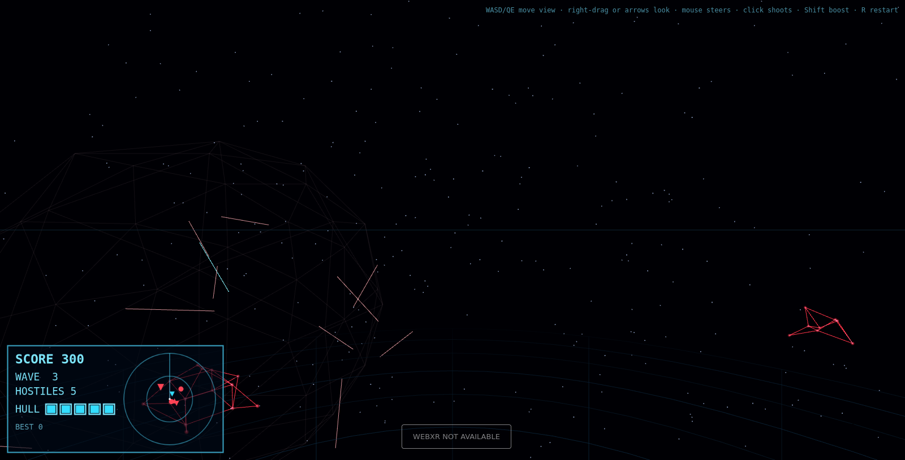
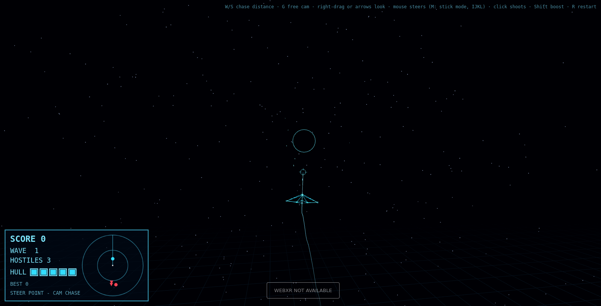

# Battle Room

A seated, 360-degree wireframe space battle for **Meta Quest 3 / 3S**, inspired by the
command-school simulator in *Ender's Game*. You sit in the middle of the battle. Your
cyan ship and the red enemy waves fly all around you: in front, behind, above and below.

It is a WebXR web page built with three.js. It runs in the Quest's built-in browser, so you
don't need to install an app or turn on developer mode. It also runs in a normal desktop
browser with mouse and keyboard.

## How to play

- Destroy every red ship to clear a wave. Each new wave has more enemies, and they are
  faster and shoot more often. From wave 3 on, armoured **cruisers** (4 hits, 3-shot
  spread) join the fighters.
- Your hull has 5 points. Clearing a wave repairs 1. Getting shot or ramming an enemy
  costs 1. Points per kill = 100 for a fighter or 300 for a cruiser, times the wave number.
- Enemies attack from every direction. Look around and listen: sounds play from the
  direction they come from. The wrist radar (desktop: bottom-left) shows every ship
  around you. Your facing is up on the radar, and the triangles mark ships above or
  below you.

## Controls

Comfort rules:
- Up is always up. The view never pitches or rolls you.
- In the chase camera, the only automatic turn is a smooth left/right turn to stay behind
  your ship. Head tracking works normally.

### Quest (VR, seated)

| Hand | Input | Action |
|---|---|---|
| Right | **Point** (POINT mode, default) | Fly in the direction you point. Straight ahead = straight; pointing to a side keeps turning that way while the view follows; tilt up/down to climb or dive. A short laser and ring show your pointing direction |
| Right | **Trigger** | Shoot along the aim line out of the ship's nose (gentle aim assist) |
| Right | **Grip** / **stick forward** | Boost |
| Right | **A** / **stick back** | Brake |
| Right | **Click the thumbstick** | Switch steering: POINT (default) or STICK (thumbstick flies the ship: left/right turn, up/down nose up/down). Remembered |
| Right | **B** | STICK mode only: invert up/down. Remembered |
| Right | **Trigger / A** | Start, and restart after you are destroyed |
| Left | **Click the thumbstick** | Switch camera: CHASE (default) or FREE |
| Left | **Thumbstick up/down** (chase) | Move the chase view closer / farther |
| Left | **Y / X** (chase) | Raise / lower the chase view |
| Left | **Thumbstick, Y/X, grip + drag** (free) | The old controls: move your viewpoint forward/back/sideways, up/down, or grab space and pull yourself through it |
| Left | **Look at your wrist** | Score, wave, hull, radar, and the current steering + camera mode |

### Desktop (testing without a headset)

| Input | Action |
|---|---|
| Mouse | Steer: the ship flies the way the cursor points (POINT mode) |
| M | Switch to STICK mode: I/K = nose up/down, J/L = turn (V inverts up/down) |
| Left click / Space | Shoot |
| Shift / F | Boost / brake |
| W / S, Q / E | Chase camera: closer / farther, lower / higher |
| G | Switch between chase and free camera (free: WASD + Q/E move) |
| Right-drag or arrow keys | Look around (stands in for head tracking) |
| C | Snap the view behind the ship |
| Enter / R | Start / restart |

### What's on screen

- **Scale:** ships, shots and explosions are drawn at half their earlier size (zoomed out),
  and speeds and hit sizes were halved to match.
- **No boundaries:** your ship goes wherever you steer it, and the battle travels with you.
- **Aim line:** a short line with a crosshair comes out of the ship's nose. That is where the
  ship is heading and where your shots go.
- **Off-screen arrow:** when your ship is outside your view (for example in the free camera),
  a pulsing cyan arrow at the edge of your view points to it.

URL options: `?wave=5` starts at wave 5, and `?demo` turns on an autopilot (attract mode).
`?test` sends errors and status lines to a local test server.

## Getting it onto the Quest

**Live copy:** https://willcoding11.github.io/vr-battle-room/ (GitHub Pages). Open it in the
Quest Browser and press **ENTER VR**.

WebXR only works over **HTTPS** (or `localhost`), so the files must be served from an HTTPS
address. The folder is plain static files (`index.html`, `js/`, `vendor/`), so there is no
build step.

1. **Simplest: a static host.** Put the folder on any HTTPS static host, such as GitHub
   Pages, Netlify Drop or Cloudflare Pages. Open the URL in the Quest Browser and press
   **ENTER VR**. Tip: bookmark it in the Quest browser.
2. **Local, over USB, no hosting.** On a PC with `adb` and the Quest in developer mode, run
   `adb reverse tcp:8000 tcp:8000`. Then run `python -m http.server 8000` in this folder
   and open `http://localhost:8000` on the Quest. `localhost` counts as secure.
3. **Local Wi-Fi.** Serve the folder over HTTPS with a self-signed certificate, for example
   `npx http-server -S` or `caddy`, and accept the warning in the Quest browser.

When you are in the Quest browser, sit down, then press **ENTER VR**. If the battle sits too
high or too low, hold the Meta button to recentre, or use the left-hand Y/X buttons.

## Files

- `index.html` - page, desktop HUD and title screen
- `js/main.js` - game: scene, input (VR + desktop), player, enemies, waves, HUD, effects
- `js/models.js` - wireframe ship models (points joined by lines)
- `js/audio.js` - synthesized 3D sound effects (WebAudio, no audio files)
- `vendor/` - three.js r187 (`three.module.js`, `three.core.js`, `VRButton.js`), MIT licence
- `screenshots/` - desktop-mode screenshots

## Not done yet / ideas

- Squadron mode (point and give orders to groups of ships)
- Proper enemy formations and enemy types beyond fighter and cruiser
- A louder warning when an enemy attacks from behind (positional sound only, so far)
- A settings menu (comfort options, seated height, volume)
- So far it has only been tested in an emulator (IWER) and in desktop Firefox, not yet on a real Quest
