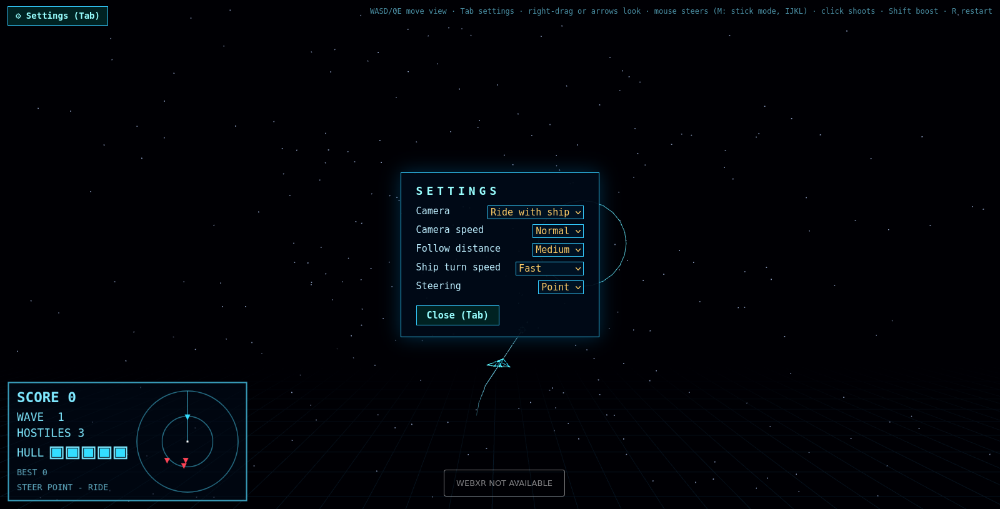

# Battle Room

A seated, 360-degree wireframe space battle for **Meta Quest 3 / 3S**, inspired by the
command-school simulator in *Ender's Game*. You sit in the middle of the battle. Your
cyan ship and the red enemy waves fly all around you: in front, behind, above and below.

It is a WebXR web page built with three.js. It runs in the Quest's built-in browser, so you
don't need to install an app or turn on developer mode. It also runs in a normal desktop
browser with mouse and keyboard.

## How to play

- Destroy every red ship to clear a wave. Each new wave has more enemies, and they are
  faster and shoot more often. From wave 3 on, armoured **cruisers** (4 hits, 3-shot
  spread) join the fighters.
- Your hull has 5 points. Clearing a wave repairs 1. Getting shot or ramming an enemy
  costs 1. Points per kill = 100 for a fighter or 300 for a cruiser, times the wave number.
- Enemies attack from every direction. Look around and listen: sounds play from the
  direction they come from. The wrist radar (desktop: bottom-left) shows every ship
  around you. Your facing is up on the radar, and the triangles mark ships above or
  below you.

## Controls

Comfort rules:
- The game **never rotates you**. Turn your own head and body to follow the action.
- Up is always up.
- The view only *slides* along with your ship (translation only), at a fixed offset.

### Quest (VR, seated)

| Hand | Input | Action |
|---|---|---|
| Right | **Point** (default steering) | The ship flies in the direction you point and turns quickly toward it. A short 0.5 m laser and ring show your pointing direction |
| Right | **Trigger** | Shoot along the aim line out of the ship's nose (gentle aim assist) |
| Right | **Grip** / **stick forward** | Boost |
| Right | **A** / **stick back** | Brake |
| Right | **Click the thumbstick** | Switch steering: POINT or STICK (thumbstick flies the ship: left/right turn, up/down nose up/down; B inverts) |
| Right | **Trigger / A** | Start, and restart after you are destroyed |
| Left | **Thumbstick** | Move your view, relative to where you're looking |
| Left | **Y / X** | Move your view up / down |
| Left | **Hold grip** | 2x view move speed while held |
| Left | **Click the thumbstick** | Put the view back behind your ship (relative to where you're looking) |
| Left | **X + Y together** | Open/close **Settings**. Point at a row with the right controller and pull the trigger to change it. The game pauses while it's open |
| Left | **Look at your wrist** | Score, wave, hull, radar, steering and camera mode |

### Settings (saved on the device)

| Setting | Options | Default |
|---|---|---|
| Camera | **Ride with ship**: your view = ship position + your offset, so stick movement adds on top of the ship's motion. **Independent**: while you push the stick you move at only your own speed (the ship's motion isn't added); when you let go, the view locks onto the ship again at the new offset | Ride with ship |
| Camera speed | Slow 1.2 / Normal 2.5 / Fast 4.5 m/s (hold left grip = 2x) | Normal |
| Follow distance | Near 1.4 / Medium 2.4 / Far 3.6 m behind the ship (a bit above it) | Medium |
| Ship turn speed | Normal 2x / Fast 2.6x / Very fast 3.4x the original turn rate | Fast |
| Steering | Point / Stick | Point |

### Desktop (testing without a headset)

| Input | Action |
|---|---|
| Mouse | Steer: the ship flies the way the cursor points |
| M | Switch to STICK mode: I/K = nose up/down, J/L = turn (V inverts up/down) |
| Left click / Space | Shoot |
| Shift / F | Boost / brake |
| W A S D, Q / E | Move your view (relative to where you look), down / up. Hold X for 2x |
| Right-drag or arrow keys | Look around (stands in for head tracking) |
| C | Put the view back behind your ship |
| Tab or the gear button | Settings |
| Enter / R | Start / restart |

### What's on screen

- **Scale:** ships, shots and explosions are drawn at half size (zoomed out), with speeds and
  hit sizes scaled to match.
- **No boundaries:** your ship goes wherever you steer it, and the battle travels with you.
- **Aim line:** a short line with a crosshair comes out of the ship's nose. That is where the
  ship is heading and where your shots go.
- **Off-screen arrow:** when your ship is outside your view, a pulsing cyan arrow at the edge
  of your view points to it.

URL options: `?wave=5` starts at wave 5, and `?demo` turns on an autopilot (attract mode).
`?test` sends errors and status lines to a local test server.

## Getting it onto the Quest

**Live copy:** https://willcoding11.github.io/vr-battle-room/ (GitHub Pages). Open it in the
Quest Browser and press **ENTER VR**.

WebXR only works over **HTTPS** (or `localhost`), so the files must be served from an HTTPS
address. The folder is plain static files (`index.html`, `js/`, `vendor/`), so there is no
build step.

1. **Simplest: a static host.** Put the folder on any HTTPS static host, such as GitHub
   Pages, Netlify Drop or Cloudflare Pages. Open the URL in the Quest Browser and press
   **ENTER VR**. Tip: bookmark it in the Quest browser.
2. **Local, over USB, no hosting.** On a PC with `adb` and the Quest in developer mode, run
   `adb reverse tcp:8000 tcp:8000`. Then run `python -m http.server 8000` in this folder
   and open `http://localhost:8000` on the Quest. `localhost` counts as secure.
3. **Local Wi-Fi.** Serve the folder over HTTPS with a self-signed certificate, for example
   `npx http-server -S` or `caddy`, and accept the warning in the Quest browser.

When you are in the Quest browser, sit down, then press **ENTER VR**. If the battle sits too
high or too low, hold the Meta button to recentre, or use the left-hand Y/X buttons.

## Files

- `index.html` - page, desktop HUD and title screen
- `js/main.js` - game: scene, input (VR + desktop), player, enemies, waves, HUD, effects
- `js/models.js` - wireframe ship models (points joined by lines)
- `js/audio.js` - synthesized 3D sound effects (WebAudio, no audio files)
- `vendor/` - three.js r187 (`three.module.js`, `three.core.js`, `VRButton.js`), MIT licence
- `screenshots/` - desktop-mode screenshots

## Not done yet / ideas

- Squadron mode (point and give orders to groups of ships)
- Proper enemy formations and enemy types beyond fighter and cruiser
- A louder warning when an enemy attacks from behind (positional sound only, so far)
- A settings menu (comfort options, seated height, volume)
- So far it has only been tested in an emulator (IWER) and in desktop Firefox, not yet on a real Quest
